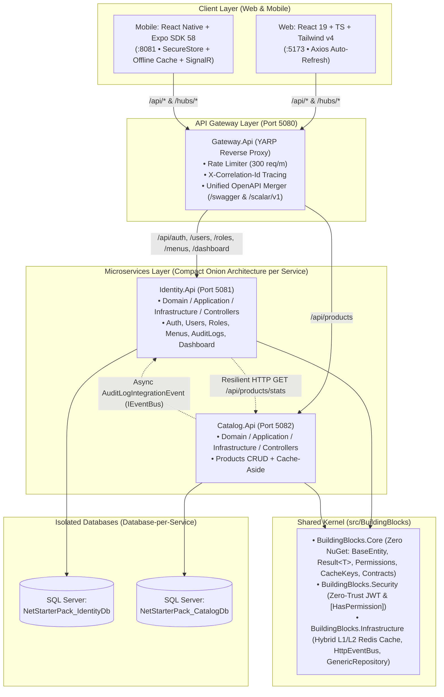

# NetStarterPack Microservices — Base Template .NET 10 (Microservices + Compact Onion + YARP Gateway) + React 19

Project ini adalah edisi **Microservices Architecture** dari **NetStarterPack** yang memadukan skalabilitas **Microservices** (API Gateway, *Database-per-Service*, *Zero-Trust Security*, & *Cross-Service EventBus*) dengan kerapian **Onion Architecture** di dalam masing-masing service (*Compact Onion*), serta **React 19 + TypeScript (Vite 8 & Tailwind CSS v4)** di sisi Frontend.

Tujuannya simpel: memberikan fondasi Microservices modern yang **clean, reliable, secure, dan maintainable secara vertikal maupun horizontal**, tapi tetap **gampang dijalankan waktu development** (cukup sekali tekan `F5`, semua microservice dan React otomatis menyala barengan!).

---

## 📚 Daftar Dokumentasi Lengkap (A sampai Z)

Seluruh panduan teknis sudah disusun berurutan (dari konsep inti sampai deployment) di dalam folder [`docs/`](docs/):

1. 🏛️ **[Bedah Arsitektur Microservices, Compact Onion, & YARP Gateway (`docs/01_ARCHITECTURE.md`)](docs/01_ARCHITECTURE.md)**
   *Penjelasan hubungan Microservices (level makro) vs Onion Architecture (level mikro), Sequence Diagram alur request lintas service, YARP Reverse Proxy, Database-per-Service, Resilient EventBus, Distributed Tracing (`X-Correlation-Id`), dan arsitektur Frontend React.*
2. 🗂️ **[Peta Lengkap Project & Subfolder — Tujuan & Kapan Dipakai (`docs/02_PROJECT_STRUCTURE_GUIDE.md`)](docs/02_PROJECT_STRUCTURE_GUIDE.md)**
   *Panduan navigasi harian tiap project & subfolder (`BuildingBlocks.Core/Contracts`, `BuildingBlocks.Infrastructure/Middleware`, `Caching`, `Messaging`, `Persistence`, `Infrastructure/Clients`, `Domain/`, `Application/`, hingga `frontend/src/` & `mobile/`).*
3. 🧰 **[Tech Stack, Daftar Package, & Alasan Pemilihan Teknologi (`docs/03_TECH_STACK.md`)](docs/03_TECH_STACK.md)**
   *Rincian lengkap versi .NET 10, NuGet & npm packages per layer, database/Redis/Docker/IIS, matriks prasyarat environment, dan alasan pemilihan tiap teknologi.*
4. 🔐 **[Zero-Trust JWT, Refresh Token, RBAC Lintas Service, & Menu Dinamis (`docs/04_AUTH_AND_RBAC.md`)](docs/04_AUTH_AND_RBAC.md)**
   *ERD database `IdentityDb`, cara kerja `PBKDF2-SHA256`, validasi JWT mandiri di tiap microservice lewat `BuildingBlocks.Security`, proteksi endpoint internal (`X-Internal-Api-Key`), serta 3 lapis proteksi (`[HasPermission]`, `<ProtectedRoute>`, dan `hasPermission()`).*
5. ⚡ **[Panduan Hybrid Caching L1/L2 & Shared Redis di Microservices (`docs/05_CACHING_AND_REDIS.md`)](docs/05_CACHING_AND_REDIS.md)**
   *Analogi dasar caching, arsitektur Hybrid L1 (`IMemoryCache`) + L2 (`IDistributedCache` / Shared Redis), pola Cache-Aside (`GetOrCreateAsync`), mekanisme `RemoveByPrefixAsync`, invalidasi cache lintas service saat ada event audit, dan cara menyambungkan ke server Redis.*
6. 📡 **[Referensi Endpoint API, Routing YARP, & Kontrak JSON (`docs/06_API_REFERENCE.md`)](docs/06_API_REFERENCE.md)**
   *Tabel pemetaan route YARP Gateway, daftar seluruh endpoint API publik & internal, format standar `Result<T>`, daftar HTTP Status Code (termasuk `429 Rate Limit`), dan cara testing lewat Unified Swagger / Scalar UI.*
7. 🛠️ **[Panduan A–Z Membuat Modul & Microservice Baru (`docs/07_CUSTOMIZATION_GUIDE.md`)](docs/07_CUSTOMIZATION_GUIDE.md)**
   *Contekan lengkap langkah demi langkah untuk 3 level studi kasus: (A) Menambah modul CRUD di service lama (`Customer`), (B) Membuat microservice baru (`Order.Api :5083`), dan (C) Example 3 Advanced (`Workflow.Api :5084`).*
8. 🧩 **[Example 3 (Advanced): Dynamic Form Builder & Multi-Level Approval Workflow (`docs/08_WORKFLOW_ADVANCED_EXAMPLE.md`)](docs/08_WORKFLOW_ADVANCED_EXAMPLE.md)**
   *Studi kasus level enterprise (`Workflow.Api` di port `5084`, DB `NetStarterPack_WorkflowDb`): diagram ERD 4 tabel, State Machine, Sequence Diagram 3-level approval, 7 lapisan security handling, & walkthrough testing di browser.*
9. 📱 **[Panduan NetStarterPack Mobile — React Native & Expo (`docs/09_MOBILE_STARTERPACK_GUIDE.md`)](docs/09_MOBILE_STARTERPACK_GUIDE.md)**
   *Arsitektur & panduan menjalankan aplikasi mobile (`mobile/`) di HP fisik via Expo Go (`start-mobile-dev.ps1`), Live Cluster Monitor, Biometrik, Workflow, SignalR Newsroom, serta rilis CI/CD terpisah (`eas.json`).*
10. 🧪 **[Panduan Unit Testing Lintas Microservice (`docs/10_UNIT_TESTING_GUIDE.md`)](docs/10_UNIT_TESTING_GUIDE.md)**
    *Struktur modular unit test untuk `BuildingBlocks`, 5 microservice (`Identity`, `Catalog`, `Order`, `Workflow`, `Announcement`), dan `CrossService` menggunakan xUnit + EF Core In-Memory + `TestDbFactory` + `InMemoryEventBus`.*
11. 🚀 **[Panduan Publish & Deploy ke Windows Server IIS (`docs/11_IIS_DEPLOYMENT_GUIDE.md`)](docs/11_IIS_DEPLOYMENT_GUIDE.md)**
    *Panduan first-time deploy seluruh service & Frontend React ke IIS lengkap dengan studi kasus selective deploy per fitur menggunakan `publish-iis.ps1`.*
12. 🧯 **[Catatan Lapangan & Playbook Troubleshooting IIS (`docs/12_IIS_TROUBLESHOOTING_AND_PLAYBOOK.md`)](docs/12_IIS_TROUBLESHOOTING_AND_PLAYBOOK.md)**
    *Solusi cepat untuk `NETSDK1152`, `404 /api/auth/login` (ARR Proxy vs `VITE_API_URL`), error SQL `IIS APPPOOL\*` (3 opsi: SSMS Login, SQL Auth, Custom Identity), WebSocket SignalR, & debug `500.30`.*
13. 📖 **[Kamus Istilah / Glosarium Arsitektur (`docs/13_GLOSSARY.md`)](docs/13_GLOSSARY.md)**
    *Penjelasan bahasa santai untuk seluruh istilah dan komponen yang benar-benar dipakai di kodingan project ini (YARP, Compact Onion, BuildingBlocks, Database-per-Service, Docker, Polyglot Persistence, Zero-Trust JWT, Integration Event, Graceful Degradation, Correlation ID, hingga Hybrid Cache).*

---

## 🌐 Topologi Service, Port, & Database

| Komponen / Service | Port | Database SQL Server | Tanggung Jawab Utama |
| :--- | :---: | :--- | :--- |
| **`Gateway.Api`** *(YARP Reverse Proxy)* | `5080` | *(Stateless / Tanpa DB)* | Pintu masuk tunggal Frontend, Routing YARP, Rate Limiting (`300 req/menit`), CORS terpusat, `X-Correlation-Id`, Aggregated Health Check, **Unified Swagger/Scalar UI**, & **F5 Auto-Orchestrator**. |
| **`Identity.Api`** *(Auth & Core Hub)* | `5081` | `NetStarterPack_IdentityDb` | Login JWT, Refresh Token Rotation, Users, Roles, Permissions, Dynamic Sidebar Menus, Dashboard Aggregator, & penerima terpusat `AuditLogs` dari seluruh microservice. |
| **`Catalog.Api`** *(Business Microservice 1)* | `5082` | `NetStarterPack_CatalogDb` | Contoh Microservice Bisnis mandiri (CRUD `Products` + Hybrid L1/L2 Cache + publish `AuditLogIntegrationEvent` via `IEventBus` ke Identity). |
| **`Order.Api`** *(Example 2: Order CRUD)* | `5083` | `NetStarterPack_OrderDb` | Contoh Microservice Mandiri ke-2 (CRUD `Orders` + kalkulasi total otomatis + Cache + EventBus + Soft-Delete). |
| **`Workflow.Api`** *(Example 3 Advanced)* | `5084` | `NetStarterPack_WorkflowDb` | **Dynamic Form Builder & Multi-Level Approval Engine** (Hybrid Relational + JSON Schema, State Machine, Working List, Tracking Stepper, & 7-Layer Security). |
| **`Announcement.Api`** *(HR Newsroom)* | `5085` | `NetStarterPack_AnnouncementDb` | **Internal Announcement & Newsroom** (Compact Rich Text Editor, Banner & Image/File Uploads, Like, On/Off Comment oleh HR, Bell Unread Feed, & Pagination 10/halaman). |
| **`MasterData.Api`** *(Unified Lookups)* | `5086` | `NetStarterPack_MasterDataDb` | **Unified Master Data & Lookup Service** (1 tabel referensi bersama untuk dropdown lintas service: `PRODUCT_CATEGORY`, `UNIT_OF_MEASURE`, `PAYMENT_METHOD`, `PRIORITY_LEVEL`, `DOCUMENT_TYPE`, cascading parent-child, Hybrid Cache L1/L2, & `[Idempotent]`). |
| **`Frontend`** *(React 19 + TS + Tailwind v4)* | `5173` | — | SPA Web Frontend yang cukup menembak ke **1 URL Gateway (`http://localhost:5080`)** tanpa perlu tahu di belakang ada berapa microservice. |
| **`Mobile`** *(React Native + Expo SDK 58 + TS)* | `8081` *(Metro)* | — | Aplikasi Mobile Android/iOS (*Expo Go-ready*) yang juga menembak 1 pintu **`Gateway.Api (:5080)`** (LAN/HTTPS), lengkap dengan SecureStore, Biometric 2-in-1, Offline Cache, SignalR, & 14 modul RBAC. |

---

## 🏗️ Gambaran Alur Arsitektur (Macro Microservices + Micro Compact Onion)



---

## 📂 Struktur Folder Solution

```text
net-starterpack-microservice/
├── NetStarterPack.Microservices.sln              # Solution utama (Default Startup: Gateway.Api)
├── run-app.bat & start-dev.ps1                   # Script launcher sekali klik (Backend + Web)
├── run-mobile.bat & start-mobile-dev.ps1         # Script launcher sekali klik (Gateway LAN :5080 + Expo Go QR)
├── README.md                                     # Dokumentasi utama
├── docs/                                         # Dokumentasi mendalam berurutan (01 s/d 13)
│   ├── 01_ARCHITECTURE.md                        # Bedah Microservices, Compact Onion, YARP, & EventBus
│   ├── 02_PROJECT_STRUCTURE_GUIDE.md             # Peta lengkap project & fungsi tiap subfolder
│   ├── 03_TECH_STACK.md                          # Rincian versi package & alasan teknologi
│   ├── 04_AUTH_AND_RBAC.md                       # Zero-Trust JWT, Refresh Token, RBAC 3 Lapis, & Menu
│   ├── 05_CACHING_AND_REDIS.md                   # Hybrid L1/L2 Cache & konfigurasi Shared Redis
│   ├── 06_API_REFERENCE.md                       # Daftar endpoint API, routing YARP, & kontrak JSON
│   ├── 07_CUSTOMIZATION_GUIDE.md                 # Panduan A-Z bikin modul baru & microservice baru
│   ├── 08_WORKFLOW_ADVANCED_EXAMPLE.md           # Example 3 Advanced: Dynamic Form & Multi-Level Approval
│   ├── 09_MOBILE_STARTERPACK_GUIDE.md            # Panduan Mobile Starterpack (React Native + Expo Go)
│   ├── 10_UNIT_TESTING_GUIDE.md                  # Panduan Unit Test lintas microservice (xUnit)
│   ├── 11_IIS_DEPLOYMENT_GUIDE.md                # Panduan publish & deploy ke Windows Server IIS
│   ├── 12_IIS_TROUBLESHOOTING_AND_PLAYBOOK.md    # Playbook troubleshooting kasus lapangan IIS
│   └── 13_GLOSSARY.md                            # Kamus istilah arsitektur & komponen project
├── src/
│   ├── BuildingBlocks/                           # [SHARED KERNEL] Dipakai semua microservice
│   │   ├── BuildingBlocks.Core/                  # ZERO NuGet: BaseEntity, Result<T>, Permissions, RoleNames, CacheKeys, Contracts
│   │   ├── BuildingBlocks.Security/              # Plug & Play Zero-Trust JWT, [HasPermission], CurrentUserService
│   │   └── BuildingBlocks.Infrastructure/        # DistributedCacheService (L1+L2), HttpEventBus, GenericRepository, Middleware
│   ├── ApiGateway/
│   │   └── Gateway.Api/                          # [PORT 5080] YARP Proxy + Rate Limiter + Unified Docs + Auto-Orchestrator
│   └── Services/
│       ├── Identity/Identity.Api/                # [PORT 5081] Compact Onion (Auth, RBAC, Menus, Org, Audit, Dashboard)
│       ├── Catalog/Catalog.Api/                  # [PORT 5082] Compact Onion (Products CRUD + Cache)
│       ├── Order/Order.Api/                      # [PORT 5083] Compact Onion (Orders CRUD + Stats)
│       ├── Workflow/Workflow.Api/                # [PORT 5084] Compact Onion (Dynamic Form & Multi-Level Approval)
│       ├── Announcement/Announcement.Api/        # [PORT 5085] Compact Onion (HR Newsroom + SignalR Hub)
│       └── MasterData/MasterData.Api/            # [PORT 5086] Compact Onion (Unified Lookups + Hybrid Cache)
├── tests/
│   └── NetStarterPack.Microservices.UnitTests/   # Unit tests modular: Common/, BuildingBlocks/, Services/*, & CrossService/
├── frontend/                                     # React 19 + TypeScript + Vite 8 + Tailwind CSS v4 (Port 5173)
└── mobile/                                       # React Native + Expo SDK 58 + Expo Router (Expo Go / EAS Build)
```

---

## 👤 Daftar Akun Dummy Bawaan (Hasil Seeder `Identity.Api`)

Saat aplikasi dijalankan pertama kali, `IdentityDatabaseSeeder` otomatis membuat database `NetStarterPack_IdentityDb` (5 role, 16 permission, 8 menu, 5 akun user) dan `CatalogDatabaseSeeder` otomatis membuat database `NetStarterPack_CatalogDb` (6 produk contoh):

| Role | Username | Email | Password | Keterangan Hak Akses |
| :--- | :--- | :--- | :--- | :--- |
| **SuperAdmin** | `superadmin` | `superadmin@starterpack.local` | `Password123!` | Akses penuh ke seluruh microservice, pengaturan role, menu, user, katalog, & audit log |
| **Admin** | `admin` | `admin@starterpack.local` | `Password123!` | Kelola user, CRUD katalog penuh, lihat laporan, lihat role/menu, dan pantau audit log |
| **Manager** *(Dummy)* | `manager` | `manager@starterpack.local` | `Password123!` | Lihat daftar user, tambah/edit katalog, & ekspor CSV laporan |
| **Staff** *(Dummy)* | `staff` | `staff@starterpack.local` | `Password123!` | Hanya bisa buka Dashboard & tambah/edit katalog (tombol Hapus otomatis disembunyikan) |
| **Viewer** *(Dummy)* | `viewer` | `viewer@starterpack.local` | `Password123!` | Hanya bisa melihat Dashboard & Katalog dalam mode *Read-only* |

---

## 🚀 Cara Menjalankan Project & Unit Test (One-Click Orchestrator)

Kamu **tidak perlu** repot membuka 4 terminal terpisah untuk menyalakan masing-masing service.

### 1. Lewat Visual Studio (Paling Praktis)
1. Buka file **`NetStarterPack.Microservices.sln`** di Visual Studio 2022 / 2026.
2. Langsung tekan tombol hijau **Start (`F5`)** (Startup Project sudah otomatis disetel ke **`Gateway.Api`**).
3. `Gateway.Api` (`http://localhost:5080`) otomatis mengompilasi dan menyalakan:
   - **`Identity.Api`** di `http://localhost:5081`
   - **`Catalog.Api`** di `http://localhost:5082`
   - **`React Vite Frontend`** di `http://localhost:5173`
4. Saat kamu menghentikan debugging (Stop) di Visual Studio, seluruh child process di atas otomatis dimatikan dengan bersih.

### 2. Tanpa Visual Studio (Double-Click / Terminal)
- **Web + Backend**: Klik 2x **`run-app.bat`**, atau jalankan lewat PowerShell:
  ```powershell
  .\start-dev.ps1
  ```
- **Mobile (HP Fisik via Expo Go) + Backend LAN**: Klik 2x **`run-mobile.bat`**, atau jalankan lewat PowerShell:
  ```powershell
  .\start-mobile-dev.ps1
  ```
  *(Script otomatis mendeteksi IP LAN PC, mengisi `mobile/.env`, menyalakan `Gateway.Api` di `0.0.0.0:5080`, dan menampilkan QR Code Expo Go. Detail lengkap di [`docs/09_MOBILE_STARTERPACK_GUIDE.md`](docs/09_MOBILE_STARTERPACK_GUIDE.md)).*

### 3. URL Dokumentasi & Pengetesan API
- **Web App React**: `http://localhost:5173`
- **Unified Gateway Swagger UI** *(Tes semua microservice dari 1 halaman)*: `http://localhost:5080/swagger`
- **Unified Gateway Scalar UI**: `http://localhost:5080/scalar/v1`
- **Aggregated Microservices Health Check**: `http://localhost:5080/api/health`
- **Standalone Identity Swagger**: `http://localhost:5081/swagger`
- **Standalone Catalog Swagger**: `http://localhost:5082/swagger`

### 4. Menjalankan Unit Test
```powershell
dotnet test
```


