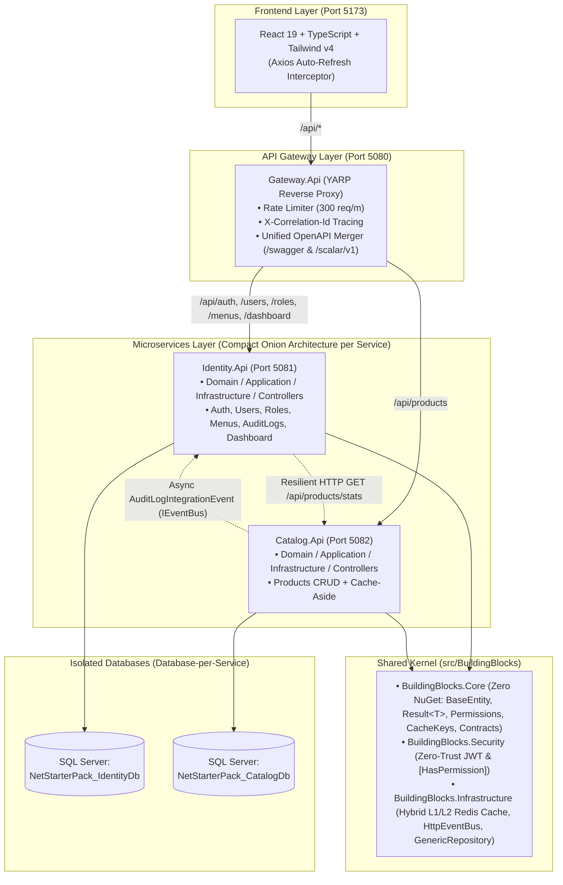

# NetStarterPack Microservices — Base Template .NET 10 (Microservices + Compact Onion + YARP Gateway) + React 19

Project ini adalah edisi **Microservices Architecture** dari **NetStarterPack** yang memadukan skalabilitas **Microservices** (API Gateway, *Database-per-Service*, *Zero-Trust Security*, & *Cross-Service EventBus*) dengan kerapian **Onion Architecture** di dalam masing-masing service (*Compact Onion*), serta **React 19 + TypeScript (Vite 8 & Tailwind CSS v4)** di sisi Frontend.

Tujuannya simpel: memberikan fondasi Microservices modern yang **clean, reliable, secure, dan maintainable secara vertikal maupun horizontal**, tapi tetap **gampang dijalankan waktu development** (cukup sekali tekan `F5`, semua microservice dan React otomatis menyala barengan!).

---

## 📚 Daftar Dokumentasi Lengkap (A sampai Z)

Seluruh panduan teknis sudah disusun secara mendalam di dalam folder [`docs/`](docs/):

1. 🛠️ **[Panduan A–Z Membuat Modul & Microservice Baru (`docs/CUSTOMIZATION_GUIDE.md`)](docs/CUSTOMIZATION_GUIDE.md)**
   *Contekan lengkap langkah demi langkah untuk 2 skenario: (A) Menambah tabel/modul CRUD baru di dalam microservice yang sudah ada, dan (B) Membuat microservice baru dari nol (Example 2: `Order.Api` di port `5083`) lengkap dengan koneksi ke `BuildingBlocks`, routing YARP Gateway, Unit Test, hingga halaman React & Menu Sidebar.*
2. 🧩 **[Example 3 (Advanced): Dynamic Form Builder & Multi-Level Approval Workflow (`docs/WORKFLOW_ADVANCED_EXAMPLE.md`)](docs/WORKFLOW_ADVANCED_EXAMPLE.md)**
   *Studi kasus level enterprise (`Workflow.Api` di port `5084`, DB `NetStarterPack_WorkflowDb`): form dinamis berbasis tipe dokumen (Pengadaan Laptop, Cuti, Barang Kantor), alur approval berjenjang lintas role (`Staff` &rarr; `Manager` &rarr; `ITLead` / `HRManager` &rarr; `FinanceDirector`), menu Create Form, Working List, & Tracking List, serta 7 lapisan security handling (Anti-Self-Approval, Anti-Queue-Jumping, Schema Validation Backend).*
2. 🏛️ **[Bedah Arsitektur Microservices, Compact Onion, & YARP Gateway (`docs/ARCHITECTURE.md`)](docs/ARCHITECTURE.md)**
   *Penjelasan hubungan Microservices (level makro) vs Onion Architecture (level mikro), Sequence Diagram alur request lintas service, YARP Reverse Proxy, Database-per-Service, Resilient EventBus, Distributed Tracing (`X-Correlation-Id`), dan arsitektur Frontend React.*
3. 🔐 **[Zero-Trust JWT, Refresh Token, RBAC Lintas Service, & Menu Dinamis (`docs/AUTH_AND_RBAC.md`)](docs/AUTH_AND_RBAC.md)**
   *ERD database `IdentityDb`, cara kerja `PBKDF2-SHA256`, validasi JWT mandiri di tiap microservice lewat `BuildingBlocks.Security`, proteksi endpoint internal (`X-Internal-Api-Key`), serta 3 lapis proteksi (`[HasPermission]`, `<ProtectedRoute>`, dan `hasPermission()`).*
4. ⚡ **[Panduan Hybrid Caching L1/L2 & Shared Redis di Microservices (`docs/CACHING_AND_REDIS.md`)](docs/CACHING_AND_REDIS.md)**
   *Analogi dasar caching, arsitektur Hybrid L1 (`IMemoryCache`) + L2 (`IDistributedCache` / Shared Redis), pola Cache-Aside (`GetOrCreateAsync`), mekanisme `RemoveByPrefixAsync`, invalidasi cache lintas service saat ada event audit, dan cara menyambungkan ke server Redis.*
5. 🧪 **[Panduan Unit Testing Lintas Microservice (`docs/UNIT_TESTING_GUIDE.md`)](docs/UNIT_TESTING_GUIDE.md)**
   *Cara menguji `Identity.Api` dan `Catalog.Api` sekaligus menggunakan xUnit + EF Core In-Memory Database + `FakeCurrentUserService` + `InMemoryEventBus`, lengkap dengan 6 skenario test standar.*
6. 📡 **[Referensi Endpoint API, Routing YARP, & Kontrak JSON (`docs/API_REFERENCE.md`)](docs/API_REFERENCE.md)**
   *Tabel pemetaan route YARP Gateway, daftar seluruh endpoint API publik & internal, format standar `Result<T>`, daftar HTTP Status Code (termasuk `429 Rate Limit`), dan cara testing lewat Unified Swagger / Scalar UI.*
7. 📖 **[Kamus Istilah / Glosarium Arsitektur (`docs/GLOSSARY.md`)](docs/GLOSSARY.md)**
   *Penjelasan bahasa santai untuk seluruh istilah dan komponen yang benar-benar dipakai di kodingan project ini (mulai dari YARP Reverse Proxy, Compact Onion, BuildingBlocks, Database-per-Service, Zero-Trust JWT, Integration Event, Graceful Degradation, Correlation ID, hingga Hybrid Cache & Axios Interceptor).*
8. 🤖 **[Contekan Prompt AI Siap Pakai (`PROMPTS.md`)](PROMPTS.md)**
   *Kumpulan template prompt untuk meminta AI Agent membuat microservice baru, menambah modul CRUD, atau menyesuaikan role agar 100% patuh standar project ini.*

---

## 🌐 Topologi Service, Port, & Database

| Komponen / Service | Port | Database SQL Server | Tanggung Jawab Utama |
| :--- | :---: | :--- | :--- |
| **`Gateway.Api`** *(YARP Reverse Proxy)* | `5080` | *(Stateless / Tanpa DB)* | Pintu masuk tunggal Frontend, Routing YARP, Rate Limiting (`300 req/menit`), CORS terpusat, `X-Correlation-Id`, Aggregated Health Check, **Unified Swagger/Scalar UI**, & **F5 Auto-Orchestrator**. |
| **`Identity.Api`** *(Auth & Core Hub)* | `5081` | `NetStarterPack_IdentityDb` | Login JWT, Refresh Token Rotation, Users, Roles, Permissions, Dynamic Sidebar Menus, Dashboard Aggregator, & penerima terpusat `AuditLogs` dari seluruh microservice. |
| **`Catalog.Api`** *(Business Microservice 1)* | `5082` | `NetStarterPack_CatalogDb` | Contoh Microservice Bisnis mandiri (CRUD `Products` + Hybrid L1/L2 Cache + publish `AuditLogIntegrationEvent` via `IEventBus` ke Identity). |
| **`Order.Api`** *(Example 2: Order CRUD)* | `5083` | `NetStarterPack_OrderDb` | Contoh Microservice Mandiri ke-2 (CRUD `Orders` + kalkulasi total otomatis + Cache + EventBus + Soft-Delete). |
| **`Workflow.Api`** *(Example 3 Advanced)* | `5084` | `NetStarterPack_WorkflowDb` | **Dynamic Form Builder & Multi-Level Approval Engine** (Hybrid Relational + JSON Schema, State Machine, Working List, Tracking Stepper, & 7-Layer Security). |
| **`Frontend`** *(React 19 + TS + Tailwind v4)* | `5173` | — | SPA Frontend yang cukup menembak ke **1 URL Gateway (`http://localhost:5080`)** tanpa perlu tahu di belakang ada berapa microservice. |

---

## 🏗️ Gambaran Alur Arsitektur (Macro Microservices + Micro Compact Onion)



---

## 📂 Struktur Folder Solution

```text
net-starterpack-microservice/
├── NetStarterPack.Microservices.sln              # Solution utama (Default Startup: Gateway.Api)
├── run-app.bat & start-dev.ps1                   # Script launcher sekali klik
├── README.md                                     # Dokumentasi utama
├── docs/                                         # Dokumentasi mendalam A sampai Z
│   ├── CUSTOMIZATION_GUIDE.md                    # Panduan A-Z bikin modul baru & microservice baru
│   ├── ARCHITECTURE.md                           # Bedah Microservices, Compact Onion, YARP, & EventBus
│   ├── AUTH_AND_RBAC.md                          # Zero-Trust JWT, Refresh Token, RBAC 3 Lapis, & Menu
│   ├── CACHING_AND_REDIS.md                      # Hybrid L1/L2 Cache & konfigurasi Shared Redis
│   ├── UNIT_TESTING_GUIDE.md                     # Panduan Unit Test lintas microservice (xUnit)
│   ├── API_REFERENCE.md                          # Daftar endpoint API, routing YARP, & kontrak JSON
│   └── GLOSSARY.md                               # Kamus istilah arsitektur & komponen project
├── src/
│   ├── BuildingBlocks/                           # [SHARED KERNEL] Dipakai semua microservice
│   │   ├── BuildingBlocks.Core/                  # ZERO NuGet: BaseEntity, Result<T>, Permissions, RoleNames, CacheKeys, Contracts
│   │   ├── BuildingBlocks.Security/              # Plug & Play Zero-Trust JWT, [HasPermission], CurrentUserService
│   │   └── BuildingBlocks.Infrastructure/        # DistributedCacheService (L1+L2), HttpEventBus, GenericRepository, Middleware
│   ├── ApiGateway/
│   │   └── Gateway.Api/                          # [PORT 5080] YARP Proxy + Rate Limiter + Unified Docs + Auto-Orchestrator
│   └── Services/
│       ├── Identity/
│       │   └── Identity.Api/                     # [PORT 5081] Compact Onion (Domain/, Application/, Infrastructure/, Controllers/)
│       └── Catalog/
│           └── Catalog.Api/                      # [PORT 5082] Compact Onion (Domain/, Application/, Infrastructure/, Controllers/)
├── tests/
│   └── NetStarterPack.Microservices.UnitTests/   # Unit tests untuk Identity, Catalog, EventBus, & Caching
└── frontend/                                     # React 19 + TypeScript + Vite 8 + Tailwind CSS v4 (Port 5173)
```

---

## 👤 Daftar Akun Dummy Bawaan (Hasil Seeder `Identity.Api`)

Saat aplikasi dijalankan pertama kali, `IdentityDatabaseSeeder` otomatis membuat database `NetStarterPack_IdentityDb` (5 role, 16 permission, 8 menu, 5 akun user) dan `CatalogDatabaseSeeder` otomatis membuat database `NetStarterPack_CatalogDb` (6 produk contoh):

| Role | Username | Email | Password | Keterangan Hak Akses |
| :--- | :--- | :--- | :--- | :--- |
| **SuperAdmin** | `superadmin` | `superadmin@starterpack.local` | `Password123!` | Akses penuh ke seluruh microservice, pengaturan role, menu, user, katalog, & audit log |
| **Admin** | `admin` | `admin@starterpack.local` | `Password123!` | Kelola user, CRUD katalog penuh, lihat laporan, lihat role/menu, dan pantau audit log |
| **Manager** *(Dummy)* | `manager` | `manager@starterpack.local` | `Password123!` | Lihat daftar user, tambah/edit katalog, & ekspor CSV laporan |
| **Staff** *(Dummy)* | `staff` | `staff@starterpack.local` | `Password123!` | Hanya bisa buka Dashboard & tambah/edit katalog (tombol Hapus otomatis disembunyikan) |
| **Viewer** *(Dummy)* | `viewer` | `viewer@starterpack.local` | `Password123!` | Hanya bisa melihat Dashboard & Katalog dalam mode *Read-only* |

---

## 🚀 Cara Menjalankan Project & Unit Test (One-Click Orchestrator)

Kamu **tidak perlu** repot membuka 4 terminal terpisah untuk menyalakan masing-masing service.

### 1. Lewat Visual Studio (Paling Praktis)
1. Buka file **`NetStarterPack.Microservices.sln`** di Visual Studio 2022 / 2026.
2. Langsung tekan tombol hijau **Start (`F5`)** (Startup Project sudah otomatis disetel ke **`Gateway.Api`**).
3. `Gateway.Api` (`http://localhost:5080`) otomatis mengompilasi dan menyalakan:
   - **`Identity.Api`** di `http://localhost:5081`
   - **`Catalog.Api`** di `http://localhost:5082`
   - **`React Vite Frontend`** di `http://localhost:5173`
4. Saat kamu menghentikan debugging (Stop) di Visual Studio, seluruh child process di atas otomatis dimatikan dengan bersih.

### 2. Tanpa Visual Studio (Double-Click / Terminal)
- Klik 2x file **`run-app.bat`**, atau jalankan lewat PowerShell:
  ```powershell
  .\start-dev.ps1
  ```

### 3. URL Dokumentasi & Pengetesan API
- **Web App React**: `http://localhost:5173`
- **Unified Gateway Swagger UI** *(Tes semua microservice dari 1 halaman)*: `http://localhost:5080/swagger`
- **Unified Gateway Scalar UI**: `http://localhost:5080/scalar/v1`
- **Aggregated Microservices Health Check**: `http://localhost:5080/api/health`
- **Standalone Identity Swagger**: `http://localhost:5081/swagger`
- **Standalone Catalog Swagger**: `http://localhost:5082/swagger`

### 4. Menjalankan Unit Test
```powershell
dotnet test
```


