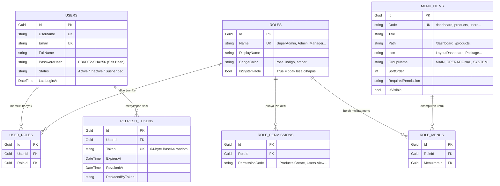
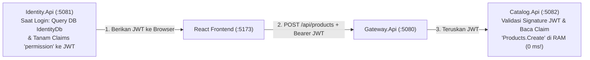
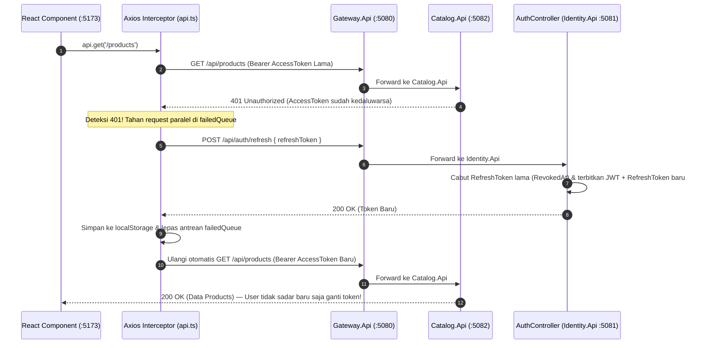

# Dokumentasi Lengkap: Zero-Trust JWT, Refresh Token, RBAC Lintas Microservice, & Menu Dinamis

Dokumen ini membedah secara mendalam bagaimana sistem keamanan di **NetStarterPack Microservices** bekerja — mulai dari penyimpanan tabel identitas di `NetStarterPack_IdentityDb`, penerbitan token JWT di `Identity.Api`, bagaimana microservice lain (`Catalog.Api`, dll.) memvalidasi token & permission secara **Zero-Trust (100% Stateless)** lewat `BuildingBlocks.Security`, hingga pengamanan komunikasi internal antar-microservice (`X-Internal-Api-Key`).

---

## 1. Struktur Tabel Keamanan & Menu di `NetStarterPack_IdentityDb` (ERD)

Seluruh tabel pengguna, role, permission, refresh token, menu sidebar, dan audit log dikelola secara terpusat oleh **`Identity.Api`** di dalam database **`NetStarterPack_IdentityDb`**:



> **Perhatikan:** Microservice bisnis seperti **`Catalog.Api`** (`NetStarterPack_CatalogDb`) **sama sekali tidak memiliki tabel `Users` atau `Roles`** di databasenya! Lalu bagaimana `Catalog.Api` bisa tahu siapa user yang sedang request dan apakah dia punya izin `Products.Create`? Jawabannya ada pada **Stateless JWT Claims** di bawah ini.

---

## 2. Rahasia Zero-Trust Microservices: Klaim Permission di Dalam JWT

### A. Keamanan Password (`PasswordHasher.cs`)
Lokasi: [`src/Services/Identity/Identity.Api/Infrastructure/Security/TokenAndPasswordServices.cs`](../src/Services/Identity/Identity.Api/Infrastructure/Security/TokenAndPasswordServices.cs)
- Menggunakan algoritma **`PBKDF2-SHA256`** dengan **100.000 iterasi** dan **16-byte cryptographic random salt** untuk setiap user (`{Base64Salt}.{Base64Hash}`).
- Verifikasi login menggunakan `CryptographicOperations.FixedTimeEquals` untuk mencegah *Timing Attack*.

### B. Isi Payload `AccessToken` (JWT)
Saat user login di `POST /api/auth/login` (diteruskan oleh YARP Gateway ke `Identity.Api`), `JwtTokenService` menerbitkan token JWT yang ditandatangani dengan `HMAC-SHA256` (`JwtSettings:SecretKey`) dan berisi klaim:
- `sub` & `ClaimTypes.NameIdentifier`: `Guid` ID milik user.
- `ClaimTypes.Name`: Username (`superadmin`, `staff`, dll).
- `ClaimTypes.Email` & `fullName`: Email dan nama lengkap user.
- `ClaimTypes.Role`: Daftar semua Role milik user.
- `permission`: Daftar seluruh kode Permission unik yang dimiliki user tersebut (misal: `"Dashboard.View"`, `"Products.View"`, `"Products.Create"`, `"Products.Edit"`).

### C. Kenapa Desain Ini Sangat Penting untuk Microservices?

- Ketika `Catalog.Api (:5082)` menerima request `POST /api/products`, `Catalog.Api` **TIDAK PERLU** menembak atau bertanya ke `Identity.Api (:5081)` maupun membuka koneksi ke database `NetStarterPack_IdentityDb`!
- Cukup menggunakan project bersama **`BuildingBlocks.Security`**, `Catalog.Api` memverifikasi tanda tangan kriptografi JWT di memori (0 milidetik) dan langsung membaca klaim `"permission": "Products.Create"` serta identitas user dari `ICurrentUserService`.
- **Zero-Trust**: Bahkan jika ada seseorang yang mem-bypass API Gateway (`:5080`) dan menembak langsung ke port internal `http://localhost:5082/api/products`, `Catalog.Api` tetap menolak request tersebut (`401`/`403`) jika tokennya tidak valid atau tidak memiliki permission yang sesuai!

---

## 3. Plug & Play Security di Tiap Microservice (`BuildingBlocks.Security`)

Lokasi: [`src/BuildingBlocks/BuildingBlocks.Security/PermissionAuthorization.cs`](../src/BuildingBlocks/BuildingBlocks.Security/PermissionAuthorization.cs)

Semua logika validasi JWT, `CurrentUserService`, atribut `[HasPermission(...)]`, `PermissionPolicyProvider`, dan `PermissionAuthorizationHandler` sudah dibungkus menjadi **1 baris extension method**:

```csharp
// Di Program.cs milik Identity.Api, Catalog.Api, atau microservice baru mana pun:
builder.Services.AddSharedJwtSecurity(builder.Configuration);
```

Dan di Controller microservice mana pun, kamu tinggal memasang atribut `[HasPermission(...)]` yang membaca konstanta dari `BuildingBlocks.Core.Constants.Permissions`:

```csharp
[HasPermission(Permissions.Products.Create)]
[HttpPost]
public async Task<IActionResult> Create([FromBody] CreateOrUpdateProductRequest request, CancellationToken ct)
```

---

## 4. Keamanan Komunikasi Internal Antar-Microservice (`X-Internal-Api-Key`)

Bagaimana jika suatu microservice (`Catalog.Api`) perlu mengirim data internal ke microservice lain (`Identity.Api`), misalnya saat mengirim `AuditLogIntegrationEvent` ke `POST /api/internal/events/audit-log` pada kondisi background atau sistem?

1. **Di `Gateway.Api/Program.cs`**: Seluruh path yang berawalan `/api/internal/*` tidak memiliki route di YARP dan disembunyikan dari Unified OpenAPI Spec, sehingga tidak bisa dipanggil dari luar melalui API Gateway.
2. **Di `HttpEventBus.cs` & `InternalEventsController.cs`**: Setiap request internal antar-microservice wajib menyertakan header rahasia **`X-Internal-Api-Key`** yang dicocokkan dengan `JwtSettings:InternalApiKey`. Jika tidak cocok, `InternalEventsController` langsung menolak dengan `401 Unauthorized`.

---

## 5. Alur Perpanjangan Sesi Otomatis (*Refresh Token Rotation*)



---

## 6. Tiga Lapis Proteksi RBAC & Menu Sidebar Dinamis

Sama seperti edisi Monolith, sistem RBAC memisahkan **Role (Jabatan Dinamis)** dan **Permission (Kode Aksi Granular di `BuildingBlocks.Core/Constants/Permissions.cs`)**, serta menjaga aplikasi di 3 titik:

1. **Titik 1 — Endpoint Microservice (`[HasPermission]`)**: Dijaga oleh `PermissionAuthorizationHandler` di masing-masing microservice (`Identity.Api`, `Catalog.Api`, `Order.Api`, `Workflow.Api`). Role **`SuperAdmin`** otomatis lolos semua pengecekan permission di seluruh microservice.
2. **Titik 2 — Route Halaman React (`<ProtectedRoute permission="...">`)**: Dijaga di [`frontend/src/App.tsx`](../frontend/src/App.tsx).
3. **Titik 3 — Visibilitas Tombol Aksi UI (`hasPermission('...')`)**: Mengatur muncul/tidaknya tombol Tambah, Edit, dan Hapus di tiap halaman React.

### Cara Kerja Menu Sidebar Dinamis (`/menus` — Database-Driven Navigation)

Sidebar di [`frontend/src/components/Layout.tsx`](../frontend/src/components/Layout.tsx) **tidak di-hardcode**. Setiap kali user login, `AuthContext.tsx` memanggil `GET /api/menus/my-menus` ke `Identity.Api (:5081)` yang memfilter tabel `MenuItems` & `RoleMenus` berdasarkan role + permission user tersebut.

**Catatan penting alur kerja fitur "Tambah Menu" di halaman `/menus`**:
- **Halaman & Route tetap dibuat di code React dulu** (`pages/XPage.tsx` + `<Route path="/..." />` di `App.tsx`). Form **+ Tambah Menu** di UI `/menus` fungsinya untuk **mendaftarkan & mengatur navigasinya**, bukan men-generate halaman React dari nol.
- **Keuntungan utama pola ini di Microservices**:
  1. **Ubah label, ikon, grup, & urutan tanpa deploy ulang**: Cukup edit dari UI `/menus`, tidak perlu ubah kode sidebar atau rebuild Frontend.
  2. **Pengaturan akses lintas Role yang fleksibel**: Saat organisasi menambah role baru (misal `ITLead`, `HRManager`, `FinanceDirector`), Admin cukup klik-centang role mana yang boleh melihat tiap menu langsung dari UI.
  3. ***Dark Launch* / *Feature Toggle***: Developer bisa deploy halaman fitur baru dulu, lalu saat hari-H rilis (atau saat fitur sedang maintenance), Admin tinggal aktifkan/nonaktifkan centang **Tampilkan di Sidebar Navigasi** dari UI `/menus`.
  4. **Hub Navigasi Terpusat**: Meski backend terpecah di banyak microservice (`Catalog :5082`, `Order :5083`, `Workflow :5084`), seluruh navigasi dan RBAC tetap diatur dari satu tempat (`Identity.Api :5081`).
