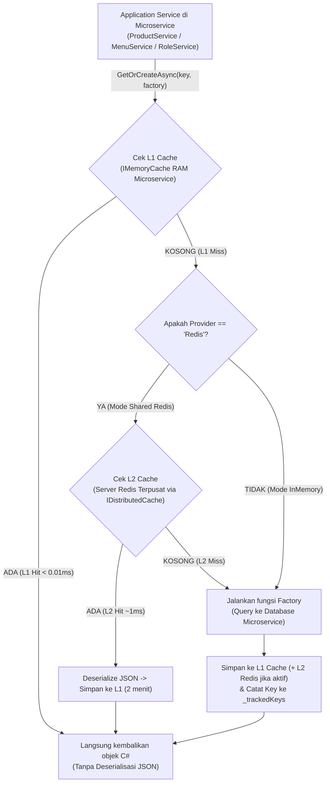

# Panduan Mendalam: Arsitektur Caching di Microservices (Hybrid L1 In-Memory + L2 Shared Redis)

Dokumen ini menjelaskan konsep dasar hingga detail teknis bagaimana sistem **Caching** di **NetStarterPack Microservices** bekerja melalui `BuildingBlocks.Infrastructure`, bagaimana tiap microservice mengelola cache-nya, bagaimana invalidasi cache lintas service terjadi, serta cara beralih dari mode **`InMemory`** ke **`Redis`** terpusat.

---

## 1. Kenapa Caching & Redis Makin Krusial di Arsitektur Microservices?

Bayangkan **Database SQL Server** milik masing-masing microservice (`NetStarterPack_IdentityDb` dan `NetStarterPack_CatalogDb`) itu seperti **gudang arsip belakang**, sedangkan **Microservice (`Identity.Api` & `Catalog.Api`)** adalah **petugas loket depan**.

Di arsitektur Microservices:
1. Setiap kali halaman Dashboard dibuka, `Identity.Api` juga meminta ringkasan statistik produk (`/api/products/stats`) ke `Catalog.Api`.
2. Tanpa cache, setiap request antar-microservice akan memicu query `SELECT` & `SUM` berulang-ulang ke SQL Server.
3. Dengan **Hybrid L1 + L2 Cache (`DistributedCacheService` di `BuildingBlocks.Infrastructure`)**:
   - Data yang sering dibaca (`Products`, `Stats`, `Menus`, `Roles`, `Users`, `Dashboard`) disimpan di **RAM L1 (`IMemoryCache`)** dan/atau **Server Redis L2 (`IDistributedCache`)**.
   - Ketika `Identity.Api` meminta `/api/products/stats` ke `Catalog.Api`, `Catalog.Api` langsung menjawab dari RAM dalam waktu **< 0.05 milidetik** tanpa menyentuh database `NetStarterPack_CatalogDb` sama sekali!

---

## 2. Arsitektur Hybrid L1 + L2 Cache (`BuildingBlocks.Infrastructure`)

Lokasi: [`src/BuildingBlocks/BuildingBlocks.Infrastructure/Caching/DistributedCacheService.cs`](../src/BuildingBlocks/BuildingBlocks.Infrastructure/Caching/DistributedCacheService.cs)



### Perbandingan Mode `InMemory` vs `Redis` di Microservices

Di `appsettings.json` milik `Identity.Api` dan `Catalog.Api`, terdapat section yang sama:
```json
"CacheSettings": {
  "Provider": "InMemory",
  "RedisConnectionString": "localhost:6379,abortConnect=false,connectTimeout=2000",
  "InstanceName": "NetStarterPackMicro_",
  "DefaultExpirationMinutes": 15
}
```

| Karakteristik | `"Provider": "InMemory"` *(Default Dev)* | `"Provider": "Redis"` *(Production / Multi-Instance)* |
| :--- | :--- | :--- |
| **Lokasi Penyimpanan** | Di RAM masing-masing proses microservice (`5081` sendiri, `5082` sendiri) | L1 RAM lokal (2 menit) + **1 Server Redis Terpusat** yang dipakai bersama semua microservice |
| **Butuh Install Software?** | **Tidak perlu** — langsung jalan saat tekan `F5` | Butuh server Redis (Docker / Memurai / WSL / Cloud Redis) |
| **Kapan Dipakai?** | Saat *development* lokal di laptop atau testing cepat | Saat produksi / jalanin banyak replica microservice (Horizontal Scaling) |
| **Jika Server Redis Mati?** | — | **Aman (Safe Fallback)!** Dibungkus `try-catch`, otomatis lanjut ambil dari SQL Server tanpa crash |

---

## 3. Bedah 4 Komponen Caching di Project Ini

### 1. Standar Penamaan Kunci Bersama — [`BuildingBlocks.Core/Constants/CacheKeys.cs`](../src/BuildingBlocks/BuildingBlocks.Core/Constants/CacheKeys.cs)
Semua konstanta prefix dan fungsi pembentuk key ditaruh di `BuildingBlocks.Core` agar seragam lintas microservice:
```csharp
public static class CacheKeys
{
    public const string ProductsPrefix  = "products:";
    public const string MenusPrefix     = "menus:";
    public const string RolesPrefix     = "roles:";
    public const string UsersPrefix     = "users:";
    public const string DashboardPrefix = "dashboard:";

    public static string ProductList(string? search, string? category) => ...;
    public static string ProductById(Guid id) => $"{ProductsPrefix}id:{id}";
    public static string ProductStats() => $"{ProductsPrefix}stats";
}
```

### 2. Kontrak Abstraksi — [`BuildingBlocks.Core/Interfaces/ICoreInterfaces.cs`](../src/BuildingBlocks/BuildingBlocks.Core/Interfaces/ICoreInterfaces.cs)
Semua microservice menyuntikkan interface `ICacheService` yang sama:
- **`GetOrCreateAsync<T>(key, factory, expiration, ct)`**: Ambil dari cache jika ada; jika kosong, jalankan query DB (`factory`), simpan ke cache, lalu kembalikan.
- **`RemoveByPrefixAsync(prefixKey, ct)`**: Sapu bersih seluruh cache yang diawali prefix tertentu (misal `"products:"` langsung menghapus `products:list:...`, `products:id:...`, dan `products:stats`).

### 3. Bagaimana Invalidasi Cache Lintas Microservice Bekerja?
Pertanyaan menarik di Microservices:
*"Saat `Catalog.Api (:5082)` menambah produk baru, data produk ada di `Catalog.Api`, tapi ringkasan Dashboard (`dashboard:summary`) ada di `Identity.Api (:5081)`. Bagaimana cara `Identity.Api` tahu bahwa cache Dashboard-nya harus di-reset?"*

Lihat alurnya di [`ProductService.cs`](../src/Services/Catalog/Catalog.Api/Application/Services/ProductService.cs) dan [`DashboardService.cs`](../src/Services/Identity/Identity.Api/Application/Services/DashboardService.cs):
1. Saat `CreateProductAsync` dipanggil di **`Catalog.Api`**:
   - `Catalog.Api` menghapus cache lokalnya: `await cacheService.RemoveByPrefixAsync(CacheKeys.ProductsPrefix, ct);` (sehingga `/api/products` dan `/api/products/stats` langsung segar).
   - `Catalog.Api` mengirim `AuditLogIntegrationEvent` lewat `IEventBus.PublishAuditAsync(...)` ke **`Identity.Api`**.
2. Saat **`Identity.Api`** menerima event tersebut di `DashboardService.RecordIntegrationAuditLogAsync`:
   - `Identity.Api` menyimpan baris `AuditLog` ke `NetStarterPack_IdentityDb`.
   - `Identity.Api` langsung memanggil `await cacheService.RemoveByPrefixAsync(CacheKeys.DashboardPrefix, ct);`!
   - Hasilnya: Begitu user kembali ke halaman Dashboard, angka **Total Katalog**, **Nilai Inventori**, dan **Log Aktivitas Terakhir** di `Identity.Api` langsung ter-update seketika!

---

## 4. Matriks Cache di Seluruh Microservice

| Microservice | Service Class | Key yang Di-Cache | TTL | Kapan Di-Invalidate (`RemoveByPrefixAsync`)? |
| :--- | :--- | :--- | :---: | :--- |
| **`Catalog.Api (:5082)`** | `ProductService` | `products:list:s=all:c=all`<br/>`products:id:{guid}`<br/>`products:stats` | 10 Menit | Saat `CreateProduct`, `UpdateProduct`, atau `DeleteProduct` (`products:`) |
| **`Identity.Api (:5081)`** | `MenuService` | `menus:all`<br/>`menus:roles:{roles}` | 15 Menit | Saat CRUD Menu atau saat akses menu Role diubah (`menus:` & `dashboard:`) |
| **`Identity.Api (:5081)`** | `RoleService` | `roles:all` | 15 Menit | Saat CRUD Role atau penugasan Role User berubah (`roles:`, `menus:`, `users:`, `dashboard:`) |
| **`Identity.Api (:5081)`** | `UserService` | `users:all` | 15 Menit | Saat CRUD User atau Update Profile (`users:`, `roles:`, `dashboard:`) |
| **`Identity.Api (:5081)`** | `DashboardService` | `dashboard:summary` | 2 Menit | Saat ada perubahan di `Identity.Api` **ATAU** saat menerima `AuditLogIntegrationEvent` dari microservice lain |

---

## 5. Cara Menyalakan Shared Redis untuk Seluruh Microservice

1. **Jalankan Redis Server** (misal via Docker):
   ```powershell
   docker run -d --name redis-micro -p 6379:6379 redis:alpine
   ```
2. **Ubah `"Provider"` menjadi `"Redis"`** di `appsettings.json` milik `Identity.Api` dan `Catalog.Api`:
   ```json
   "CacheSettings": {
     "Provider": "Redis",
     "RedisConnectionString": "localhost:6379,abortConnect=false,connectTimeout=2000",
     "InstanceName": "NetStarterPackMicro_",
     "DefaultExpirationMinutes": 15
   }
   ```
3. **Cek Key di Redis**:
   ```powershell
   docker exec -it redis-micro redis-cli KEYS "NetStarterPackMicro_*"
   ```

---

## 6. Anti Double-Submit dengan `IdempotencyMiddleware` (Pakai Hybrid Cache L1/L2)

Selain untuk mempercepat baca data (`GET`), Hybrid Cache L1/L2 yang sama juga dipakai oleh **`IdempotencyMiddleware`** ([`IdempotencyMiddleware.cs`](../src/BuildingBlocks/BuildingBlocks.Infrastructure/Middleware/IdempotencyMiddleware.cs)) buat mencegah **double-submit** (misalnya user klik tombol Submit/Approve 2x waktu koneksi lambat, atau request ke-retry otomatis setelah refresh token).

### Cara Kerjanya Singkat
1. Endpoint mutasi yang perlu proteksi cukup dikasih atribut **`[Idempotent]`** dari [`IdempotentAttribute.cs`](../src/BuildingBlocks/BuildingBlocks.Core/Attributes/IdempotentAttribute.cs).
   - Default-nya `RequireKey = false`: kalau client lama/Swagger tidak kirim header, request tetap jalan biasa. Begitu header `Idempotency-Key` dikirim, middleware langsung aktif.
   - Kalau mau wajibin header di endpoint tertentu, tinggal pakai `[Idempotent(RequireKey = true)]`.
2. Saat request masuk dengan header `Idempotency-Key`, middleware bikin key cache terisolasi per service, user, HTTP method, dan path:
   ```text
   idempotency:{serviceScope}:{userId}:{METHOD}:{path}:{idempotencyKey}
   ```
3. Tiga skenario yang ditangani otomatis:
   - **Request pertama masih berjalan, lalu klik ke-2 masuk bersamaan**: langsung ditahan pakai lock `InProgress` dan dibalas **`409 Conflict`**.
   - **Request pertama sudah sukses (`2xx`), lalu request duplikat dengan key & payload sama masuk lagi**: controller tidak dijalankan ulang—middleware langsung replay response lama dari Hybrid Cache L1/L2 + tambah header **`X-Idempotent-Replayed: true`**.
   - **Key yang sama dipakai lagi tapi body/payload-nya berbeda**: dicek lewat SHA-256 request hash dan ditolak dengan **`422 Unprocessable Entity`**.
   - **Request pertama gagal (`4xx`/`5xx`/exception)**: lock `InProgress` otomatis dibersihkan supaya user bisa retry dengan aman.

### Konfigurasi per Microservice (`appsettings.json`)
```json
"IdempotencySettings": {
  "Enabled": true,
  "DefaultExpirationMinutes": 30,
  "InProgressLockSeconds": 60
}
```

Kalau semua microservice sudah diarahkan ke Shared Redis (`"Provider": "Redis"`), proteksi anti double-submit ini otomatis ikut konsisten di seluruh replica/instance. Di sisi client (`frontend/src/services/api.ts` & `mobile/src/core/api/client.ts`), interceptor Axios sudah otomatis menyisipkan `Idempotency-Key` dengan jendela deduplikasi 5 detik untuk request `POST`/`PUT`/`PATCH` (dan mengecualikan endpoint auth, toggle like, dan upload `FormData`).
