# Panduan Lengkap A sampai Z: Cara Membuat Modul CRUD Baru & Microservice Baru dari Nol

Dokumen ini adalah panduan komprehensif (*step-by-step*) dari **A sampai Z** untuk mengembangkan fitur di **NetStarterPack Microservices**.

Karena arsitektur project ini mendukung **Maintainability secara Vertikal maupun Horizontal**, panduan ini dibagi menjadi **3 Level Studi Kasus**:
- **BAGIAN A (Vertical Scaling)**: Menambah modul/tabel CRUD baru di dalam microservice yang sudah ada (Studi Kasus: Modul **Pelanggan / `Customer`**).
- **BAGIAN B (Horizontal Scaling — Example 2)**: Membuat **Microservice Mandiri Baru** dari nol dengan port dan database terpisah (Studi Kasus: Microservice **`Order.Api` di Port `5083`** dengan database **`NetStarterPack_OrderDb`**), lalu menyambungkannya ke **YARP API Gateway (`:5080`)**, **Unified Swagger/Scalar**, dan **F5 Auto-Orchestrator**.
- **BAGIAN C (Advanced Enterprise — Example 3)**: Membuat microservice kompleks dari A sampai Z dengan **4 tabel relasional + JSON Schema Form Dinamis + Multi-Level Approval State Machine + 7 Lapis Security Guard + 3 Halaman React** (Studi Kasus: **`Workflow.Api` di Port `5084`** dengan database **`NetStarterPack_WorkflowDb`**). *(Lihat juga diagram ERD, State Machine, Sequence Diagram, & Walkthrough Testing lengkapnya di [`docs/08_WORKFLOW_ADVANCED_EXAMPLE.md`](08_WORKFLOW_ADVANCED_EXAMPLE.md)).*

---

## Gambaran Alur Pengerjaan (Dari Shared Kernel $\rightarrow$ Microservice $\rightarrow$ Gateway $\rightarrow$ Frontend)

```mermaid
flowchart LR
    subgraph BB ["1. Shared BuildingBlocks"]
        B1["BuildingBlocks.Core<br/>• Permissions.cs<br/>• CacheKeys.cs"]
    end

    subgraph MS ["2. Microservice (Compact Onion)"]
        direction LR
        D["Domain/<br/>• Entity (BaseEntity)<br/>• IUnitOfWork"] --> A["Application/<br/>• DTOs (record)<br/>• Service (+Cache & IEventBus)"]
        A --> I["Infrastructure/<br/>• DbContext & Seeder<br/>• UnitOfWork"]
        I --> C["Controllers/<br/>• BaseApiController<br/>• [HasPermission]"]
    end

    subgraph GW ["3. YARP API Gateway (:5080)"]
        Y["Gateway.Api<br/>• Route & Cluster di appsettings.json<br/>• Test di Unified Swagger/Scalar"]
    end

    subgraph UT ["4. Unit Testing"]
        T["xUnit + InMemory DB<br/>+ InMemoryEventBus"]
    end

    subgraph FE ["5. React Frontend (:5173)"]
        F["types/index.ts -> Page.tsx<br/>-> App.tsx -> Menu Sidebar"]
    end

    BB --> MS --> GW --> UT --> FE
```



---

# BAGIAN A: Menambah Modul CRUD Baru di Microservice yang Sudah Ada (Studi Kasus: `Customer`)

Misalkan kita ingin menambahkan tabel dan fitur **Data Pelanggan (`Customer`)** ke dalam microservice bisnis `Catalog.Api` (atau microservice mana pun yang sudah ada).

## Checklist Cepat File yang Disentuh (Bagian A)

| Urutan | Project / Folder | Lokasi File | Aksi | Fungsi |
| :---: | :--- | :--- | :---: | :--- |
| **1.1** | `BuildingBlocks.Core` | [`src/BuildingBlocks/BuildingBlocks.Core/Constants/Permissions.cs`](../src/BuildingBlocks/BuildingBlocks.Core/Constants/Permissions.cs) | Edit | Daftar konstanta permission `Customers.*` |
| **1.2** | `BuildingBlocks.Core` | [`src/BuildingBlocks/BuildingBlocks.Core/Constants/CacheKeys.cs`](../src/BuildingBlocks/BuildingBlocks.Core/Constants/CacheKeys.cs) | Edit | Daftar prefix & helper key cache `customers:` |
| **2.1** | `Catalog.Api/Domain` | `src/Services/Catalog/Catalog.Api/Domain/Entities/Customer.cs` | Buat Baru | Class entity `Customer : BaseEntity` |
| **2.2** | `Catalog.Api/Domain` | [`src/Services/Catalog/Catalog.Api/Domain/Interfaces/ICatalogUnitOfWork.cs`](../src/Services/Catalog/Catalog.Api/Domain/Interfaces/ICatalogUnitOfWork.cs) | Edit | Tambah `IRepository<Customer> Customers { get; }` |
| **3.1** | `Catalog.Api/Application` | `src/Services/Catalog/Catalog.Api/Application/DTOs/CustomerDtos.cs` | Buat Baru | DTO Request & Response (`record`) |
| **3.2** | `Catalog.Api/Application` | `src/Services/Catalog/Catalog.Api/Application/Interfaces/ICustomerService.cs` | Buat Baru | Kontrak interface `ICustomerService` |
| **3.3** | `Catalog.Api/Application` | `src/Services/Catalog/Catalog.Api/Application/Services/CustomerService.cs` | Buat Baru | Logika bisnis CRUD + Cache + `IEventBus.PublishAuditAsync` |
| **4.1** | `Catalog.Api/Infrastructure` | [`src/Services/Catalog/Catalog.Api/Infrastructure/Persistence/CatalogPersistence.cs`](../src/Services/Catalog/Catalog.Api/Infrastructure/Persistence/CatalogPersistence.cs) | Edit | Tambah `DbSet<Customer>`, Fluent API, & `CatalogUnitOfWork` |
| **4.2** | `Catalog.Api` | [`src/Services/Catalog/Catalog.Api/Program.cs`](../src/Services/Catalog/Catalog.Api/Program.cs) | Edit | Registrasi DI `AddScoped<ICustomerService, CustomerService>()` |
| **5.1** | `Catalog.Api/Controllers` | `src/Services/Catalog/Catalog.Api/Controllers/CustomersController.cs` | Buat Baru | Endpoint HTTP `/api/customers` + `[HasPermission]` |
| **5.2** | `Gateway.Api` | [`src/ApiGateway/Gateway.Api/appsettings.json`](../src/ApiGateway/Gateway.Api/appsettings.json) | Edit | Tambah route YARP `/api/customers` ke `catalog-cluster` |
| **6.1** | `UnitTests` | `tests/NetStarterPack.Microservices.UnitTests/Services/Catalog/CustomerServiceTests.cs` | Buat Baru | Unit test CRUD, Cache, Soft-Delete, & `InMemoryEventBus` |
| **7.1** | `Frontend React` | `frontend/src/types/index.ts`, `pages/catalog/CustomersPage.tsx`, `App.tsx` | Buat/Edit | Tampilan tabel, modal CRUD, & proteksi `hasPermission` |

---

## Tahap 1: Update `BuildingBlocks.Core` (Agar Permission & Cache Key Dikenali Semua Service)

### 1.1. Daftarkan Konstanta Permission di [`Permissions.cs`](../src/BuildingBlocks/BuildingBlocks.Core/Constants/Permissions.cs)
Buka `src/BuildingBlocks/BuildingBlocks.Core/Constants/Permissions.cs`, tambahkan class `Customers` dan daftarkan ke dalam `Permissions.GetAll()`:

```csharp
public static class Customers
{
    public const string View = "Customers.View";
    public const string Create = "Customers.Create";
    public const string Edit = "Customers.Edit";
    public const string Delete = "Customers.Delete";
}

// Di dalam method GetAll():
new(Customers.View, "Lihat Pelanggan", "Customers", "Melihat daftar dan detail pelanggan"),
new(Customers.Create, "Tambah Pelanggan", "Customers", "Menambahkan pelanggan baru"),
new(Customers.Edit, "Ubah Pelanggan", "Customers", "Mengubah data pelanggan"),
new(Customers.Delete, "Hapus Pelanggan", "Customers", "Menghapus data pelanggan"),
```
> **Kenapa ditaruh di `BuildingBlocks.Core`?**
> Supaya **`Identity.Api`** bisa menampilkan pilihan centangan permission `Customers.*` di halaman **Role & Hak Akses (`/roles`)**, sementara **`Catalog.Api`** bisa memakainya pada atribut `[HasPermission(Permissions.Customers.Create)]`!

### 1.2. Tambahkan Kunci Cache di [`CacheKeys.cs`](../src/BuildingBlocks/BuildingBlocks.Core/Constants/CacheKeys.cs)
Buka `src/BuildingBlocks/BuildingBlocks.Core/Constants/CacheKeys.cs`:

```csharp
public const string CustomersPrefix = "customers:";

public static string CustomerList(string? search = null, string? status = null) =>
    $"{CustomersPrefix}list:s={search?.Trim().ToLowerInvariant() ?? "all"}:st={status?.Trim().ToLowerInvariant() ?? "all"}";

public static string CustomerById(Guid id) =>
    $"{CustomersPrefix}id:{id}";
```

---

## Tahap 2: Folder `Domain/` di Dalam Microservice

### 2.1. Buat Entity `Customer.cs`
Buat file `src/Services/Catalog/Catalog.Api/Domain/Entities/Customer.cs` yang mewarisi **`BaseEntity`** dari `BuildingBlocks.Core.Common`:

```csharp
using BuildingBlocks.Core.Common;

namespace Catalog.Api.Domain.Entities;

public enum CustomerStatus
{
    Active = 1,
    Inactive = 2,
    Blacklisted = 3
}

public class Customer : BaseEntity
{
    public string Code { get; set; } = string.Empty;
    public string Name { get; set; } = string.Empty;
    public string Email { get; set; } = string.Empty;
    public string Phone { get; set; } = string.Empty;
    public string CompanyName { get; set; } = string.Empty;
    public decimal CreditLimit { get; set; }
    public CustomerStatus Status { get; set; } = CustomerStatus.Active;
}
```

### 2.2. Tambahkan Repository ke [`ICatalogUnitOfWork.cs`](../src/Services/Catalog/Catalog.Api/Domain/Interfaces/ICatalogUnitOfWork.cs)
```csharp
public interface ICatalogUnitOfWork
{
    IRepository<Product> Products { get; }
    IRepository<Customer> Customers { get; } // <-- Tambahkan baris ini
    Task<int> SaveChangesAsync(CancellationToken cancellationToken = default);
}
```

---

## Tahap 3: Folder `Application/` di Dalam Microservice (Logika Bisnis + Cache + `IEventBus`)

### 3.1. Buat DTO (`CustomerDtos.cs`) & Interface (`ICustomerService.cs`)
Buat `src/Services/Catalog/Catalog.Api/Application/DTOs/CustomerDtos.cs`:
```csharp
namespace Catalog.Api.Application.DTOs;

public record CustomerDto(
    Guid Id,
    string Code,
    string Name,
    string Email,
    string Phone,
    string CompanyName,
    decimal CreditLimit,
    string Status,
    DateTime CreatedAt,
    string? CreatedBy);

public record CreateOrUpdateCustomerRequest(
    string Code,
    string Name,
    string Email,
    string Phone,
    string CompanyName,
    decimal CreditLimit,
    string Status = "Active");
```

Buat `src/Services/Catalog/Catalog.Api/Application/Interfaces/ICustomerService.cs`:
```csharp
using BuildingBlocks.Core.Common;
using Catalog.Api.Application.DTOs;

namespace Catalog.Api.Application.Interfaces;

public interface ICustomerService
{
    Task<Result<IReadOnlyList<CustomerDto>>> GetAllCustomersAsync(string? search = null, string? status = null, CancellationToken cancellationToken = default);
    Task<Result<CustomerDto>> GetCustomerByIdAsync(Guid id, CancellationToken cancellationToken = default);
    Task<Result<CustomerDto>> CreateCustomerAsync(CreateOrUpdateCustomerRequest request, CancellationToken cancellationToken = default);
    Task<Result<CustomerDto>> UpdateCustomerAsync(Guid id, CreateOrUpdateCustomerRequest request, CancellationToken cancellationToken = default);
    Task<Result> DeleteCustomerAsync(Guid id, CancellationToken cancellationToken = default);
}
```

### 3.2. Buat Implementasi `CustomerService.cs` (Perhatikan Bedanya dengan Monolith pada Bagian `IEventBus`!)
Di arsitektur Microservices, tabel `AuditLogs` berada di database `NetStarterPack_IdentityDb` milik `Identity.Api`. Oleh karena itu, microservice bisnis **tidak melakukan insert ke tabel AuditLog lokal**, melainkan memanggil **`await eventBus.PublishAuditAsync(...)`**!

Buat file `src/Services/Catalog/Catalog.Api/Application/Services/CustomerService.cs`:

```csharp
using BuildingBlocks.Core.Common;
using BuildingBlocks.Core.Constants;
using BuildingBlocks.Core.Contracts;
using BuildingBlocks.Core.Interfaces;
using Catalog.Api.Application.DTOs;
using Catalog.Api.Application.Interfaces;
using Catalog.Api.Domain.Entities;
using Catalog.Api.Domain.Interfaces;

namespace Catalog.Api.Application.Services;

public class CustomerService(
    ICatalogUnitOfWork unitOfWork,
    ICurrentUserService currentUserService,
    ICacheService cacheService,
    IEventBus eventBus) : ICustomerService
{
    public async Task<Result<IReadOnlyList<CustomerDto>>> GetAllCustomersAsync(
        string? search = null,
        string? status = null,
        CancellationToken cancellationToken = default)
    {
        var baseKey = CacheKeys.CustomerList(null, null);

        var allDtos = await cacheService.GetOrCreateAsync(
            baseKey,
            async ct =>
            {
                var customers = await unitOfWork.Customers.GetListAsync(cancellationToken: ct);
                return customers
                    .OrderByDescending(c => c.CreatedAt)
                    .Select(MapToDto)
                    .ToList();
            },
            TimeSpan.FromMinutes(10),
            cancellationToken);

        IEnumerable<CustomerDto> query = allDtos;

        if (!string.IsNullOrWhiteSpace(search))
        {
            var term = search.Trim();
            query = query.Where(c =>
                c.Name.Contains(term, StringComparison.OrdinalIgnoreCase) ||
                c.Code.Contains(term, StringComparison.OrdinalIgnoreCase) ||
                c.CompanyName.Contains(term, StringComparison.OrdinalIgnoreCase) ||
                c.Email.Contains(term, StringComparison.OrdinalIgnoreCase));
        }

        if (!string.IsNullOrWhiteSpace(status))
        {
            var statusTerm = status.Trim();
            query = query.Where(c => c.Status.Equals(statusTerm, StringComparison.OrdinalIgnoreCase));
        }

        return Result<IReadOnlyList<CustomerDto>>.Success(query.ToList());
    }

    public async Task<Result<CustomerDto>> GetCustomerByIdAsync(Guid id, CancellationToken cancellationToken = default)
    {
        var dto = await cacheService.GetOrCreateAsync<CustomerDto?>(
            CacheKeys.CustomerById(id),
            async ct =>
            {
                var customer = await unitOfWork.Customers.GetByIdAsync(id, ct);
                return customer is null ? null : MapToDto(customer);
            },
            TimeSpan.FromMinutes(10),
            cancellationToken);

        return dto is null
            ? Result<CustomerDto>.Failure("Data pelanggan tidak ditemukan.", 404)
            : Result<CustomerDto>.Success(dto);
    }

    public async Task<Result<CustomerDto>> CreateCustomerAsync(
        CreateOrUpdateCustomerRequest request,
        CancellationToken cancellationToken = default)
    {
        if (string.IsNullOrWhiteSpace(request.Code) || string.IsNullOrWhiteSpace(request.Name))
        {
            return Result<CustomerDto>.Failure("Kode dan Nama pelanggan wajib diisi.", 400);
        }

        var code = request.Code.Trim().ToUpperInvariant();
        if (await unitOfWork.Customers.AnyAsync(c => c.Code == code, cancellationToken))
        {
            return Result<CustomerDto>.Failure($"Pelanggan dengan kode '{code}' sudah terdaftar.", 409);
        }

        if (!Enum.TryParse<CustomerStatus>(request.Status, true, out var status))
        {
            status = CustomerStatus.Active;
        }

        var customer = new Customer
        {
            Code = code,
            Name = request.Name.Trim(),
            Email = request.Email.Trim(),
            Phone = request.Phone.Trim(),
            CompanyName = request.CompanyName.Trim(),
            CreditLimit = request.CreditLimit,
            Status = status,
            CreatedBy = currentUserService.Username ?? "System"
        };

        // 1. Simpan ke Database lokal Microservice
        await unitOfWork.Customers.AddAsync(customer, cancellationToken);
        await unitOfWork.SaveChangesAsync(cancellationToken);

        // 2. Invalidate Cache modul Customers
        await cacheService.RemoveByPrefixAsync(CacheKeys.CustomersPrefix, cancellationToken);

        // 3. Publish AuditLogIntegrationEvent ke Identity.Api lewat IEventBus (Resilient & Decoupled!)
        await eventBus.PublishAuditAsync(new AuditLogIntegrationEvent(
            UserId: currentUserService.UserId,
            UserName: currentUserService.Username ?? "System",
            Action: "CREATE_CUSTOMER",
            Module: "Customers",
            EntityId: customer.Id.ToString(),
            Details: $"[Catalog.Api] Menambahkan pelanggan '{customer.Name}' (Kode: {customer.Code}).",
            IpAddress: currentUserService.IpAddress,
            SourceService: "Catalog.Api"), cancellationToken);

        return Result<CustomerDto>.Success(MapToDto(customer), "Data pelanggan berhasil ditambahkan.", 201);
    }

    public async Task<Result<CustomerDto>> UpdateCustomerAsync(
        Guid id,
        CreateOrUpdateCustomerRequest request,
        CancellationToken cancellationToken = default)
    {
        var customer = await unitOfWork.Customers.GetByIdAsync(id, cancellationToken);
        if (customer is null)
        {
            return Result<CustomerDto>.Failure("Data pelanggan tidak ditemukan.", 404);
        }

        var code = request.Code.Trim().ToUpperInvariant();
        if (await unitOfWork.Customers.AnyAsync(c => c.Id != id && c.Code == code, cancellationToken))
        {
            return Result<CustomerDto>.Failure($"Pelanggan lain dengan kode '{code}' sudah ada.", 409);
        }

        if (Enum.TryParse<CustomerStatus>(request.Status, true, out var status))
        {
            customer.Status = status;
        }

        customer.Code = code;
        customer.Name = request.Name.Trim();
        customer.Email = request.Email.Trim();
        customer.Phone = request.Phone.Trim();
        customer.CompanyName = request.CompanyName.Trim();
        customer.CreditLimit = request.CreditLimit;
        customer.UpdatedAt = DateTime.UtcNow;
        customer.UpdatedBy = currentUserService.Username ?? "System";

        unitOfWork.Customers.Update(customer);
        await unitOfWork.SaveChangesAsync(cancellationToken);

        await cacheService.RemoveByPrefixAsync(CacheKeys.CustomersPrefix, cancellationToken);

        await eventBus.PublishAuditAsync(new AuditLogIntegrationEvent(
            UserId: currentUserService.UserId,
            UserName: currentUserService.Username ?? "System",
            Action: "UPDATE_CUSTOMER",
            Module: "Customers",
            EntityId: customer.Id.ToString(),
            Details: $"[Catalog.Api] Memperbarui pelanggan '{customer.Name}' (Kode: {customer.Code}).",
            IpAddress: currentUserService.IpAddress,
            SourceService: "Catalog.Api"), cancellationToken);

        return Result<CustomerDto>.Success(MapToDto(customer), "Data pelanggan berhasil diperbarui.");
    }

    public async Task<Result> DeleteCustomerAsync(Guid id, CancellationToken cancellationToken = default)
    {
        var customer = await unitOfWork.Customers.GetByIdAsync(id, cancellationToken);
        if (customer is null)
        {
            return Result.Failure("Data pelanggan tidak ditemukan.", 404);
        }

        unitOfWork.Customers.Remove(customer);
        await unitOfWork.SaveChangesAsync(cancellationToken);

        await cacheService.RemoveByPrefixAsync(CacheKeys.CustomersPrefix, cancellationToken);

        await eventBus.PublishAuditAsync(new AuditLogIntegrationEvent(
            UserId: currentUserService.UserId,
            UserName: currentUserService.Username ?? "System",
            Action: "DELETE_CUSTOMER",
            Module: "Customers",
            EntityId: customer.Id.ToString(),
            Details: $"[Catalog.Api] Menghapus pelanggan '{customer.Name}' (Kode: {customer.Code}).",
            IpAddress: currentUserService.IpAddress,
            SourceService: "Catalog.Api"), cancellationToken);

        return Result.Success("Data pelanggan berhasil dihapus.");
    }

    private static CustomerDto MapToDto(Customer c) =>
        new(
            c.Id,
            c.Code,
            c.Name,
            c.Email,
            c.Phone,
            c.CompanyName,
            c.CreditLimit,
            c.Status.ToString(),
            c.CreatedAt,
            c.CreatedBy);
}
```

---

## Tahap 4: Folder `Infrastructure/` & Registrasi DI di Microservice

### 4.1. Update `CatalogDbContext` & `CatalogUnitOfWork` di [`CatalogPersistence.cs`](../src/Services/Catalog/Catalog.Api/Infrastructure/Persistence/CatalogPersistence.cs)
```csharp
// Di dalam CatalogDbContext:
public DbSet<Product> Products => Set<Product>();
public DbSet<Customer> Customers => Set<Customer>(); // <-- Tambahkan ini

// Di dalam OnModelCreating:
modelBuilder.Entity<Customer>(entity =>
{
    entity.ToTable("Customers");
    entity.HasKey(x => x.Id);
    entity.Property(x => x.Code).HasMaxLength(50).IsRequired();
    entity.Property(x => x.Name).HasMaxLength(200).IsRequired();
    entity.Property(x => x.Email).HasMaxLength(150);
    entity.Property(x => x.Phone).HasMaxLength(50);
    entity.Property(x => x.CompanyName).HasMaxLength(200);
    entity.Property(x => x.CreditLimit).HasPrecision(18, 2);
    entity.HasIndex(x => x.Code).IsUnique();
    entity.HasQueryFilter(x => !x.IsDeleted); // WAJIB untuk Soft-Delete!
});

// Di dalam CatalogUnitOfWork:
private IRepository<Customer>? _customers;
public IRepository<Customer> Customers =>
    _customers ??= new GenericRepository<Customer, CatalogDbContext>(dbContext);
```

### 4.2. Daftarkan Service di `Catalog.Api/Program.cs`
```csharp
builder.Services.AddScoped<ICustomerService, CustomerService>();
```

---

## Tahap 5: Buat Controller & Daftarkan Route di YARP API Gateway (`Gateway.Api`)

### 5.1. Buat `CustomersController.cs` di `Catalog.Api/Controllers/`
```csharp
using BuildingBlocks.Core.Constants;
using BuildingBlocks.Infrastructure.Controllers;
using BuildingBlocks.Security;
using Catalog.Api.Application.DTOs;
using Catalog.Api.Application.Interfaces;
using Microsoft.AspNetCore.Authorization;
using Microsoft.AspNetCore.Mvc;

namespace Catalog.Api.Controllers;

[Authorize]
public class CustomersController(ICustomerService customerService) : BaseApiController
{
    [HasPermission(Permissions.Customers.View)]
    [HttpGet]
    public async Task<IActionResult> GetAll([FromQuery] string? search, [FromQuery] string? status, CancellationToken ct) =>
        ToActionResult(await customerService.GetAllCustomersAsync(search, status, ct));

    [HasPermission(Permissions.Customers.View)]
    [HttpGet("{id:guid}")]
    public async Task<IActionResult> GetById(Guid id, CancellationToken ct) =>
        ToActionResult(await customerService.GetCustomerByIdAsync(id, ct));

    [HasPermission(Permissions.Customers.Create)]
    [HttpPost]
    public async Task<IActionResult> Create([FromBody] CreateOrUpdateCustomerRequest request, CancellationToken ct) =>
        ToActionResult(await customerService.CreateCustomerAsync(request, ct));

    [HasPermission(Permissions.Customers.Edit)]
    [HttpPut("{id:guid}")]
    public async Task<IActionResult> Update(Guid id, [FromBody] CreateOrUpdateCustomerRequest request, CancellationToken ct) =>
        ToActionResult(await customerService.UpdateCustomerAsync(id, request, ct));

    [HasPermission(Permissions.Customers.Delete)]
    [HttpDelete("{id:guid}")]
    public async Task<IActionResult> Delete(Guid id, CancellationToken ct) =>
        ToActionResult(await customerService.DeleteCustomerAsync(id, ct));
}
```

### 5.2. Tambahkan Route `/api/customers` di YARP [`Gateway.Api/appsettings.json`](../src/ApiGateway/Gateway.Api/appsettings.json)
Supaya panggilan `api.get('/customers')` dari React (`:5173`) diteruskan oleh YARP Gateway (`:5080`) ke `Catalog.Api (:5082)`, tambahkan route ini di `src/ApiGateway/Gateway.Api/appsettings.json`:

```json
"customers-route": {
  "ClusterId": "catalog-cluster",
  "Match": {
    "Path": "/api/customers/{**catch-all}"
  }
},
"customers-root-route": {
  "ClusterId": "catalog-cluster",
  "Match": {
    "Path": "/api/customers"
  }
}
```
> **Otomatis Tampil di Unified Swagger & Scalar Gateway!**
> Karena `Gateway.Api` memiliki *Unified OpenAPI Merger*, begitu kamu menambahkan `CustomersController` di `Catalog.Api`, seluruh endpoint `/api/customers` **langsung muncul secara otomatis** di **`http://localhost:5080/swagger`** dan **`http://localhost:5080/scalar/v1`**!

---

## Tahap 6: Membuat Unit Test (`tests/NetStarterPack.Microservices.UnitTests`)

Buat file baru `tests/NetStarterPack.Microservices.UnitTests/Services/Catalog/CustomerServiceTests.cs`, lalu uji `CustomerService` menggunakan `TestDbFactory.CreateCatalogAsync()`, `TestCacheFactory.CreateInMemory()`, dan `InMemoryEventBus`:

```csharp
[Fact]
public async Task CreateUpdateDelete_ShouldValidateCacheAndPublishAuditEvents()
{
    using var ctx = await TestDbFactory.CreateCatalogAsync();
    var currentUser = new FakeCurrentUserService { Username = "staff" };
    var cache = TestCacheFactory.CreateInMemory();
    var eventBus = new InMemoryEventBus();

    var customerService = new CustomerService(ctx.Uow, currentUser, cache, eventBus);

    // 1. Tambah Pelanggan Baru (201 Created)
    var createReq = new CreateOrUpdateCustomerRequest(
        Code: "cust-001",
        Name: "PT Nusantara Maju",
        Email: "billing@nusantara.co.id",
        Phone: "021-5550123",
        CompanyName: "Nusantara Group",
        CreditLimit: 50_000_000m,
        Status: "Active");

    var createResult = await customerService.CreateCustomerAsync(createReq);

    Assert.True(createResult.Succeeded);
    Assert.Equal(201, createResult.StatusCode);
    Assert.Equal("CUST-001", createResult.Data!.Code);

    // 2. Pastikan event CREATE_CUSTOMER terkirim ke IEventBus
    Assert.Single(eventBus.PublishedEvents);
    Assert.Equal("CREATE_CUSTOMER", eventBus.PublishedEvents[0].Action);

    // 3. Pastikan kode duplikat ditolak (409 Conflict)
    var duplicateResult = await customerService.CreateCustomerAsync(createReq);
    Assert.False(duplicateResult.Succeeded);
    Assert.Equal(409, duplicateResult.StatusCode);

    // 4. Pastikan Soft-Delete mengubah IsDeleted = true
    var customerId = createResult.Data.Id;
    await customerService.DeleteCustomerAsync(customerId);

    var rawInDb = await ctx.Db.Customers.IgnoreQueryFilters().FirstOrDefaultAsync(c => c.Id == customerId);
    Assert.NotNull(rawInDb);
    Assert.True(rawInDb!.IsDeleted);
}
```

---

## Tahap 7: Implementasi di Frontend React (`frontend/`) & Menu Sidebar

Di sisi Frontend React (`:5173`), langkahnya **100% sama mudahnya** dengan edisi Monolith karena semua request `/api/*` di-proxy otomatis ke YARP API Gateway (`:5080`):

1. **Tambahkan Interface di [`frontend/src/types/index.ts`](../frontend/src/types/index.ts)**:
   ```ts
   export interface CustomerItem {
     id: string;
     code: string;
     name: string;
     email: string;
     phone: string;
     companyName: string;
     creditLimit: number;
     status: string;
     createdAt: string;
     createdBy?: string;
   }
   ```
2. **Buat Halaman `frontend/src/pages/catalog/CustomersPage.tsx`**:
   Gunakan `const { hasPermission } = useAuth();` untuk mengecek `Customers.Create`, `Customers.Edit`, dan `Customers.Delete`, lalu panggil `api.get('/customers')`, `api.post('/customers', form)`, `api.put(...)`, dan `api.delete(...)`.
3. **Daftarkan Route di [`frontend/src/App.tsx`](../frontend/src/App.tsx)**:
   ```tsx
   <Route
     path="customers"
     element={
       <ProtectedRoute permission="Customers.View">
         <CustomersPage />
       </ProtectedRoute>
     }
   />
   ```
4. **Daftarkan ke Menu Sidebar (2 Pilihan: Lewat UI `/menus` atau Lewat Seeder)**:

   > ⚠️ **Penting — Urutan yang Benar**:
   > **Selalu buat halaman React (`XPage.tsx`) dan daftarkan `<Route>`-nya di `App.tsx` dulu**, baru daftarkan menunya di sidebar!
   > Kalau kamu langsung klik **+ Tambah Menu** dengan path `/customers` tapi di `App.tsx` belum ada `<Route path="customers" ... />`, menunya memang langsung muncul di sidebar, tapi saat diklik React Router akan me-redirect balik ke `/dashboard`.

   - **Cara A — Langsung lewat UI Frontend (`/menus`) *(Paling Cepat untuk DB yang Sudah Jalan)***:
     1. Login sebagai `superadmin` (atau role yang punya permission `Menus.Manage`) di `http://localhost:5173`.
     2. Buka halaman **Manajemen Menu (`/menus`)** &rarr; klik tombol **+ Tambah Menu** (*Tambah Menu Navigasi Baru*).
     3. Isi form modal sesuai halaman yang baru kamu buat:
        - **Judul Menu**: Nama yang tampil di sidebar (misal: `Data Pelanggan`).
        - **Path URL Frontend**: **Wajib sama persis** dengan `path` di `App.tsx` dengan diawali `/` (misal: `/customers`).
        - **Grup Sidebar**: Nama kelompok di sidebar (misal: `OPERATIONAL`, `MICROSERVICES`, atau `WORKFLOW & APPROVAL`).
        - **Ikon**: Pilih dari daftar ikon yang sudah didaftarkan di [`frontend/src/components/DynamicIcon.tsx`](../frontend/src/components/DynamicIcon.tsx).
        - **Urutan**: Angka posisi tampilan menu dari atas ke bawah.
        - **Permission Wajib (Opsional)**: Pilih misal `Customers.View` (daftar ini otomatis ditarik dari `BuildingBlocks.Core/Constants/Permissions.cs`).
        - **Tampilkan Menu Ini untuk Role**: Klik/pilih role mana saja yang boleh melihat menu ini.
        - **Tampilkan di Sidebar Navigasi**: Centang untuk langsung tampil (atau matikan centang dulu kalau mau *Dark Launch* / sembunyikan sementara saat maintenance).
     4. Klik **Simpan Menu** — menu langsung tersimpan ke `NetStarterPack_IdentityDb`, cache menu otomatis ter-invalidate, dan sidebar langsung berubah tanpa perlu edit kode `Layout.tsx` atau rebuild Frontend!
     5. Jangan lupa cek halaman **Role & Hak Akses (`/roles`)** untuk memastikan role terkait juga sudah dicentang permission `Customers.View` / `Create` / `Edit` / `Delete`-nya.

   - **Cara B — Lewat Kode di [`IdentityDatabaseSeeder.cs`](../src/Services/Identity/Identity.Api/Infrastructure/Persistence/IdentityDatabaseSeeder.cs)**:
     - Cocok kalau kamu ingin menu fitur barumu **otomatis langsung ada** setiap kali project ini dijalankan di komputer baru / database baru yang masih kosong (seperti contoh `orders` dan `workflow-*` di `IdentityDatabaseSeeder.cs`).
     - Untuk aplikasi yang sudah terlanjur live di server dengan DB existing, **Cara A (via UI `/menus`)** atau method *idempotent auto-upgrade* (seperti `EnsureWorkflowRolesUsersAndMenusAsync()`) adalah cara paling aman tanpa perlu drop database.

---

# BAGIAN B (EXAMPLE 2 — SUDAH TERIMPLEMENTASI LIVE!): Membuat Microservice Mandiri Baru dari Nol (`Order.Api` di Port `5083`)

> 💡 **Kabar Baik!** Seluruh studi kasus **Example 2 (`Order.Api` di Port `5083` + database `NetStarterPack_OrderDb` + halaman React `OrdersPage.tsx`)** di bawah ini **SUDAH DIIMPLEMENTASIKAN SECARA NYATA** di dalam solution ini!
> Kamu bisa langsung membuka dan mempelajari file aslinya di:
> - **Backend Microservice**: [`src/Services/Order/Order.Api/`](../src/Services/Order/Order.Api/)
> - **YARP Gateway Route**: [`src/ApiGateway/Gateway.Api/appsettings.json`](../src/ApiGateway/Gateway.Api/appsettings.json) (`orders-route` $\rightarrow$ `http://localhost:5083`)
> - **Unit Test**: [`tests/NetStarterPack.Microservices.UnitTests/Services/Order/OrderServiceTests.cs`](../tests/NetStarterPack.Microservices.UnitTests/Services/Order/OrderServiceTests.cs)
> - **Frontend React UI**: [`frontend/src/pages/orders/OrdersPage.tsx`](../frontend/src/pages/orders/OrdersPage.tsx) (Menu: **Pesanan (Order.Api)** di `/orders`)

---

## Kapan Harus Pakai Bagian A vs Bagian B?
- Gunakan **Bagian A** kalau tabel barumu masih satu rumpun dengan service yang sudah ada (misal tambah tabel `Kategori` di dalam `Catalog.Api`).
- Gunakan **Bagian B (Example 2 ini)** kalau kamu ingin membuat **Microservice Mandiri Baru** yang punya **Port sendiri (`:5083`)** dan **Database SQL Server sendiri (`NetStarterPack_OrderDb`)**.

---

## Langkah 1: Buat Project Web API Baru (Tanpa Edit `.csproj` Manual!)

Kamu **sama sekali tidak perlu** menulis atau mengedit XML `.csproj` secara manual. Pilih salah satu dari **2 cara standar** di bawah ini (lewat klik GUI Visual Studio atau lewat Terminal CLI):

### Cara 1: Lewat Visual Studio GUI (Paling Umum & Gampang)
1. **Buat Project Baru**:
   - Di **Solution Explorer**, klik kanan folder **`Services`** (di bawah `src`) $\rightarrow$ pilih **Add** $\rightarrow$ **New Project...**
   - Pilih template **ASP.NET Core Web API** $\rightarrow$ Klik **Next**.
   - Isi **Project name**: `Order.Api`
   - Isi **Location**: `...\net-starterpack-microservice\src\Services\Order`
   - Pilih Framework **`.NET 10.0`**, centang *Use controllers* $\rightarrow$ Klik **Create**.
2. **Sambungkan ke `BuildingBlocks` (Klik Kanan)**:
   - Di project `Order.Api` yang baru muncul, klik kanan **Dependencies** $\rightarrow$ **Add Project Reference...**
   - Centang **`BuildingBlocks.Core`**, **`BuildingBlocks.Security`**, dan **`BuildingBlocks.Infrastructure`** $\rightarrow$ Klik **OK**.
3. **Install Package EF Core (Lewat NuGet GUI)**:
   - Klik kanan **Dependencies** pada `Order.Api` $\rightarrow$ **Manage NuGet Packages...**
   - Cari dan install:
     - `Microsoft.EntityFrameworkCore.SqlServer` (versi `10.0.*`)
     - `Microsoft.EntityFrameworkCore.Sqlite` (versi `10.0.*`)
     - `Microsoft.EntityFrameworkCore.InMemory` (versi `10.0.*`)
4. **Agar Ikut Di-Build Otomatis Saat Tekan `F5` di `Gateway.Api`**:
   - Klik kanan project **`Gateway.Api`** di Solution Explorer $\rightarrow$ pilih **Build Dependencies** $\rightarrow$ **Project Dependencies...**
   - Centang kotak **`Order.Api`** $\rightarrow$ Klik **OK**.

### Cara 2: Lewat Terminal PowerShell (Kalau Suka Command Line)
Kalau kamu malas klik-klik di Visual Studio, cukup copy-paste perintah `dotnet` standar ini di terminal root project:
```powershell
# 1. Buat project Web API baru & masukkan ke Solution
dotnet new webapi -n Order.Api -o src/Services/Order/Order.Api --use-controllers
dotnet sln NetStarterPack.Microservices.sln add src/Services/Order/Order.Api/Order.Api.csproj --solution-folder src/Services

# 2. Tambahkan reference ke BuildingBlocks
dotnet add src/Services/Order/Order.Api reference src/BuildingBlocks/BuildingBlocks.Core
dotnet add src/Services/Order/Order.Api reference src/BuildingBlocks/BuildingBlocks.Security
dotnet add src/Services/Order/Order.Api reference src/BuildingBlocks/BuildingBlocks.Infrastructure

# 3. Install package EF Core
dotnet add src/Services/Order/Order.Api package Microsoft.EntityFrameworkCore.SqlServer --version "10.0.*"
dotnet add src/Services/Order/Order.Api package Microsoft.EntityFrameworkCore.Sqlite --version "10.0.*"
dotnet add src/Services/Order/Order.Api package Microsoft.EntityFrameworkCore.InMemory --version "10.0.*"
```

---

## Langkah 2: Daftarkan Permission, CacheKey, & Kontrak di `BuildingBlocks.Core`

Sebelum ngoding di dalam `Order.Api`, kita daftarkan dulu konstanta permission `Orders.*` di `BuildingBlocks.Core` supaya dikenali oleh `Identity.Api` (untuk halaman Role & Menu) maupun oleh `Order.Api`:

### 2.1. Tambahkan `Permissions.Orders` di [`BuildingBlocks.Core/Constants/Permissions.cs`](../src/BuildingBlocks/BuildingBlocks.Core/Constants/Permissions.cs)
```csharp
public static class Orders
{
    public const string View = "Orders.View";
    public const string Create = "Orders.Create";
    public const string Edit = "Orders.Edit";
    public const string Delete = "Orders.Delete";
}

// Dan tambahkan ke dalam list Permissions.GetAll():
new(Orders.View, "Lihat Pesanan / Order", "Orders", "Melihat daftar transaksi pesanan (Order Microservice)"),
new(Orders.Create, "Buat Pesanan / Order", "Orders", "Membuat transaksi pesanan baru (Order Microservice)"),
new(Orders.Edit, "Ubah Pesanan / Order", "Orders", "Mengubah status dan detail pesanan (Order Microservice)"),
new(Orders.Delete, "Hapus Pesanan / Order", "Orders", "Menghapus/membatalkan data pesanan (Order Microservice)"),
```

### 2.2. Tambahkan Kunci Cache `OrdersPrefix` di [`BuildingBlocks.Core/Constants/CacheKeys.cs`](../src/BuildingBlocks/BuildingBlocks.Core/Constants/CacheKeys.cs)
```csharp
public const string OrdersPrefix = "orders:";

public static string OrderList(string? search, string? status) =>
    $"{OrdersPrefix}list:s={search?.Trim().ToLowerInvariant() ?? "all"}:st={status?.Trim().ToLowerInvariant() ?? "all"}";

public static string OrderById(Guid id) =>
    $"{OrdersPrefix}id:{id}";

public static string OrderStats() =>
    $"{OrdersPrefix}stats";
```

### 2.3. Tambahkan Kontrak Statistik `OrderStatsDto` di [`BuildingBlocks.Core/Contracts/IntegrationContracts.cs`](../src/BuildingBlocks/BuildingBlocks.Core/Contracts/IntegrationContracts.cs)
```csharp
public record OrderStatsDto(
    int TotalOrders,
    decimal TotalRevenue,
    int PendingOrders,
    int CompletedOrders
);
```

---

## Langkah 3: Buat Layer `Domain/` di Dalam `Order.Api`

Di dalam project `Order.Api`, buat folder `Domain/Entities/` dan `Domain/Interfaces/`.

### 3.1. Buat Entity [`Domain/Entities/Order.cs`](../src/Services/Order/Order.Api/Domain/Entities/Order.cs)
```csharp
using BuildingBlocks.Core.Common;

namespace Order.Api.Domain.Entities;

public enum OrderStatus
{
    Pending = 0,
    Processing = 1,
    Completed = 2,
    Cancelled = 3
}

public class Order : BaseEntity
{
    public string OrderNumber { get; set; } = string.Empty;
    public string CustomerName { get; set; } = string.Empty;
    public string CustomerEmail { get; set; } = string.Empty;
    public string ProductSku { get; set; } = string.Empty;
    public string ProductName { get; set; } = string.Empty;
    public int Quantity { get; set; }
    public decimal UnitPrice { get; set; }
    public decimal TotalAmount { get; set; }
    public OrderStatus Status { get; set; } = OrderStatus.Pending;
    public string Notes { get; set; } = string.Empty;
}
```

### 3.2. Buat Kontrak Unit of Work [`Domain/Interfaces/IOrderUnitOfWork.cs`](../src/Services/Order/Order.Api/Domain/Interfaces/IOrderUnitOfWork.cs)
```csharp
using BuildingBlocks.Core.Interfaces;

namespace Order.Api.Domain.Interfaces;

public interface IOrderUnitOfWork
{
    IRepository<Entities.Order> Orders { get; }
    Task<int> SaveChangesAsync(CancellationToken cancellationToken = default);
}
```

---

## Langkah 4: Buat Layer `Application/` di Dalam `Order.Api`

### 4.1. Buat DTO [`Application/DTOs/OrderDtos.cs`](../src/Services/Order/Order.Api/Application/DTOs/OrderDtos.cs)
```csharp
namespace Order.Api.Application.DTOs;

public record OrderDto(
    Guid Id,
    string OrderNumber,
    string CustomerName,
    string CustomerEmail,
    string ProductSku,
    string ProductName,
    int Quantity,
    decimal UnitPrice,
    decimal TotalAmount,
    string Status,
    string Notes,
    DateTime CreatedAt,
    string? CreatedBy
);

public record CreateOrUpdateOrderRequest(
    string OrderNumber,
    string CustomerName,
    string CustomerEmail,
    string ProductSku,
    string ProductName,
    int Quantity,
    decimal UnitPrice,
    string Status,
    string Notes
);
```

### 4.2. Buat Interface [`Application/Interfaces/IOrderService.cs`](../src/Services/Order/Order.Api/Application/Interfaces/IOrderService.cs)
```csharp
using BuildingBlocks.Core.Common;
using BuildingBlocks.Core.Contracts;
using Order.Api.Application.DTOs;

namespace Order.Api.Application.Interfaces;

public interface IOrderService
{
    Task<Result<IReadOnlyList<OrderDto>>> GetAllOrdersAsync(string? search = null, string? status = null, CancellationToken cancellationToken = default);
    Task<Result<OrderDto>> GetOrderByIdAsync(Guid id, CancellationToken cancellationToken = default);
    Task<Result<OrderDto>> CreateOrderAsync(CreateOrUpdateOrderRequest request, CancellationToken cancellationToken = default);
    Task<Result<OrderDto>> UpdateOrderAsync(Guid id, CreateOrUpdateOrderRequest request, CancellationToken cancellationToken = default);
    Task<Result> DeleteOrderAsync(Guid id, CancellationToken cancellationToken = default);
    Task<Result<OrderStatsDto>> GetOrderStatsAsync(CancellationToken cancellationToken = default);
}
```

### 4.3. Buat Implementasi [`Application/Services/OrderService.cs`](../src/Services/Order/Order.Api/Application/Services/OrderService.cs)
Perhatikan bagaimana `OrderService` menghitung otomatis `TotalAmount = Quantity * UnitPrice`, menyimpan ke database `NetStarterPack_OrderDb`, menghapus cache `orders:*`, dan mengirim `AuditLogIntegrationEvent` dengan `SourceService: "Order.Api"` ke `Identity.Api`:

```csharp
using BuildingBlocks.Core.Common;
using BuildingBlocks.Core.Constants;
using BuildingBlocks.Core.Contracts;
using BuildingBlocks.Core.Interfaces;
using Order.Api.Application.DTOs;
using Order.Api.Application.Interfaces;
using Order.Api.Domain.Entities;
using Order.Api.Domain.Interfaces;

namespace Order.Api.Application.Services;

public class OrderService(
    IOrderUnitOfWork unitOfWork,
    ICurrentUserService currentUserService,
    ICacheService cacheService,
    IEventBus eventBus) : IOrderService
{
    public async Task<Result<IReadOnlyList<OrderDto>>> GetAllOrdersAsync(
        string? search = null,
        string? status = null,
        CancellationToken cancellationToken = default)
    {
        var baseKey = CacheKeys.OrderList(null, null);

        var allDtos = await cacheService.GetOrCreateAsync(
            baseKey,
            async ct =>
            {
                var orders = await unitOfWork.Orders.GetListAsync(cancellationToken: ct);
                return orders
                    .OrderByDescending(o => o.CreatedAt)
                    .Select(MapToDto)
                    .ToList();
            },
            TimeSpan.FromMinutes(10),
            cancellationToken);

        IEnumerable<OrderDto> query = allDtos;

        if (!string.IsNullOrWhiteSpace(search))
        {
            var term = search.Trim();
            query = query.Where(o =>
                o.OrderNumber.Contains(term, StringComparison.OrdinalIgnoreCase) ||
                o.CustomerName.Contains(term, StringComparison.OrdinalIgnoreCase) ||
                o.ProductName.Contains(term, StringComparison.OrdinalIgnoreCase) ||
                o.ProductSku.Contains(term, StringComparison.OrdinalIgnoreCase));
        }

        if (!string.IsNullOrWhiteSpace(status))
        {
            var statusTerm = status.Trim();
            query = query.Where(o => o.Status.Equals(statusTerm, StringComparison.OrdinalIgnoreCase));
        }

        return Result<IReadOnlyList<OrderDto>>.Success(query.ToList());
    }

    public async Task<Result<OrderDto>> GetOrderByIdAsync(Guid id, CancellationToken cancellationToken = default)
    {
        var dto = await cacheService.GetOrCreateAsync<OrderDto?>(
            CacheKeys.OrderById(id),
            async ct =>
            {
                var order = await unitOfWork.Orders.GetByIdAsync(id, ct);
                return order is null ? null : MapToDto(order);
            },
            TimeSpan.FromMinutes(10),
            cancellationToken);

        return dto is null
            ? Result<OrderDto>.Failure("Data pesanan tidak ditemukan.", 404)
            : Result<OrderDto>.Success(dto);
    }

    public async Task<Result<OrderDto>> CreateOrderAsync(
        CreateOrUpdateOrderRequest request,
        CancellationToken cancellationToken = default)
    {
        if (string.IsNullOrWhiteSpace(request.OrderNumber) ||
            string.IsNullOrWhiteSpace(request.CustomerName) ||
            string.IsNullOrWhiteSpace(request.ProductName))
        {
            return Result<OrderDto>.Failure("Nomor Order, Nama Pelanggan, dan Nama Produk wajib diisi.", 400);
        }

        if (request.Quantity <= 0)
        {
            return Result<OrderDto>.Failure("Jumlah (Quantity) pesanan minimal 1 unit.", 400);
        }

        var orderNo = request.OrderNumber.Trim().ToUpperInvariant();
        if (await unitOfWork.Orders.AnyAsync(o => o.OrderNumber == orderNo, cancellationToken))
        {
            return Result<OrderDto>.Failure($"Pesanan dengan nomor '{orderNo}' sudah terdaftar.", 409);
        }

        if (!Enum.TryParse<OrderStatus>(request.Status, true, out var status))
        {
            status = OrderStatus.Pending;
        }

        var order = new Domain.Entities.Order
        {
            OrderNumber = orderNo,
            CustomerName = request.CustomerName.Trim(),
            CustomerEmail = request.CustomerEmail.Trim(),
            ProductSku = string.IsNullOrWhiteSpace(request.ProductSku) ? "CUSTOM-ITEM" : request.ProductSku.Trim().ToUpperInvariant(),
            ProductName = request.ProductName.Trim(),
            Quantity = request.Quantity,
            UnitPrice = request.UnitPrice,
            TotalAmount = request.Quantity * request.UnitPrice,
            Status = status,
            Notes = request.Notes.Trim(),
            CreatedBy = currentUserService.Username ?? "System"
        };

        await unitOfWork.Orders.AddAsync(order, cancellationToken);
        await unitOfWork.SaveChangesAsync(cancellationToken);

        await cacheService.RemoveByPrefixAsync(CacheKeys.OrdersPrefix, cancellationToken);
        await cacheService.RemoveByPrefixAsync(CacheKeys.DashboardPrefix, cancellationToken);

        await eventBus.PublishAuditAsync(new AuditLogIntegrationEvent(
            UserId: currentUserService.UserId,
            UserName: currentUserService.Username ?? "System",
            Action: "CREATE_ORDER",
            Module: "Orders",
            EntityId: order.Id.ToString(),
            Details: $"[Order.Api] Membuat pesanan '{order.OrderNumber}' untuk '{order.CustomerName}' ({order.ProductName} x{order.Quantity}).",
            IpAddress: currentUserService.IpAddress,
            SourceService: "Order.Api"), cancellationToken);

        return Result<OrderDto>.Success(MapToDto(order), "Pesanan baru berhasil dibuat.", 201);
    }

    // Method UpdateOrderAsync, DeleteOrderAsync, & GetOrderStatsAsync
    // tersedia lengkap di src/Services/Order/Order.Api/Application/Services/OrderService.cs
}
```

---

## Langkah 5: Buat Layer `Infrastructure/` (`OrderDbContext` & Seeder)

Buat file [`Infrastructure/Persistence/OrderPersistence.cs`](../src/Services/Order/Order.Api/Infrastructure/Persistence/OrderPersistence.cs) yang berisi:
1. **`OrderDbContext`**: Mengatur tabel `Orders`, precision `decimal(18,2)` untuk `UnitPrice` & `TotalAmount`, index unik `OrderNumber`, dan `entity.HasQueryFilter(x => !x.IsDeleted)`.
2. **`OrderUnitOfWork`**: Menggunakan `GenericRepository<Order, OrderDbContext>` dari `BuildingBlocks.Infrastructure` (jadi kita tidak perlu menulis kode CRUD Repository lagi!).
3. **`OrderDatabaseSeeder`**: Otomatis membuat database `NetStarterPack_OrderDb` dan mengisi 4 data pesanan contoh (`ORD-2026-001` s/d `ORD-2026-004`) saat startup.

---

## Langkah 6: Buat Controller, `Program.cs`, & `appsettings.json` (`Port 5083`)

### 6.1. Buat [`Controllers/OrdersController.cs`](../src/Services/Order/Order.Api/Controllers/OrdersController.cs)
```csharp
using BuildingBlocks.Core.Constants;
using BuildingBlocks.Infrastructure.Controllers;
using BuildingBlocks.Security;
using Microsoft.AspNetCore.Authorization;
using Microsoft.AspNetCore.Mvc;
using Order.Api.Application.DTOs;
using Order.Api.Application.Interfaces;

namespace Order.Api.Controllers;

[Authorize]
public class OrdersController(IOrderService orderService) : BaseApiController
{
    [HasPermission(Permissions.Orders.View)]
    [HttpGet]
    public async Task<IActionResult> GetAll([FromQuery] string? search, [FromQuery] string? status, CancellationToken ct) =>
        ToActionResult(await orderService.GetAllOrdersAsync(search, status, ct));

    [AllowAnonymous]
    [HttpGet("stats")]
    public async Task<IActionResult> GetStats(CancellationToken ct) =>
        ToActionResult(await orderService.GetOrderStatsAsync(ct));

    [HasPermission(Permissions.Orders.View)]
    [HttpGet("{id:guid}")]
    public async Task<IActionResult> GetById(Guid id, CancellationToken ct) =>
        ToActionResult(await orderService.GetOrderByIdAsync(id, ct));

    [HasPermission(Permissions.Orders.Create)]
    [HttpPost]
    public async Task<IActionResult> Create([FromBody] CreateOrUpdateOrderRequest request, CancellationToken ct) =>
        ToActionResult(await orderService.CreateOrderAsync(request, ct));

    [HasPermission(Permissions.Orders.Edit)]
    [HttpPut("{id:guid}")]
    public async Task<IActionResult> Update(Guid id, [FromBody] CreateOrUpdateOrderRequest request, CancellationToken ct) =>
        ToActionResult(await orderService.UpdateOrderAsync(id, request, ct));

    [HasPermission(Permissions.Orders.Delete)]
    [HttpDelete("{id:guid}")]
    public async Task<IActionResult> Delete(Guid id, CancellationToken ct) =>
        ToActionResult(await orderService.DeleteOrderAsync(id, ct));
}
```

### 6.2. Isi [`Order.Api/Program.cs`](../src/Services/Order/Order.Api/Program.cs)
Karena semua urusan JWT, `[HasPermission]`, Cache, EventBus, CorrelationId, dan Swagger/Scalar sudah dibungkus di `BuildingBlocks`, file `Program.cs` milik microservice baru sangat bersih:

```csharp
using BuildingBlocks.Infrastructure;
using BuildingBlocks.Security;
using Microsoft.EntityFrameworkCore;
using Order.Api.Application.Interfaces;
using Order.Api.Application.Services;
using Order.Api.Domain.Interfaces;
using Order.Api.Infrastructure.Persistence;

var builder = WebApplication.CreateBuilder(args);

// 1. Plug & Play Zero-Trust JWT, [HasPermission], L1/L2 Cache, EventBus, & OpenAPI
builder.Services.AddSharedJwtSecurity(builder.Configuration);
builder.Services.AddSharedInfrastructure(builder.Configuration);

// 2. Setup Database Terpisah: NetStarterPack_OrderDb
var connectionString = builder.Configuration.GetConnectionString("DefaultConnection");
builder.Services.AddDbContext<OrderDbContext>(options =>
    options.UseSqlServer(connectionString, sql => sql.EnableRetryOnFailure(3)));

// 3. Register Order Onion Services
builder.Services.AddScoped<IOrderUnitOfWork, OrderUnitOfWork>();
builder.Services.AddScoped<IOrderService, OrderService>();
builder.Services.AddScoped<OrderDatabaseSeeder>();

var app = builder.Build();

// 4. Auto-Migrate, Seed Order Data, & Pre-Warm Cache
using (var scope = app.Services.CreateScope())
{
    var seeder = scope.ServiceProvider.GetRequiredService<OrderDatabaseSeeder>();
    await seeder.SeedAsync();
}

app.UseSharedMicroservicePipeline(
    serviceTitle: "Order & Transaction Microservice API",
    serviceName: "Order.Api");

app.Run();
```

---

## Langkah 7: Sambungkan `Order.Api (:5083)` ke YARP Gateway (`:5080`) & React Frontend (`:5173`)

1. **Tambahkan Route YARP di [`Gateway.Api/appsettings.json`](../src/ApiGateway/Gateway.Api/appsettings.json)**:
   - Route `orders-route` (`/api/orders/{**catch-all}`) & `orders-root-route` (`/api/orders`) diarahkan ke `order-cluster` (`http://localhost:5083`).
2. **Daftarkan ke Orchestrator & OpenAPI Merger di [`Gateway.Api/Program.cs`](../src/ApiGateway/Gateway.Api/Program.cs)**:
   - Panggil `TryStartDotnetMicroservice("Order.Api", 5083, ...)` agar otomatis ikut menyala saat tekan `F5`.
   - Panggil `MergeMicroserviceOpenApiAsync(client, "http://localhost:5083/openapi/v1.json", ...)` agar endpoint `/api/orders` otomatis tampil di Unified Swagger (`http://localhost:5080/swagger`).
3. **Buat Halaman React [`frontend/src/pages/orders/OrdersPage.tsx`](../frontend/src/pages/orders/OrdersPage.tsx)**:
   - Halaman ini mengambil daftar pesanan dari `GET /api/orders` (diteruskan YARP ke `Order.Api :5083`).
   - Saat modal **Buat Pesanan Baru** dibuka, ia juga memanggil `GET /api/products` (diteruskan YARP ke `Catalog.Api :5082`) untuk menampilkan dropdown pilihan produk yang otomatis mengisi SKU dan Harga Satuan!


---

# BAGIAN C (Example 3 — Advanced): Membuat Dynamic Form Builder & Multi-Level Approval Microservice (`Workflow.Api :5084`) dari A sampai Z

Kalau **Bagian A (`Customer`)** adalah contoh *vertical scaling* (nambah tabel di service lama) dan **Bagian B (`Order.Api`)** adalah contoh *horizontal scaling* CRUD 1 tabel, maka **Bagian C (`Workflow.Api`)** ini adalah contoh **studi kasus Enterprise / Advanced** yang menyangkut:
- **Relasi banyak tabel + skema data dinamis** (`FormTemplates`, `WorkflowRequests`, `WorkflowApprovalSteps`, `WorkflowHistoryLogs`)
- **Formulir yang berubah-ubah sesuai tipe dokumen** (*Pengadaan Laptop*, *Pengajuan Cuti*, *Pengadaan Barang Kantor*, atau template buatan Admin)
- **Multi-Level Approval lintas role organisasi** (`Staff` &rarr; `Manager` &rarr; `ITLead` / `HRManager` &rarr; `FinanceDirector`)
- **Penanganan Keamanan Berlapis di Backend** (*Dynamic Schema Validation*, *Anti-Self-Approval*, *Anti-Queue-Jumping*, *Ownership Guard*, & *Immutable Audit Log*)
- **Auto-Upgrade Database Existing** di `Identity.Api` untuk menambahkan role, akun user perusahaan, dan 3 menu baru tanpa `DROP DATABASE`!

> **Catatan**: Seluruh kode pada **Bagian C** ini **sudah terimplementasi dan berjalan live** pada folder `src/Services/Workflow/Workflow.Api/` & `frontend/src/pages/workflow/`. Untuk melihat **Diagram ERD, State Machine, Sequence Diagram, & Walkthrough Testing di Browser**, buka juga [`docs/08_WORKFLOW_ADVANCED_EXAMPLE.md`](08_WORKFLOW_ADVANCED_EXAMPLE.md).

---

## Checklist Lengkap File yang Disentuh (Bagian C — Example 3)

| Langkah | Project / Layer | File yang Dibuat / Diubah | Peran Utama |
| :---: | :--- | :--- | :--- |
| **1** | Solution & Project | `src/Services/Workflow/Workflow.Api/` | Buat project Web API baru via Visual Studio / `dotnet` CLI (Port `5084`) |
| **2.1** | `BuildingBlocks.Core` | [`Constants/RoleNames.cs`](../src/BuildingBlocks/BuildingBlocks.Core/Constants/RoleNames.cs) | Tambah 3 role perusahaan: `ITLead`, `HRManager`, `FinanceDirector` |
| **2.2** | `BuildingBlocks.Core` | [`Constants/Permissions.cs`](../src/BuildingBlocks/BuildingBlocks.Core/Constants/Permissions.cs) | Tambah `Permissions.Workflows` (`View`, `Create`, `Approve`, `ManageTemplates`) |
| **2.3** | `BuildingBlocks.Core` | [`Constants/CacheKeys.cs`](../src/BuildingBlocks/BuildingBlocks.Core/Constants/CacheKeys.cs), [`Contracts/IntegrationContracts.cs`](../src/BuildingBlocks/BuildingBlocks.Core/Contracts/IntegrationContracts.cs) | Tambah `WorkflowsPrefix` & `WorkflowStatsDto` |
| **2.4** | `BuildingBlocks.Core` & `Security` | [`Interfaces/ICoreInterfaces.cs`](../src/BuildingBlocks/BuildingBlocks.Core/Interfaces/ICoreInterfaces.cs), [`CurrentUserService.cs`](../src/BuildingBlocks/BuildingBlocks.Security/CurrentUserService.cs) | Tambah properti `FullName` dari klaim JWT `"fullName"` (tanpa JOIN ke `IdentityDb`) |
| **2.5** | `BuildingBlocks.Infrastructure` | [`Messaging/HttpEventBus.cs`](../src/BuildingBlocks/BuildingBlocks.Infrastructure/Messaging/HttpEventBus.cs) | Tambah `WorkflowServiceUrl` (`http://localhost:5084`) di `ServiceEndpointsSettings` |
| **3** | `Workflow.Api/Domain` | [`Domain/Entities/WorkflowEntities.cs`](../src/Services/Workflow/Workflow.Api/Domain/Entities/WorkflowEntities.cs), [`Domain/Interfaces/IWorkflowUnitOfWork.cs`](../src/Services/Workflow/Workflow.Api/Domain/Interfaces/IWorkflowUnitOfWork.cs) | 4 Entity relasional+JSON, Enum State Machine, & `IWorkflowRequestRepository` |
| **4** | `Workflow.Api/Application` | [`Application/DTOs/WorkflowDtos.cs`](../src/Services/Workflow/Workflow.Api/Application/DTOs/WorkflowDtos.cs), [`Interfaces/IWorkflowService.cs`](../src/Services/Workflow/Workflow.Api/Application/Interfaces/IWorkflowService.cs), [`Services/WorkflowService.cs`](../src/Services/Workflow/Workflow.Api/Application/Services/WorkflowService.cs) | Schema Validator, State Machine Approval, 7 Security Guards, Cache, & EventBus |
| **5** | `Workflow.Api/Infrastructure` | [`Infrastructure/Persistence/WorkflowPersistence.cs`](../src/Services/Workflow/Workflow.Api/Infrastructure/Persistence/WorkflowPersistence.cs) | `WorkflowDbContext` (4 `DbSet`), `WorkflowRequestRepository`, `WorkflowUnitOfWork`, & `WorkflowDatabaseSeeder` |
| **6** | `Workflow.Api/Controllers` & Host | [`Controllers/WorkflowsController.cs`](../src/Services/Workflow/Workflow.Api/Controllers/WorkflowsController.cs), [`Program.cs`](../src/Services/Workflow/Workflow.Api/Program.cs), [`appsettings.json`](../src/Services/Workflow/Workflow.Api/appsettings.json), [`Dockerfile`](../src/Services/Workflow/Workflow.Api/Dockerfile) | 11 Endpoint REST API + `[HasPermission]`, DB `NetStarterPack_WorkflowDb` (+ template komentar 1-DB) |
| **7** | `Identity.Api` | [`Infrastructure/Persistence/IdentityDatabaseSeeder.cs`](../src/Services/Identity/Identity.Api/Infrastructure/Persistence/IdentityDatabaseSeeder.cs) | Seed 3 role & 3 user baru, 3 menu `WORKFLOW & APPROVAL`, & `EnsureWorkflowRolesUsersAndMenusAsync()` |
| **8** | `Gateway.Api`, Docker, & IIS | [`Gateway.Api/appsettings.json`](../src/ApiGateway/Gateway.Api/appsettings.json), [`Gateway.Api/Program.cs`](../src/ApiGateway/Gateway.Api/Program.cs), [`docker-compose.yml`](../docker-compose.yml), [`publish-iis.ps1`](../publish-iis.ps1) | Route YARP `/api/workflows`, F5 Auto-Orchestrator, Unified Swagger, Health Probe, Docker & IIS |
| **9** | `Frontend React` | `types/index.ts`, `DynamicIcon.tsx`, `App.tsx`, `Layout.tsx`, `LoginPage.tsx`, `DashboardPage.tsx`, `WorkflowCreatePage.tsx`, `WorkflowWorkingListPage.tsx`, `WorkflowTrackingPage.tsx` | 3 halaman workflow dinamis + 8 Quick Login akun korporat + Topologi 5 node |
| **10** | `UnitTests` | [`tests/NetStarterPack.Microservices.UnitTests/Services/Workflow/WorkflowServiceTests.cs`](../tests/NetStarterPack.Microservices.UnitTests/Services/Workflow/WorkflowServiceTests.cs) | 4 test khusus Workflow: Schema Validation, 3-Level Approval + Anti-Bypass, Anti-Self-Approval, & Revisi/Resubmit |

---

## Langkah 1: Buat Project `Workflow.Api` (Visual Studio GUI atau CLI)

Sama seperti di Example 2, **jangan edit file `.csproj` secara manual**. Gunakan salah satu cara standar berikut:

### Cara 1: Visual Studio GUI
1. Di **Solution Explorer**, klik kanan folder **`src/Services`** &rarr; **Add** &rarr; **New Project...** &rarr; pilih **ASP.NET Core Web API** &rarr; beri nama **`Workflow.Api`**, lokasi `src\Services\Workflow\`, centang **Use controllers**, Target Framework **.NET 10.0**.
2. Klik kanan **Dependencies** pada `Workflow.Api` &rarr; **Add Project Reference...** &rarr; centang **`BuildingBlocks.Core`**, **`BuildingBlocks.Security`**, dan **`BuildingBlocks.Infrastructure`**.
3. Klik kanan **Dependencies** &rarr; **Manage NuGet Packages...** &rarr; install:
   - `Microsoft.EntityFrameworkCore.SqlServer` (`10.0.*`)
   - `Microsoft.EntityFrameworkCore.Sqlite` (`10.0.*`)
   - `Microsoft.EntityFrameworkCore.InMemory` (`10.0.*`)
4. Klik kanan **`Gateway.Api`** &rarr; **Build Dependencies** &rarr; **Project Dependencies...** &rarr; centang **`Workflow.Api`** (supaya saat tekan `F5`, `Workflow.Api` otomatis ikut di-build!).
5. Klik kanan **`NetStarterPack.Microservices.UnitTests`** &rarr; **Add Project Reference...** &rarr; centang **`Workflow.Api`**.

### Cara 2: PowerShell (`dotnet` CLI)
```powershell
# 1. Buat project Web API baru & daftarkan ke Solution
dotnet new webapi -n Workflow.Api -o src/Services/Workflow/Workflow.Api --use-controllers
dotnet sln NetStarterPack.Microservices.sln add src/Services/Workflow/Workflow.Api/Workflow.Api.csproj --solution-folder src/Services

# 2. Tambah referensi ke 3 Shared BuildingBlocks
dotnet add src/Services/Workflow/Workflow.Api reference src/BuildingBlocks/BuildingBlocks.Core
dotnet add src/Services/Workflow/Workflow.Api reference src/BuildingBlocks/BuildingBlocks.Security
dotnet add src/Services/Workflow/Workflow.Api reference src/BuildingBlocks/BuildingBlocks.Infrastructure

# 3. Install package EF Core
dotnet add src/Services/Workflow/Workflow.Api package Microsoft.EntityFrameworkCore.SqlServer --version "10.0.*"
dotnet add src/Services/Workflow/Workflow.Api package Microsoft.EntityFrameworkCore.Sqlite --version "10.0.*"
dotnet add src/Services/Workflow/Workflow.Api package Microsoft.EntityFrameworkCore.InMemory --version "10.0.*"

# 4. Hubungkan ke UnitTests
dotnet add tests/NetStarterPack.Microservices.UnitTests reference src/Services/Workflow/Workflow.Api
```

---

## Langkah 2: Update Shared Kernel (`BuildingBlocks`)

Karena sistem approval melibatkan **role organisasi lintas service**, **permission baru**, dan **snapshot nama user dari JWT**, kita perbarui dulu shared contract di `BuildingBlocks`:

### 2.1. Tambah Role Perusahaan di [`BuildingBlocks.Core/Constants/RoleNames.cs`](../src/BuildingBlocks/BuildingBlocks.Core/Constants/RoleNames.cs)
```csharp
public static class RoleNames
{
    public const string SuperAdmin = "SuperAdmin";
    public const string Admin = "Admin";
    public const string Manager = "Manager";
    public const string ITLead = "ITLead";
    public const string HRManager = "HRManager";
    public const string FinanceDirector = "FinanceDirector";
    public const string Staff = "Staff";
    public const string Viewer = "Viewer";
}
```

### 2.2. Tambah Permission Granular di [`BuildingBlocks.Core/Constants/Permissions.cs`](../src/BuildingBlocks/BuildingBlocks.Core/Constants/Permissions.cs)
```csharp
public static class Workflows
{
    public const string View = "Workflows.View";
    public const string Create = "Workflows.Create";
    public const string Approve = "Workflows.Approve";
    public const string ManageTemplates = "Workflows.ManageTemplates";
}

// Daftarkan ke Permissions.GetAll():
new(Workflows.View, "Lihat & Tracking Workflow", "Workflows", "Melihat daftar pengajuan & posisi approval"),
new(Workflows.Create, "Buat Pengajuan Form", "Workflows", "Mengisi & mengajukan formulir dinamis"),
new(Workflows.Approve, "Approval Working List", "Workflows", "Menyetujui, meminta revisi, atau menolak pengajuan"),
new(Workflows.ManageTemplates, "Kelola Template Form", "Workflows", "Membuat & mengubah template form dinamis beserta alur approval"),
```

### 2.3. Tambah `FullName` di `ICurrentUserService` & `CurrentUserService`
Kenapa ini penting di arsitektur Microservices?
Karena `Workflow.Api` punya database sendiri (`NetStarterPack_WorkflowDb`) dan **tidak boleh melakukan SQL `JOIN` ke tabel `Users` di `NetStarterPack_IdentityDb`**. Untungnya `Identity.Api` sudah menaruh klaim `"fullName"` di dalam JWT Access Token! Jadi di `BuildingBlocks.Security/CurrentUserService.cs` kita cukup membaca klaim tersebut:
```csharp
public string? FullName =>
    httpContextAccessor.HttpContext?.User?.FindFirstValue("fullName")
    ?? Username;
```
Dengan begitu, saat `staff` submit form atau `itlead` menekan Approve, `Workflow.Api` langsung menyimpan snapshot `RequesterFullName` / `ActionByFullName` secara stateless tanpa perlu tembak HTTP ekstra ke `Identity.Api`.

### 2.4. Tambah CacheKey, Stats Contract, & Service Endpoint
- [`CacheKeys.cs`](../src/BuildingBlocks/BuildingBlocks.Core/Constants/CacheKeys.cs): Tambah `WorkflowsPrefix = "workflows:"`, `WorkflowTemplates()`, `WorkflowStats()`.
- [`IntegrationContracts.cs`](../src/BuildingBlocks/BuildingBlocks.Core/Contracts/IntegrationContracts.cs): Tambah `WorkflowStatsDto(TotalRequests, InReviewRequests, ApprovedRequests, RejectedRequests, RevisionRequests, ActiveTemplates)`.
- [`HttpEventBus.cs`](../src/BuildingBlocks/BuildingBlocks.Infrastructure/Messaging/HttpEventBus.cs): Tambah `public string WorkflowServiceUrl { get; set; } = "http://localhost:5084";` di `ServiceEndpointsSettings`.

---

## Langkah 3: Buat Layer `Domain/` di `Workflow.Api` (Desain Hybrid 4 Tabel)

Inilah inti yang membedakan **Example 3** dari CRUD biasa:
- **Jangan buat tabel terpisah** untuk setiap jenis formulir (nanti kalau ada 20 form baru harus migrasi 20 tabel).
- Gunakan **Hybrid Relational + JSON Schema**:
  1. `FormTemplate`: menyimpan definisi field (`FieldsJson`) dan urutan approver (`ApprovalFlowJson`).
  2. `WorkflowRequest`: menyimpan header pengajuan, `FormDataJson`, status state-machine, `CurrentStepOrder`, & `CurrentApproverRole`.
  3. `WorkflowApprovalStep`: menyimpan 1..N baris tahap approval per dokumen (`Waiting`, `Pending`, `Approved`, `RevisionRequested`, `Rejected`).
  4. `WorkflowHistoryLog`: catatan *append-only* setiap transisi status.

### 3.1. Buat [`Domain/Entities/WorkflowEntities.cs`](../src/Services/Workflow/Workflow.Api/Domain/Entities/WorkflowEntities.cs)
```csharp
public enum WorkflowStatus
{
    Draft = 0,
    InReview = 1,
    RevisionRequested = 2,
    Approved = 3,
    Rejected = 4
}

public enum ApprovalStepStatus
{
    Waiting = 0,
    Pending = 1,
    Approved = 2,
    Rejected = 3,
    RevisionRequested = 4
}

public class FormTemplate : BaseEntity
{
    public string Code { get; set; } = string.Empty;
    public string Name { get; set; } = string.Empty;
    public string Category { get; set; } = string.Empty;
    public string Icon { get; set; } = "FileText";
    public string Description { get; set; } = string.Empty;
    public string FieldsJson { get; set; } = "[]";
    public string ApprovalFlowJson { get; set; } = "[]";
    public bool IsActive { get; set; } = true;

    public ICollection<WorkflowRequest> Requests { get; set; } = new List<WorkflowRequest>();
}

public class WorkflowRequest : BaseEntity
{
    public string RequestNumber { get; set; } = string.Empty;
    public Guid FormTemplateId { get; set; }
    public FormTemplate FormTemplate { get; set; } = null!;
    public string TemplateCode { get; set; } = string.Empty;
    public string TemplateName { get; set; } = string.Empty;
    public string Title { get; set; } = string.Empty;
    public string FormDataJson { get; set; } = "{}";

    // Snapshot identitas dari JWT Identity.Api (tanpa SQL JOIN lintas DB)
    public Guid RequesterUserId { get; set; }
    public string RequesterUsername { get; set; } = string.Empty;
    public string RequesterFullName { get; set; } = string.Empty;

    public WorkflowStatus Status { get; set; } = WorkflowStatus.Draft;
    public int CurrentStepOrder { get; set; } = 0;
    public string? CurrentApproverRole { get; set; }
    public DateTime? SubmittedAt { get; set; }
    public DateTime? CompletedAt { get; set; }

    public ICollection<WorkflowApprovalStep> ApprovalSteps { get; set; } = new List<WorkflowApprovalStep>();
    public ICollection<WorkflowHistoryLog> HistoryLogs { get; set; } = new List<WorkflowHistoryLog>();
}
```
*(Detail lengkap `WorkflowApprovalStep` & `WorkflowHistoryLog` tersedia di [`WorkflowEntities.cs`](../src/Services/Workflow/Workflow.Api/Domain/Entities/WorkflowEntities.cs)).*

### 3.2. Buat Custom Repository Contract [`Domain/Interfaces/IWorkflowUnitOfWork.cs`](../src/Services/Workflow/Workflow.Api/Domain/Interfaces/IWorkflowUnitOfWork.cs)
Berbeda dengan `Order.Api` yang cukup pakai `IRepository<Order>` generik, `WorkflowRequest` butuh query dengan eager-loading `.Include(FormTemplate).Include(ApprovalSteps).Include(HistoryLogs)` untuk mengambil detail lengkap beserta stepper dan history log-nya:
```csharp
public interface IWorkflowRequestRepository : IRepository<WorkflowRequest>
{
    Task<WorkflowRequest?> GetByIdWithDetailsAsync(Guid id, CancellationToken cancellationToken = default);
    Task<IReadOnlyList<WorkflowRequest>> GetWorkingListForRolesAsync(
        IReadOnlyList<string> userRoles,
        Guid? excludeRequesterUserId,
        bool isSuperAdmin,
        CancellationToken cancellationToken = default);
    Task<IReadOnlyList<WorkflowRequest>> GetTrackingListAsync(
        string? scope,
        Guid? currentUserId,
        string? currentUsername,
        string? status,
        string? templateCode,
        string? search,
        CancellationToken cancellationToken = default);
}
```

---

## Langkah 4: Buat Layer `Application/` (Schema Validation, State Machine, & 7 Security Guards)

Di dalam `Workflow.Api/Application/`, buat:
1. [`DTOs/WorkflowDtos.cs`](../src/Services/Workflow/Workflow.Api/Application/DTOs/WorkflowDtos.cs): Record DTO untuk definisi field (`FormFieldDefinitionDto`), alur approval (`ApprovalFlowStepDefinitionDto`), request submit/resubmit/approve, dan response `WorkflowRequestDto` (menyertakan `TemplateFields` agar UI bisa me-render label & format rupiah secara otomatis).
2. [`Interfaces/IWorkflowService.cs`](../src/Services/Workflow/Workflow.Api/Application/Interfaces/IWorkflowService.cs): Kontrak 11 use-case bisnis.
3. [`Services/WorkflowService.cs`](../src/Services/Workflow/Workflow.Api/Application/Services/WorkflowService.cs): Di sinilah seluruh **aturan bisnis dan security guard** ditegakkan keras di server:

### A. Backend Dynamic Schema Validation (Anti-Bypass Postman/Swagger)
Saat `CreateRequestAsync` atau `ResubmitRequestAsync` dipanggil, server membaca `template.FieldsJson` dan memvalidasi setiap key di `request.FormData`:
- Jika `field.Required == true` dan isinya kosong &rarr; tolak (`400 Bad Request`).
- Jika `field.Type` adalah `"number"` atau `"currency"` &rarr; pastikan `decimal.TryParse(...)` valid dan tidak negatif.
- Jika `field.Type == "select"` &rarr; pastikan nilainya termasuk dalam daftar `field.Options`.

### B. Security Guard saat Approve / Revisi / Reject (`ValidateApprovalAuthority`)
Sebelum mengubah state dokumen, backend selalu menjalankan 3 cek wajib ini:
```csharp
// 1. Pastikan status dokumen memang sedang InReview (cegah double-approve / ubah dokumen final)
if (request.Status != WorkflowStatus.InReview)
    return Result<WorkflowRequestDto>.Failure("Pengajuan ini tidak sedang dalam status menunggu approval.", 400);

// 2. ANTI-SELF-APPROVAL: Pembuat form dilarang menyetujui/menolak pengajuannya sendiri!
if (!isSuperAdmin && request.RequesterUserId == currentUser.UserId)
    return Result<WorkflowRequestDto>.Failure(
        "Akses ditolak (Anti-Self-Approval): Pembuat pengajuan tidak diperbolehkan memproses approval untuk dokumennya sendiri.", 403);

// 3. STRICT STEP ROLE GUARD (Anti-Queue-Jumping):
// Hanya role yang sedang memegang CurrentStepOrder saat ini yang boleh memproses!
var activeStep = request.ApprovalSteps.FirstOrDefault(s => s.StepOrder == request.CurrentStepOrder);
if (activeStep is null || (!isSuperAdmin && !currentUser.Roles.Contains(activeStep.ApproverRole, StringComparer.OrdinalIgnoreCase)))
    return Result<WorkflowRequestDto>.Failure(
        $"Akses ditolak: Dokumen saat ini sedang menunggu persetujuan '{activeStep?.ApproverRole}', bukan giliran role Anda.", 403);
```

### C. State-Machine Transisi & Cross-Service EventBus
- **Approve Step N**:
  - Jika masih ada `StepOrder == CurrentStepOrder + 1` &rarr; naikkan `CurrentStepOrder`, ubah step berikutnya menjadi `Pending`, update `CurrentApproverRole`, tulis `WorkflowHistoryLog`, dan kirim event `APPROVED_STEP` ke `IEventBus`.
  - Jika itu step terakhir &rarr; ubah `request.Status = WorkflowStatus.Approved`, set `CompletedAt = DateTime.UtcNow`, kosongkan `CurrentApproverRole`, dan kirim event `FULLY_APPROVED` ke `IEventBus`.
- **Request Revision**:
  - Catatan wajib diisi (`400` jika kosong) &rarr; ubah status menjadi `RevisionRequested`, kosongkan `CurrentApproverRole`, dan buka akses edit kembali khusus untuk pemilik dokumen (`RequesterUserId == currentUser.UserId`).
- **Resubmit**:
  - Cek Ownership Guard (`403` jika bukan pembuat aslinya) &rarr; validasi ulang schema dinamis &rarr; reset semua `ApprovalSteps` (Step 1 jadi `Pending`, Step 2..N jadi `Waiting`) &rarr; kembalikan status menjadi `InReview`.

---

## Langkah 5: Buat Layer `Infrastructure/` (`WorkflowDbContext` & `WorkflowDatabaseSeeder`)

Di [`Infrastructure/Persistence/WorkflowPersistence.cs`](../src/Services/Workflow/Workflow.Api/Infrastructure/Persistence/WorkflowPersistence.cs):
1. **`WorkflowDbContext`**:
   - Konfigurasikan 4 `DbSet` (`FormTemplates`, `WorkflowRequests`, `WorkflowApprovalSteps`, `WorkflowHistoryLogs`).
   - Pasang unique index pada `FormTemplate.Code` & `WorkflowRequest.RequestNumber`.
   - Pasang `HasQueryFilter(x => !x.IsDeleted)` pada seluruh entitas agar fitur *soft-delete* aktif otomatis.
   - Sediakan blok komentar `// [TEMPLATE OPSI 1 DATABASE BERSAMA]` (`modelBuilder.HasDefaultSchema("workflow")`) agar konsisten dengan microservice lain.
2. **`WorkflowDatabaseSeeder`**:
   - Otomatis membuat database `NetStarterPack_WorkflowDb` saat startup.
   - Melakukan seeding **3 template dinamis** (`LAPTOP_PROCUREMENT`, `LEAVE_REQUEST`, `OFFICE_SUPPLY`) dan **3 contoh pengajuan live** di berbagai tahap (ada yang masih di Step 1 `Manager`, ada yang sudah sampai Step 2 `ITLead`, dan ada yang sudah `Approved`) supaya saat pertama kali dibuka user langsung melihat data realistis!

---

## Langkah 6: Buat `WorkflowsController.cs`, `Program.cs`, & `appsettings.json` (`Port 5084`)

1. **[`Controllers/WorkflowsController.cs`](../src/Services/Workflow/Workflow.Api/Controllers/WorkflowsController.cs)**:
   - Mewarisi `BaseApiController`, memetakan 11 endpoint `/api/workflows/*` (`/templates`, `/working-list`, `/tracking`, `/stats`, `/{id}`, `POST /`, `PUT /{id}/resubmit`, `POST /{id}/approve`, `POST /{id}/request-revision`, `POST /{id}/reject`), masing-masing diamankan dengan `[HasPermission(Permissions.Workflows.*)]`.
2. **[`Program.cs`](../src/Services/Workflow/Workflow.Api/Program.cs)**:
   - Sama bersihnya dengan `Order.Api`: panggil `AddSharedJwtSecurity`, `AddSharedInfrastructure`, `AddDbContext<WorkflowDbContext>`, daftarkan `IWorkflowUnitOfWork`, `IWorkflowService`, `WorkflowDatabaseSeeder`, jalankan auto-seed + pre-warm cache, lalu panggil `app.UseSharedMicroservicePipeline(...)`.
3. **[`appsettings.json`](../src/Services/Workflow/Workflow.Api/appsettings.json)**:
   - Set `"Urls": "http://localhost:5084"` dan `DefaultConnection` ke `NetStarterPack_WorkflowDb` (plus template komentar `NetStarterPack_SharedDb`).

---

## Langkah 7: Update `Identity.Api` (Role Organisasi, User Baru, 3 Menu, & Auto-Upgrade DB)

Karena kita butuh role approver korporat yang realistis (`ITLead`, `HRManager`, `FinanceDirector`), perbarui [`IdentityDatabaseSeeder.cs`](../src/Services/Identity/Identity.Api/Infrastructure/Persistence/IdentityDatabaseSeeder.cs):

1. **Untuk Database Baru (`SeedAsync`)**:
   - Tambahkan 3 role baru (`ITLead`, `HRManager`, `FinanceDirector`) & 3 akun demo (`itlead`, `hrmanager`, `financedirector`, password `Password123!`).
   - Petakan permission `Workflows.*` ke 8 role (`Staff` dapat `View`+`Create`, para Approver dapat `View`+`Create`+`Approve`, `Admin`/`SuperAdmin` dapat semua termasuk `ManageTemplates`, `Viewer` hanya `View`).
   - Tambahkan 3 menu sidebar di grup **`WORKFLOW & APPROVAL`**:
     - `workflow-create` &rarr; `/workflow-create` (Icon: `FilePlus2`, Permission: `Workflows.Create`)
     - `workflow-working-list` &rarr; `/workflow-working-list` (Icon: `ClipboardCheck`, Permission: `Workflows.Approve`)
     - `workflow-tracking` &rarr; `/workflow-tracking` (Icon: `GitBranch`, Permission: `Workflows.View`)
2. **Untuk Database Existing (`EnsureWorkflowRolesUsersAndMenusAsync`)**:
   - Tips penting di dunia nyata: developer/tim lain mungkin sudah punya database `NetStarterPack_IdentityDb` dari versi sebelumnya!
   - Method `EnsureWorkflowRolesUsersAndMenusAsync()` otomatis mengecek apakah role `ITLead` dan menu `workflow-working-list` sudah ada; jika belum, ia otomatis *insert* 3 role, 3 user, permission `Workflows.*`, dan 3 menu tersebut secara *idempotent* **tanpa perlu menghapus/reset database lama**.

---

## Langkah 8: Sambungkan ke `Gateway.Api (:5080)`, Docker, & IIS Publisher

1. **[`Gateway.Api/appsettings.json`](../src/ApiGateway/Gateway.Api/appsettings.json)**:
   - Tambah `"WorkflowPort": 5084`, `"WorkflowServiceUrl": "http://localhost:5084"`.
   - Tambah route YARP `workflows-route` (`/api/workflows/{**catch-all}`) & `workflows-root-route` (`/api/workflows`) mengarah ke cluster `workflow-cluster` (`http://localhost:5084`).
2. **[`Gateway.Api/Program.cs`](../src/ApiGateway/Gateway.Api/Program.cs)**:
   - Tambah `TryStartDotnetMicroservice("Workflow.Api", workflowPort, ...)` agar otomatis nyala saat tekan `F5`.
   - Tambah `MergeMicroserviceOpenApiAsync(client, $"{workflowUrl}/openapi/v1.json", ...)` agar 11 endpoint `/api/workflows/*` otomatis tampil di Unified Swagger (`:5080/swagger`) & Scalar (`:5080/scalar/v1`).
   - Tambah `ProbeServiceAsync(..., "Workflow.Api", ...)` pada endpoint `/api/health`.
3. **[`docker-compose.yml`](../docker-compose.yml)** & **[`publish-iis.ps1`](../publish-iis.ps1)**:
   - Tambah container `workflow-api` (`5084:5084`) di `docker-compose.yml` dan target `-Target Workflow` di `publish-iis.ps1` supaya bisa di-deploy secara independen ke IIS!

---

## Langkah 9: Bangun 3 Halaman React Frontend (`frontend/src/`)

1. **Tipe Data & Ikon**:
   - Tambahkan interface `FormTemplateItem`, `FormFieldDefinition`, `WorkflowRequestItem`, `WorkflowApprovalStepItem`, `WorkflowHistoryLogItem`, dan `WorkflowStats` di [`frontend/src/types/index.ts`](../frontend/src/types/index.ts).
   - Daftarkan ikon `FilePlus2`, `ClipboardCheck`, `GitBranch`, `Laptop`, `Calendar`, `Briefcase` di [`frontend/src/components/DynamicIcon.tsx`](../frontend/src/components/DynamicIcon.tsx).
2. **Halaman 1 — [`WorkflowCreatePage.tsx`](../frontend/src/pages/workflow/WorkflowCreatePage.tsx) & [`WorkflowTemplateModal.tsx`](../frontend/src/pages/workflow/WorkflowTemplateModal.tsx) (`/workflow-create`)**:
   - Menampilkan kartu pilihan template (`GET /api/workflows/templates`).
   - **Dynamic Form Renderer**: melakukan `.map()` terhadap `selectedTemplate.fields` dan otomatis merender `<input type="text|number|date">`, `<textarea>`, atau `<select>` (plus format rupiah live untuk tipe `currency`).
   - Panel kanan menampilkan **Preview Alur Approval** real-time sebelum user klik **Simpan Draft** atau **Submit Pengajuan Sekarang**.
   - Jika `hasPermission('Workflows.ManageTemplates')` bernilai `true` (`Admin`/`SuperAdmin`), muncul tombol **+ Buat Template Form Baru** untuk menambah jenis formulir baru langsung dari UI!
3. **Halaman 2 — [`WorkflowWorkingListPage.tsx`](../frontend/src/pages/workflow/WorkflowWorkingListPage.tsx) (`/workflow-working-list`)**:
   - Memanggil `GET /api/workflows/working-list` — hanya menampilkan dokumen yang saat ini sedang antre di role user login.
   - Modal **Review & Proses Approval** menampilkan semua jawaban dinamis, stepper progres, textarea komentar, serta 3 tombol aksi: **Approve Step Ini**, **Minta Revisi**, dan **Reject Final**.
4. **Halaman 3 — [`WorkflowTrackingPage.tsx`](../frontend/src/pages/workflow/WorkflowTrackingPage.tsx) (`/workflow-tracking`)**:
   - Menyediakan tab filter (*Semua / Pengajuan Saya / Pernah Saya Proses*), dropdown status, dan kotak pencarian.
   - Setiap dokumen menampilkan **Visual Approval Stepper** per level (`L1: Manager` &rarr; `L2: ITLead` &rarr; `L3: FinanceDirector`) supaya langsung kelihatan bola sedang berhenti di approver mana.
   - Menyediakan modal **Detail & Riwayat Audit** serta tombol **Edit & Submit Ulang** khusus bagi pembuat dokumen yang statusnya `Draft` atau `RevisionRequested`.
5. **Routing, Quick Login, & Dashboard**:
   - Daftarkan 3 route terlindungi (`<ProtectedRoute permission="Workflows.*">`) dengan `React.lazy()` di [`frontend/src/App.tsx`](../frontend/src/App.tsx).
   - Perbarui [`LoginPage.tsx`](../frontend/src/pages/auth/LoginPage.tsx) (tambah Quick Login 8 akun organisasi), [`Layout.tsx`](../frontend/src/components/Layout.tsx) (badge 5 service termasuk `:5084`), dan [`DashboardPage.tsx`](../frontend/src/pages/dashboard/DashboardPage.tsx) (node topologi ke-5 + KPI card `WorkflowDb :5084`).

---

## Langkah 10: Tulis Unit Test Lintas Role & Security (`xUnit`)

Tambahkan test otomatis di [`tests/NetStarterPack.Microservices.UnitTests/Services/Workflow/WorkflowServiceTests.cs`](../tests/NetStarterPack.Microservices.UnitTests/Services/Workflow/WorkflowServiceTests.cs) menggunakan `TestDbFactory.CreateWorkflowAsync()`, `FakeCurrentUserService`, dan `InMemoryEventBus`:

1. **`DynamicSchemaValidation_ShouldRejectMissingRequiredFields`**:
   - Memastikan submit form `LAPTOP_PROCUREMENT` dengan field wajib kosong ditolak dengan HTTP `400`.
2. **`MultiLevelApproval_FromStaffToFullyApproved_ShouldAdvance3StepsAndBlockQueueJumping`**:
   - `staff` submit pengadaan laptop &rarr; `financedirector` coba lompat antrean di Step 1 (**harus ditolak `403`**) &rarr; `manager` approve (Step 1) &rarr; `itlead` approve (Step 2) &rarr; `financedirector` approve (Step 3) &rarr; status menjadi **`Approved`** (`FULLY_APPROVED` terkirim ke `IEventBus`).
3. **`AntiSelfApproval_ShouldRejectApprovingOwnSubmissionWith403`**:
   - `manager` submit cuti sendiri lalu coba approve sendiri (**harus ditolak `403` Anti-Self-Approval**).
4. **`RevisionAndResubmitCycle_ShouldBlockNonOwnerEditAndReturnToStep1OnOwnerResubmit`**:
   - `staff` submit barang kantor &rarr; `manager` minta revisi (`RevisionRequested`) &rarr; orang lain coba edit (**ditolak `403` Ownership Guard**) &rarr; `staff` edit & resubmit &rarr; kembali ke `InReview` Step 1.

Verifikasi akhir dari terminal root:
```powershell
# 1. Jalankan seluruh backend build & unit test (0 Warning, 0 Error)
dotnet test NetStarterPack.Microservices.sln

# Atau fokus ke Workflow saja:
dotnet test --filter "FullyQualifiedName~Services.Workflow"

# 2. Verifikasi kompilasi TypeScript & bundle Vite React
cd frontend
npm run build
```

> 👉 **Langkah Berikutnya**: Ingin melihat diagram **ERD 4 Tabel**, **State Machine**, **Sequence Diagram**, dan **Walkthrough Cara Coba End-to-End di Browser**? Lanjut baca [`docs/08_WORKFLOW_ADVANCED_EXAMPLE.md`](08_WORKFLOW_ADVANCED_EXAMPLE.md)!
