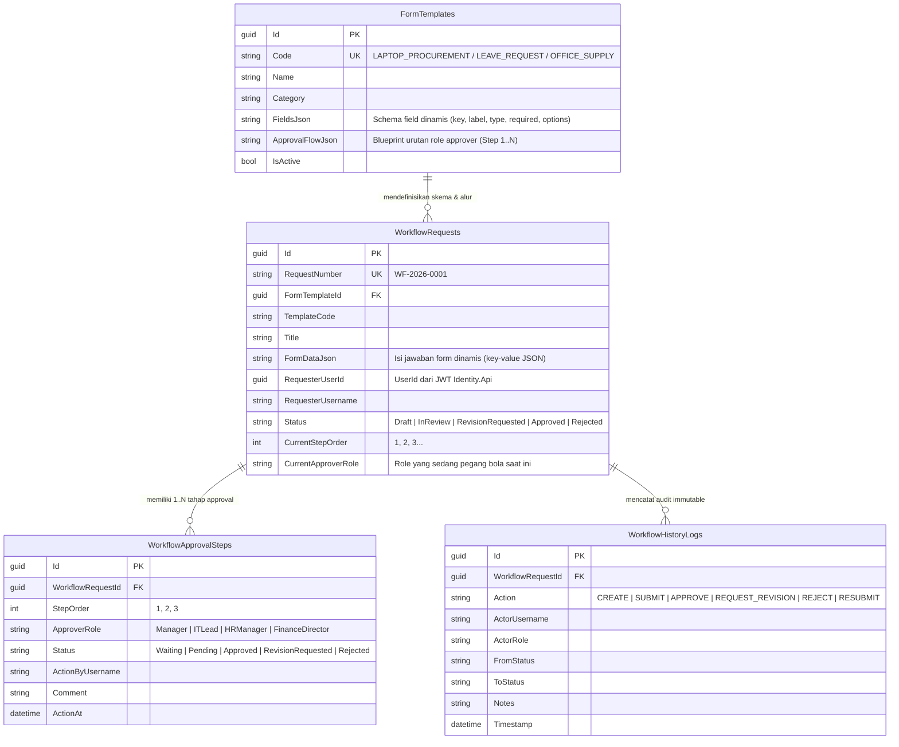
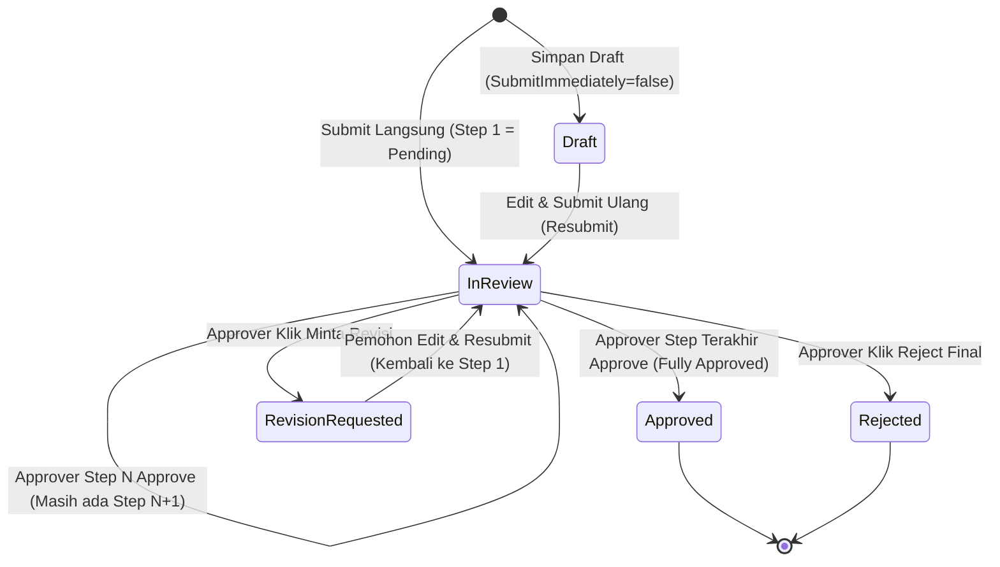
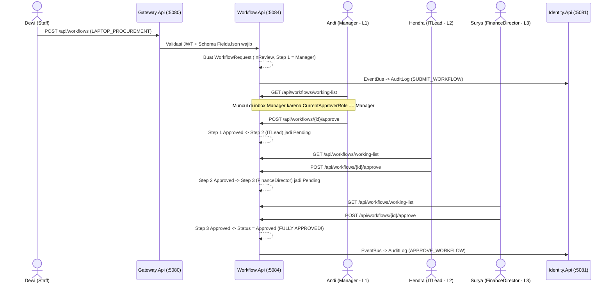

# Example 3 (Advanced): Dynamic Form Builder & Multi-Level Approval Workflow (`Workflow.Api`)

Kalau **Example 1 (`Catalog.Api`)** dan **Example 2 (`Order.Api`)** membahas CRUD standar satu tabel, maka **Example 3 (`Workflow.Api`, Port `5084`, DB: `NetStarterPack_WorkflowDb`)** adalah contoh studi kasus *real-world enterprise* yang jauh lebih kompleks:

1. **Bentuk form tidak statis (*Schema-Driven Dynamic Form*)** — jenis input (teks, angka, rupiah, tanggal, dropdown, textarea) berubah otomatis mengikuti tipe dokumen yang dipilih (`LAPTOP_PROCUREMENT`, `LEAVE_REQUEST`, `OFFICE_SUPPLY`, atau template baru buatan Admin).
2. **Alur Approval Berjenjang (*Multi-Level State Machine*)** — jumlah dan urutan approver tiap jenis dokumen berbeda-beda, misalnya:
   - **Pengadaan Laptop**: `Manager` &rarr; `ITLead` &rarr; `FinanceDirector` (3 Level)
   - **Pengajuan Cuti**: `Manager` &rarr; `HRManager` (2 Level)
   - **Pengadaan Barang Kantor**: `Manager` &rarr; `FinanceDirector` (2 Level)
3. **3 Halaman Operasional Utama**:
   - **Buat Pengajuan Form** (`/workflow-create`)
   - **Working List / Approval Inbox** (`/workflow-working-list`)
   - **Tracking Pengajuan** (`/workflow-tracking`) — lengkap dengan stepper posisi approver saat ini, log riwayat, dan tombol *Edit & Submit Ulang* saat diminta revisi.
4. **Penanganan Keamanan Berlapis (*Defense-in-Depth Security*)** — bukan cuma proteksi role di UI, tapi juga validasi skema di backend, **Anti-Self-Approval**, **Anti-Queue-Jumping** (cegah approver melompati antrean lewat Postman/Swagger), serta **Immutable History Log**.

---

## 1. Desain Database Hybrid (Relasional + JSON Schema)

Kenapa kita **tidak** membuat tabel terpisah `LaptopRequests`, `LeaveRequests`, `OfficeSupplyRequests`?
Karena kalau nanti perusahaan menambah 20 jenis form baru (misal *Klaim Dinas*, *Akses Server*, *Peminjaman Mobil*), kita harus terus-menerus bikin tabel baru, migration baru, DTO baru, dan UI baru.

Solusinya adalah **Pola Hybrid (Relational Core + JSON Schema/Payload)** di database terisolasi `NetStarterPack_WorkflowDb`:
- Data yang sering di-query, difilter, dan di-index (seperti `Status`, `CurrentApproverRole`, `RequesterUserId`, `ApprovalSteps`, dan `HistoryLogs`) disimpan sebagai **kolom & tabel relasional normal**.
- Definisi field form (`FieldsJson`) dan jawaban dinamis user (`FormDataJson`) disimpan sebagai **JSON terstruktur** yang divalidasi oleh backend terhadap skemanya.



> **Catatan Arsitektur (Database-per-Service)**:
> `Workflow.Api` **tidak boleh** melakukan SQL `JOIN` langsung ke tabel `Users` di `NetStarterPack_IdentityDb`. Karena itu, identitas pemohon (`RequesterUserId`, `RequesterUsername`, `RequesterFullName`) dan approver (`ActionByUsername`, `ActionByFullName`) diambil langsung dari klaim JWT token saat aksi terjadi dan disimpan sebagai *snapshot* di `NetStarterPack_WorkflowDb`. Kalau suatu hari nama atau jabatan user berubah, catatan sejarah dokumen lama tetap akurat!

---

## 2. Siklus Hidup Status (*State Machine*) & Alur Multi-Level Approval

### Diagram State Machine Dokumen



### Contoh Alur End-to-End: Form Pengadaan Laptop (3 Level Approval)



---

## 3. Role Organisasi & Akun Demo Realistis

Untuk membuat simulasi approval terasa seperti organisasi perusahaan sungguhan, `IdentityDatabaseSeeder` otomatis menyediakan **8 role & 8 akun demo** (password semua akun: `Password123!`).

> Jika kamu sebelumnya sudah pernah menjalankan project dan `NetStarterPack_IdentityDb` sudah ada, **tidak perlu drop database**. Method `EnsureWorkflowRolesUsersAndMenusAsync()` di `IdentityDatabaseSeeder.cs` akan otomatis menambahkan 3 role baru, 3 user baru, 4 permission `Workflows.*`, dan 3 menu sidebar secara aman saat startup!

| Username | Nama Lengkap | Role | Peran di Workflow | Menu Workflow yang Muncul |
| :--- | :--- | :--- | :--- | :--- |
| `staff` | Dewi Lestari | `Staff` | Pemohon (Requester) | Buat Pengajuan, Tracking |
| `manager` | Andi Pratama | `Manager` | Approver L1 (Semua Form) | Buat Pengajuan, Working List, Tracking |
| `itlead` | Hendra Wijaya | `ITLead` | Approver L2 Teknis (Laptop) | Buat Pengajuan, Working List, Tracking |
| `hrmanager` | Rina Kusuma | `HRManager` | Approver L2 Final (Cuti) | Buat Pengajuan, Working List, Tracking |
| `financedirector` | Surya Darmawan | `FinanceDirector` | Approver Final Budget (Laptop L3 & Kantor L2) | Buat Pengajuan, Working List, Tracking |
| `admin` | Siti Rahmawati | `Admin` | Kelola Template Form Dinamis | Semua + Tombol Buat Template Baru |
| `superadmin` | Budi Santoso | `SuperAdmin` | God-mode / Monitoring | Semua + Override Monitoring |
| `viewer` | Rizky Ramadhan | `Viewer` | Auditor (Read-Only) | Tracking Pengajuan saja |

---

## 4. Penanganan Keamanan (*Security Handling*) — 7 Lapisan Pertahanan

Sistem approval sangat rawan disalahgunakan jika validasinya hanya dipasang di Frontend (menyembunyikan tombol). Di `Workflow.Api`, seluruh aturan keamanan ditegakkan keras di Backend (`WorkflowService.cs` & `WorkflowsController.cs`):

| # | Ancaman / Celah Keamanan | Penanganan di Backend (`Workflow.Api`) | Respons jika Dilanggar |
| :--- | :--- | :--- | :--- |
| 1 | **Akses Endpoint Tanpa Hak** | Setiap endpoint diamankan `[HasPermission(Permissions.Workflows.*)]` dengan Zero-Trust JWT signature validation dari `BuildingBlocks.Security`. | `401 Unauthorized` / `403 Forbidden` |
| 2 | **Bypass Validasi Form Dinamis** (tembak API langsung pakai Postman dengan field kosong) | `ValidateDynamicFormData()` mem-parse `FormTemplate.FieldsJson` dari DB dan memverifikasi setiap field `Required == true`, tipe `number`/`currency`, dan opsi `select`. | `400 Bad Request` + daftar error spesifik per field |
| 3 | **Self-Approval** (Manager bikin pengajuan sendiri lalu meng-approve sendiri) | `ValidateApprovalAuthority()` mengecek `request.RequesterUserId == currentUser.UserId` (kecuali diblokir ketat untuk semua non-SuperAdmin). | `403 Forbidden` (*Anti-Self-Approval*) |
| 4 | **Queue-Jumping / Lompat Tahap** (FinanceDirector coba approve dokumen yang masih di Step 1 Manager) | `ValidateApprovalAuthority()` mencocokkan `currentUser.Roles` secara ketat terhadap `activeStep.ApproverRole` pada `CurrentStepOrder` saat ini. | `403 Forbidden` (*Bukan giliran role kamu*) |
| 5 | **Double-Approve / Edit Dokumen Final** | State-machine mengecek `request.Status == WorkflowStatus.InReview` untuk aksi approval dan `Draft`/`RevisionRequested` untuk resubmit. Dokumen yang sudah `Approved`/`Rejected` terkunci permanen (*immutable*). | `400 Bad Request` |
| 6 | **Edit/Resubmit Dokumen Orang Lain** | `ResubmitRequestAsync()` memverifikasi `request.RequesterUserId == currentUser.UserId` (Ownership Guard). | `403 Forbidden` |
| 7 | **Penghapusan Jejak / Audit Tampering** | Setiap transisi wajib menulis row baru ke `WorkflowHistoryLogs` (append-only) + memancarkan `AuditLogIntegrationEvent` via `IEventBus` ke `Identity.Api` untuk centralized audit stream. | Tercatat lengkap dengan Actor, Role, IP, & Timestamp |

---

## 5. Walkthrough: Cara Coba Full Lifecycle di Browser

Setelah menjalankan `Gateway.Api` (`F5` di Visual Studio) dan membuka React Frontend (`http://localhost:5173`):

1. **Login sebagai `staff` (Dewi Lestari)** dari tombol *Quick Login* di halaman Login.
2. Buka menu **Buat Pengajuan Form** (`/workflow-create`):
   - Coba klik kartu **Form Pengadaan Laptop**, lalu klik **Form Pengajuan Cuti**, lalu **Form Pengadaan Barang Kantor** — perhatikan field form dan preview alur approver di sebelah kanan berubah otomatis!
   - Pilih **Form Pengadaan Laptop**, isi judul dan semua spesifikasi, lalu klik **Submit Pengajuan Sekarang**.
3. Buka menu **Tracking Pengajuan** (`/workflow-tracking`):
   - Pengajuan kamu langsung muncul dengan stepper: `L1: Manager (AKTIF)` &rarr; `L2: ITLead (Waiting)` &rarr; `L3: FinanceDirector (Waiting)`.
4. **Logout**, lalu login sebagai **`manager` (Andi Pratama)**:
   - Buka menu **Working List (Approval)** (`/workflow-working-list`) — pengajuan tadi langsung muncul di inbox!
   - Klik **Review & Proses Approval**, tulis catatan, lalu coba:
     - **Skenario Normal**: klik **Approve Step Ini** &rarr; bola langsung berpindah ke `ITLead`.
     - **Skenario Revisi**: klik **Minta Revisi** &rarr; login balik sebagai `staff` &rarr; buka **Tracking** &rarr; klik tombol kuning **Edit & Submit Ulang**!
5. **Logout**, login sebagai **`itlead` (Hendra Wijaya)** &rarr; buka **Working List** &rarr; **Approve Step Ini** &rarr; bola pindah ke `FinanceDirector`.
6. **Logout**, login sebagai **`financedirector` (Surya Darmawan)** &rarr; buka **Working List** &rarr; **Approve Step Ini** &rarr; status dokumen berubah menjadi **Fully Approved**!
7. **Coba buat template form baru tanpa ngoding**: login sebagai **`admin`** &rarr; buka **Buat Pengajuan Form** &rarr; klik tombol **+ Buat Template Form Baru** (misal: *Form Klaim Perjalanan Dinas*) &rarr; simpan & langsung bisa dipakai mengajukan!

---

## 6. Verifikasi Otomatis via Unit Test (`xUnit`)

Semua aturan inti dan celah keamanan di atas sudah dicover oleh unit test otomatis di [`tests/NetStarterPack.Microservices.UnitTests/Services/Workflow/WorkflowServiceTests.cs`](../tests/NetStarterPack.Microservices.UnitTests/Services/Workflow/WorkflowServiceTests.cs):

- `DynamicSchemaValidation_ShouldRejectMissingRequiredFields`
- `MultiLevelApproval_FromStaffToFullyApproved_ShouldAdvance3StepsAndBlockQueueJumping` (mencakup uji `403` saat `FinanceDirector` mencoba bypass Step 1)
- `AntiSelfApproval_ShouldRejectApprovingOwnSubmissionWith403`
- `RevisionAndResubmitCycle_ShouldBlockNonOwnerEditAndReturnToStep1OnOwnerResubmit` (mencakup uji `403` edit dokumen milik orang lain serta siklus *Request Revision* &rarr; *Resubmit*)

Jalankan dari root repository:
```powershell
dotnet test --filter "FullyQualifiedName~Services.Workflow"
```
