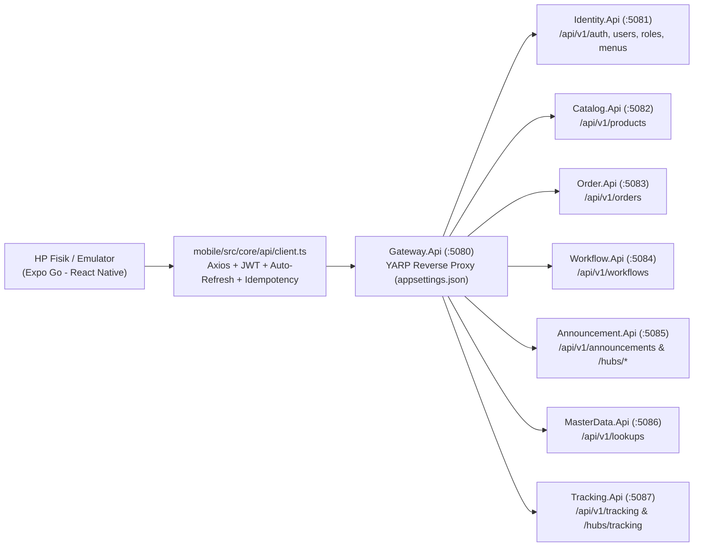
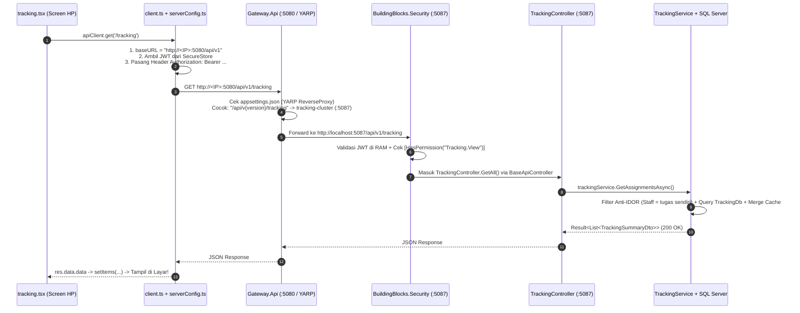

# Panduan Lengkap NetStarterPack Mobile (React Native + Expo)

Dokumen ini adalah catatan panduan dari awal sampai paham tentang isi folder **`mobile/`** — mulai dari arti folder yang pakai tanda kurung seperti `(auth)` / `(tabs)` / `(modules)`, fungsi setiap folder dan file di dalam `src/core/`, alur lengkap **bagaimana aplikasi HP menembak API lewat YARP Gateway sampai ke Controller & Database**, hingga cara menjalankan di HP fisik lewat Expo Go.

---

## 1. Gambaran Besar: 1 Pintu ke `Gateway.Api (:5080)`

Aplikasi mobile **tidak pernah** menembak langsung port microservice (`:5081` sampai `:5087`). Semua trafik HTTP REST API dan WebSocket SignalR dari HP selalu lewat satu pintu: **`Gateway.Api` (`:5080`)**.



Kenapa dibuat begini?
- Di HP kamu cukup setting **1 alamat server saja** (misal `http://192.168.43.10:5080`), tidak peduli di belakangnya nanti ada 7 atau 20 microservice.
- Kalau nanti deploy ke production (`https://api.perusahaan.com`), cukup ubah 1 URL Gateway saja, semua modul langsung ikut pindah.

---

## 2. Kenapa Ada Folder Pakai Tanda Kurung `(auth)`, `(tabs)`, `(modules)`?

Project mobile ini memakai **Expo Router** (konsepnya mirip Next.js: *file-based routing*, artinya **nama file di dalam folder `mobile/app/` otomatis menjadi halaman/route**).

Nah, di Expo Router ada 2 aturan penamaan khusus yang wajib diketahui:

### A. Folder Bertanda Kurung `(nama)` = **Route Group**
Tanda kurung `( ... )` artinya **grup pengelompokan layout**. Folder ini dipakai untuk merapikan file dan memisahkan jenis navigasi (misal: halaman login tanpa tab bar, halaman utama pakai bottom tab bar, halaman modul detail pakai stack push), **tanpa ikut masuk ke URL path** dan tanpa bikin struktur route berantakan.

Di project ini ada 3 Route Group di `mobile/app/`:
1. **`mobile/app/(auth)/`** — Halaman sebelum login (`login.tsx`). Tidak punya bottom tab bar.
2. **`mobile/app/(tabs)/`** — Halaman utama yang punya **Bottom Tab Bar** di bawah layar (`Home`, `Approval`, `Info`, `Menu`, `Profil`).
3. **`mobile/app/(modules)/`** — Halaman detail/fitur yang dibuka dari menu atau shortcut (misal `tracking.tsx`, `products.tsx`, `orders.tsx`, `users.tsx`). Dibuka sebagai layar penuh (*Stack screen*) dengan tombol **Back** di pojok kiri atas (tanpa bottom tab bar).

### B. File `_layout.tsx` = **Pembungkus Navigasi / Penjaga Rute**
Setiap folder di `mobile/app/` punya file `_layout.tsx` yang mengatur "bingkai" layar di dalam folder tersebut:
- [`mobile/app/_layout.tsx`](../mobile/app/_layout.tsx) *(Root Layout — paling luar)*:
  - Dijalankan pertama kali saat aplikasi dibuka.
  - Membungkus seluruh app dengan **React Query Persist Provider** (cache offline 24 jam) & **SafeAreaProvider**.
  - Memanggil `hydrate()` dari `authStore.ts` (baca IP server, baca token JWT dari `SecureStore`, cek status Biometrik).
  - Menjadi **Auth Guard otomatis**: kalau belum login → lempar ke `/(auth)/login`; kalau biometrik terkunci → tampilkan `BiometricLockScreen`; kalau sudah login → masuk ke `/(tabs)`.
  - Memasang `OfflineBanner` global di bagian atas layar jika internet HP putus.
- [`mobile/app/(auth)/_layout.tsx`](../mobile/app/(auth)/_layout.tsx): Stack polos tanpa header untuk layar Login.
- [`mobile/app/(tabs)/_layout.tsx`](../mobile/app/(tabs)/_layout.tsx): Mengatur **Bottom Tab Bar** (`Home`, `Approval`, `Info`, `Menu`, `Profil`), menampilkan live badge jumlah approval & pengumuman belum dibaca via SignalR, serta otomatis menyembunyikan tab `Approval` untuk role non-approver (`Staff`, `HRStaff`, `Viewer`).
- [`mobile/app/(modules)/_layout.tsx`](../mobile/app/(modules)/_layout.tsx): Stack navigator untuk semua halaman modul (seperti `tracking.tsx`, `products.tsx`, dll.) dengan warna background mengikuti tema Terang/Gelap.

---

## 3. Peta Lengkap Setiap Folder & File di `mobile/`

### A. File Konfigurasi Root (`mobile/`)
| File | Fungsinya |
| :--- | :--- |
| `mobile/package.json` | Daftar library npm (Expo, Expo Router, Axios, Zustand, TanStack React Query, SignalR, Expo Location, WebView, dll.) dan script `npm run typecheck`. |
| `mobile/app.json` | Konfigurasi aplikasi Expo (nama app, icon, plugin izin kamera/galeri/biometrik/lokasi GPS `expo-location`, serta skema routing). |
| `mobile/tsconfig.json` | Konfigurasi TypeScript, termasuk **path alias `@/*` → `./src/*`** (jadi `import ... from '@/core/api/client'` itu maksudnya `mobile/src/core/api/client.ts`). |
| `mobile/eas.json` | Profil build rilis Android/iOS via Expo Application Services (`development`, `preview` APK, `production` AAB/IPA). |
| `mobile/.env` | *(Auto-generated oleh `start-mobile-dev.ps1`, di-ignore Git)* Menyimpan `EXPO_PUBLIC_API_URL=http://<IP-LAPTOP>:5080`. |

---

### B. Folder `mobile/src/core/` (Otak & Mesin Utama Aplikasi)
Folder `core/` berisi semua pondasi teknis yang dipakai bersama oleh seluruh halaman. Tidak ada tampilan halaman di sini — isinya murni konfigurasi, HTTP client, auth, storage, tema, dan tipe data.

| Subfolder & File | Fungsi Detailnya |
| :--- | :--- |
| **`config/serverConfig.ts`** | **Penentu alamat server Gateway.** Membaca `EXPO_PUBLIC_API_URL` / host Expo Go / pilihan manual user di `AsyncStorage`. Menyediakan helper: `getGatewayUrl()` (`http://<IP>:5080`), `getApiBaseUrl()` (`http://<IP>:5080/api/v1`), `resolveMediaUrl()` (ubah `/api/v1/.../foto.jpg` jadi URL lengkap), dan `getAvatarUrl()`. |
| **`api/client.ts`** | **Jantung pemanggilan API (Axios).** Mengekspor `apiClient` yang otomatis: (1) set `baseURL`, (2) tempel header `Authorization: Bearer <JWT>`, (3) hapus `Content-Type` saat upload `FormData`, (4) pasang header `Idempotency-Key` pada `POST/PUT/PATCH`, (5) tangani error `401` lewat *Single-Flight Refresh Token Queue*, dan (6) rapikan pesan error lewat `getErrorMessage()`. |
| **`storage/secureStorage.ts`** | **Brankas token terenkripsi (`tokenStorage`).** Menyimpan `AccessToken`, `RefreshToken`, dan kredensial Biometrik menggunakan `expo-secure-store` (Android Keystore / iOS Keychain) — bukan teks biasa. |
| **`storage/queryClient.ts`** | **Konfigurasi TanStack React Query + Cache Offline.** Mengatur `staleTime` (2 menit), `gcTime` (24 jam), dan `asyncStoragePersister` agar data yang sudah dibuka tetap tampil meski HP sedang offline. |
| **`auth/authStore.ts`** | **State Management Login & RBAC (Zustand).** Menyimpan `user`, `menus`, `serverUrl`, status biometrik, serta fungsi `hydrate()`, `login()`, `loginWithBiometric()`, `logout()`, `refreshUserAndMenus()`, `hasPermission('...')`, dan `hasRole('...')`. |
| **`auth/biometric.ts`** | Pembungkus `expo-local-authentication` untuk cek apakah HP punya Sidik Jari / Face ID dan memunculkan dialog verifikasi biometrik. |
| **`hooks/useLookup.ts`** | Custom React Hook (`useLookup('PRODUCT_CATEGORY')`) untuk mengambil data dropdown referensi dari `MasterData.Api (:5086)` secara otomatis dan ter-cache. |
| **`realtime/announcementHub.ts`** | Mengelola koneksi WebSocket **SignalR** ke `${getGatewayUrl()}/hubs/announcements` lengkap dengan token JWT untuk menerima update pengumuman, like, dan komentar secara realtime. |
| **`theme/tokens.ts` & `themeStore.ts`** | Daftar palet warna Mode Terang / Mode Gelap, radius sudut, serta store pilihan tema user (`system` / `light` / `dark`) yang disimpan di `AsyncStorage`. |
| **`types/index.ts`** | Kumpulan **TypeScript Interface** yang mencerminkan DTO JSON dari semua 7 microservice (`ApiResult<T>`, `CurrentUser`, `ProductItem`, `OrderItem`, `WorkflowRequestItem`, `AnnouncementSummaryItem`, `TrackingSummaryItem`, `TrackingDetailItem`, dll.). |

---

### C. Folder `mobile/src/features/` (Komponen Khusus Per Modul)
Berisi komponen atau helper besar yang hanya dipakai oleh 1 modul tertentu supaya file di `mobile/app/` tidak terlalu panjang:
- `features/tracking/MobileLiveMap.tsx` — Peta interaktif **Leaflet + OpenStreetMap (gratis) + Esri Satellite** yang dirender di dalam `react-native-webview` lengkap dengan polyline rute, lingkaran geofence, dan marker live.
- `features/announcements/AnnouncementComposerModal.tsx` — Modal buat/edit pengumuman HR lengkap dengan upload banner & lampiran gambar/file.
- `features/workflow/DynamicFieldInput.tsx` & `workflowMeta.ts` — Renderer input form dinamis berbasis skema JSON dari `Workflow.Api` (`text`, `textarea`, `number`, `currency`, `date`, `select`) dan mapping badge status workflow.

---

### D. Folder `mobile/src/shared/` (Komponen & Utilitas Bersama)
Dipakai lintas banyak halaman:
- `shared/components/ServerUrlModal.tsx` — Modal pengaturan IP/URL Gateway + tombol **Tes Koneksi** ke `/api/health`.
- `shared/components/BiometricLockScreen.tsx` — Layar kunci Sidik Jari / Face ID saat membuka ulang aplikasi.
- `shared/components/OfflineBanner.tsx` — Banner kuning/merah otomatis di atas layar ketika jaringan HP terputus.
- `shared/components/LucideIcon.tsx` — Pemetaan nama ikon string dari database (`"MapPin"`, `"Package"`, dll.) ke ikon `lucide-react-native`.
- `shared/components/UserAvatar.tsx` — Komponen foto profil user (fallback inisial jika belum ada foto).
- `shared/utils/fileUpload.ts` — Validasi ekstensi & ukuran file sebelum upload ke server.
- `shared/utils/formatters.ts` — Helper format rupiah (`formatCurrency`) dan tanggal/jam lokal Indonesia (`formatDateTime`).

---

### E. Folder `mobile/app/` (Semua Halaman / Screen UI)
- **`(auth)/login.tsx`** — Halaman Login (React Hook Form + Zod + Quick Login Biometrik + Pengaturan Server).
- **`(tabs)/index.tsx`** — Home Dashboard (adaptif: Mesh Control untuk Admin/Tech, Workspace Operasional untuk Staff/Role Bisnis).
- **`(tabs)/approvals.tsx`** — Working List Approval (`Workflow.Api`, disembunyikan dari tab bawah jika bukan approver).
- **`(tabs)/announcements.tsx`** — Feed Pengumuman HR (`Announcement.Api`).
- **`(tabs)/menus.tsx`** — Grid semua menu dinamis dari `/api/menus/my-menus` + router ke semua layar `(modules)/`.
- **`(tabs)/profile.tsx`** — Profil user, foto profil, info struktur organisasi, ganti password, tema, biometrik, dan logout.
- **`(modules)/*.tsx`** — 13 halaman fitur lengkap:
  `tracking.tsx`, `products.tsx`, `orders.tsx`, `workflow-create.tsx`, `workflow-tracking.tsx`, `announcement-detail.tsx`, `lookups.tsx`, `users.tsx`, `roles.tsx`, `organization.tsx`, `menus-list.tsx`, `reports.tsx`, `audit-logs.tsx`.

---

## 4. Bedah Alur Request End-to-End (Baris per Baris!)

Biar benar-benar paham gimana 1 tombol di HP bisa sampai ke SQL Server di microservice yang tepat, kita ikuti perjalanan **`GET /tracking`** saat kamu buka menu **Live Tracking**:



### Trace Kode Nyatanya:
1. **Di Screen Mobile** ([`mobile/app/(modules)/tracking.tsx`](../mobile/app/(modules)/tracking.tsx)):
   ```ts
   // Screen cukup tulis endpoint relatifnya saja — tidak perlu tahu IP atau port 5087!
   const res = await apiClient.get<ApiResult<TrackingSummaryItem[]>>('/tracking');
   ```
2. **Di Request Interceptor** ([`mobile/src/core/api/client.ts`](../mobile/src/core/api/client.ts)):
   - `config.baseURL = getApiBaseUrl()` → otomatis jadi `http://<IP-LAPTOP>:5080/api/v1`.
   - `config.headers.Authorization = 'Bearer <JWT>'` → ditempel otomatis dari `SecureStore`.
   - Hasil akhir URL yang dikirim HP: **`GET http://<IP-LAPTOP>:5080/api/v1/tracking`**.
3. **Di YARP Gateway** ([`src/ApiGateway/Gateway.Api/appsettings.json`](../src/ApiGateway/Gateway.Api/appsettings.json)):
   - Bagian `ReverseProxy.Routes` mencocokkan path `"/api/v{version}/tracking"` ke `ClusterId: "tracking-cluster"`.
   - Bagian `ReverseProxy.Clusters` memetakan `"tracking-cluster"` ke `"http://localhost:5087"`.
   - YARP meneruskan request (beserta header JWT & body utuh) ke **`http://localhost:5087/api/v1/tracking`**.
4. **Di Microservice Tujuan** ([`BaseApiController.cs`](../src/BuildingBlocks/BuildingBlocks.Infrastructure/Controllers/BaseApiController.cs) & [`TrackingController.cs`](../src/Services/Tracking/Tracking.Api/Controllers/TrackingController.cs)):
   - `BaseApiController` punya `[Route("api/v{version:apiVersion}/[controller]")]`.
   - Nama class `TrackingController` tanpa kata `Controller` menjadi `tracking` → cocok persis dengan `/api/v1/tracking`!
   - Method `[HttpGet]` (`GetAll`) dengan `[HasPermission(Permissions.Tracking.View)]` dijalankan → memanggil `TrackingService` → baca SQL Server `NetStarterPack_TrackingDb` → kembalikan JSON `Result<T>`.

### 3 Mekanisme Otomatis Lainnya di `client.ts`
- **Auto-Refresh Token (`401`)**: Kalau JWT expired (15 menit), response interceptor di `client.ts` otomatis menahan request lain di antrean (*Single-Flight Queue*), memanggil `POST /api/v1/auth/refresh` **1 kali saja**, menyimpan token baru ke `SecureStore`, lalu mengulang request yang gagal tadi secara transparan.
- **Upload Foto (`FormData`)**: Contohnya ada di `handlePickPodPhoto()` di [`tracking.tsx`](../mobile/app/(modules)/tracking.tsx) (`POST /tracking/upload-pod`). Saat `client.ts` mendeteksi `data instanceof FormData`, header `Content-Type: application/json` otomatis dihapus supaya React Native memasang `multipart/form-data; boundary=...` yang benar.
- **Anti Double-Submit (`Idempotency-Key`)**: Untuk setiap `POST/PUT/PATCH` (selain login/upload), `client.ts` otomatis memasang header `Idempotency-Key` unik yang dijaga oleh `IdempotencyMiddleware` di backend supaya tap 2x di jaringan lemot tidak membuat data dobel.

---

## 5. Ringkasan Modul yang Sudah Tersedia (7 Microservice)

1. **Auth, Biometrik, & Server URL Switcher (`Identity.Api :5081`)** — Login Zod, Biometric App Lock & Quick Login, pengaturan URL Gateway + tombol Tes Koneksi (`/api/health`).
2. **Role-Adaptive Dashboard & Live Cluster Monitor** — Admin/Tech melihat topologi 7 Microservice + 7 Isolated DB; Staff & role bisnis melihat Workspace Operasional ringkas + shortcut tugas.
3. **Catalog / Products CRUD (`Catalog.Api :5082`)** — Search, filter kategori dinamis, Tambah/Edit/Soft-Delete produk.
4. **Orders CRUD (`Order.Api :5083`)** — Stats pesanan, quick-pick produk, kalkulasi total otomatis, Tambah/Edit/Hapus.
5. **Workflow Dynamic Form & Approval (`Workflow.Api :5084`)** — Working List Approval, Buat Pengajuan dinamis dari skema JSON, Tracking Pengajuan + Vertical Stepper + Revisi.
6. **HR Newsroom & Live SignalR (`Announcement.Api :5085`)** — Feed pengumuman, Composer HR (upload banner/foto), Like, & komentar berjenjang realtime via SignalR.
7. **Master Data / Unified Lookups (`MasterData.Api :5086`)** — Pengelolaan tabel lookup bersama & reusable hook `useLookup`.
8. **Field Dispatch & Live Location Tracking (`Tracking.Api :5087`)** — Peta Leaflet OSM/Satelit (`MobileLiveMap`), Live GPS Asli (`expo-location`), 3 mode simulasi (Normal, Luar Geofence, Test Fake GPS), Upload & Detail POD lengkap + Fullscreen Photo Viewer, serta Verifikasi Manager.

---

## 6. Cara Menjalankan di HP Fisik (Android / iOS dengan Expo Go)

1. Install aplikasi gratis **Expo Go** di HP (Play Store / App Store).
2. Pastikan laptop dan HP ada di jaringan yang sama (Wi-Fi lokal atau **Hotspot HP**).
3. Jalankan di root project:
   ```powershell
   .\start-mobile-dev.ps1
   ```
   *(Atau klik 2x `run-mobile.bat`.)*
4. Script otomatis membaca IPv4 LAN laptop, menulis `mobile/.env`, menyalakan seluruh backend + `Gateway.Api` di `http://0.0.0.0:5080`, dan memunculkan **QR Code** Expo.
5. Scan QR Code dari **Expo Go**.

### Troubleshooting Singkat Windows & Jaringan
- **Firewall Windows memblokir port `5080` / `8081`** (umum saat profil Wi-Fi = `Public`): buka PowerShell **Run as Administrator** sekali saja:
  ```powershell
  New-NetFirewallRule -DisplayName "NetStarterPack Gateway 5080" -Direction Inbound -Protocol TCP -LocalPort 5080 -Action Allow
  New-NetFirewallRule -DisplayName "Expo Metro 8081" -Direction Inbound -Protocol TCP -LocalPort 8081 -Action Allow
  ```
- **Error `NoRouteToHostException` / HP tidak bisa buka `http://<IP>:5080/api/health` padahal Firewall sudah dibuka**: biasanya router Wi-Fi (kosan/kantor/publik) mengaktifkan fitur **AP/Client Isolation** yang memblokir komunikasi antar-device. Solusi paling cepat & stabil tanpa tunnel: nyalakan **Hotspot HP**, sambungkan laptop ke hotspot tersebut, lalu jalankan ulang `.\start-mobile-dev.ps1`.

---

## 7. Menambah Layar Modul Baru & Build Rilis (EAS)

1. Buat file baru di `mobile/app/(modules)/<nama-modul>.tsx` dan panggil API lewat `apiClient` dari `@/core/api/client`.
2. Daftarkan pemetaan path-nya di [`mobile/app/(tabs)/menus.tsx`](../mobile/app/(tabs)/menus.tsx) (`handlePressMenu`).
3. Cek error TypeScript sebelum commit:
   ```powershell
   cd mobile
   npx tsc --noEmit
   ```
4. Build APK / AAB / IPA terpisah memakai `mobile/eas.json` (`eas build --profile preview`).
