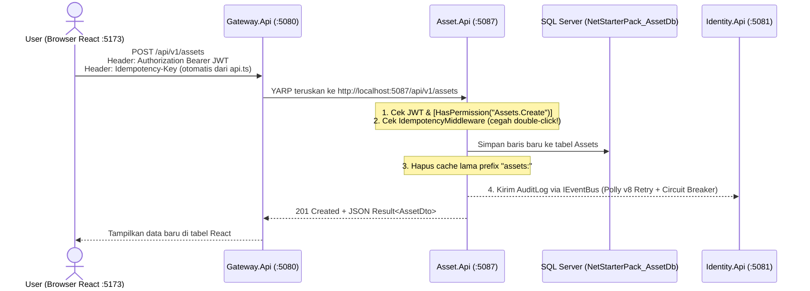

# Tutorial Pemula (Dari Nol Sampai Jalan): Cara Bikin Fitur & Microservice Baru di NetStarterPack

Halo! Kalau kamu mahasiswa, junior developer, atau baru pertama kali pegang project berarsitektur **Microservices + Compact Onion + YARP Gateway + React**, panduan ini memang ditulis khusus buat kamu.

Di sini kita **tidak cuma kasih potongan kode**, tapi juga jelasin:
- **File apa saja** yang harus dibuat & diedit (urutan persis dari awal sampai akhir).
- **Kenapa** file itu ditaruh di folder tersebut (biar paham polanya, bukan cuma copy-paste).
- **Cara ngetesnya** lewat Swagger, Web React, dan Unit Test.
- **Daftar error yang paling sering kejadian** saat pemula bikin fitur baru beserta cara cepat membenahinya.

> **Catatan bedanya dengan [`docs/07_CUSTOMIZATION_GUIDE.md`](07_CUSTOMIZATION_GUIDE.md)**:
> File `07_CUSTOMIZATION_GUIDE.md` sifatnya referensi cepat untuk developer yang sudah akrab dengan codebase ini. Sedangkan file ini (**`14_BEGINNER_TUTORIAL_BUILD_FEATURE.md`**) ditulis lebih pelan, lebih rinci, dan sudah memasukkan semua fitur terbaru di repo ini (**API Versioning `/api/v1`**, **`[Idempotent]`**, **Polly v8 Resilience**, dan integrasi dropdown **Master Lookups `MasterData.Api`**).

---

## 0. Pahami Dulu Peta Besar Project Ini (Pakai Analogi Kantor)

Sebelum bikin file pertama, bayangkan arsitektur project ini seperti **sebuah gedung kantor**:

| Bagian di Project | Analogi di Gedung Kantor | Tugas Utamanya |
| :--- | :--- | :--- |
| **`frontend/` (`:5173`) & `mobile/`** | **Pengunjung / Karyawan** | Tampilan Web React / HP yang dipakai user. Pengunjung nggak perlu tahu ruang divisi mana di lantai berapa. |
| **`Gateway.Api` (`:5080`)** | **Resepsionis Lobi Depan** | Satu-satunya pintu masuk. Begitu ada request `/api/v1/assets`, resepsionis (YARP) langsung meneruskan ke divisi yang tepat. |
| **`Identity.Api` (`:5081`)** | **Satpam & HRD** | Mengurus Login, bikin token JWT (seperti ID Card), mengatur Role/Permission, daftar Menu Sidebar, dan buku catatan Audit Log. |
| **`MasterData.Api` (`:5086`)** | **Buku Kamus Dropdown Bersama** | Menyimpan daftar pilihan umum (Kategori Produk, Satuan, Metode Bayar, Kategori Aset, dll.) dalam 1 tabel supaya kita nggak bikin banyak tabel master kecil-kecil. |
| **`BuildingBlocks/`** | **Kotak Perkakas Bersama** | Peralatan standar yang bisa dipakai ulang semua divisi: Validasi JWT, Hybrid Cache L1/L2, Anti Double-Submit (`[Idempotent]`), Polly v8 Retry/Circuit Breaker, API Versioning `/api/v1`, dan `GenericRepository`. |
| **`Asset.Api` (`:5087`) *(Yang Akan Kita Buat!)*** | **Divisi Baru: Manajemen Aset Kantor** | Service mandiri dengan databasenya sendiri (`NetStarterPack_AssetDb`) untuk mencatat laptop, proyektor, monitor, dll. |

### Alur 1 Klik Tombol "Simpan Aset" (Biar Kebayang!)



---

## 1. Studi Kasus Kita: Microservice `Asset.Api` (Manajemen Aset Kantor)

Kenapa kita pakai studi kasus **Manajemen Aset Kantor (`Asset.Api` di Port `5087`)**?
Karena gampang dibayangkan semua orang, tapi cukup lengkap untuk langsung mempraktikkan **seluruh kebiasaan standar** di project ini:

- **Tabel**: `Assets` di database terpisah `NetStarterPack_AssetDb`
- **Kolom**:
  - `AssetCode` (unik, misal `AST-LPT-001`)
  - `Name` (misal `MacBook Pro 14" M3`)
  - `Category` (diambil dari dropdown **`MasterData.Api`** grup `ASSET_CATEGORY`!)
  - `Condition` (`Good`, `NeedsRepair`, `Damaged`)
  - `AssignedTo` (nama karyawan pemegang aset, boleh kosong)
  - `PurchasePrice` (harga beli)
  - `PurchaseDate` (tanggal beli)
  - Plus kolom bawaan dari `BaseEntity`: `Id`, `CreatedAt`, `CreatedBy`, `UpdatedAt`, `UpdatedBy`, `IsDeleted` (otomatis!).

### Peta Lengkap File yang Akan Kamu Sentuh

Simpan tabel ini sebagai checklist kerja kamu:

| Tahap | Project | Path File | Aksi | Fungsi Singkat |
| :---: | :--- | :--- | :---: | :--- |
| **1** | `BuildingBlocks.Core` | `src/BuildingBlocks/BuildingBlocks.Core/Constants/Permissions.cs` | Edit | Tambah permission `Assets.View/Create/Edit/Delete` |
| **1** | `BuildingBlocks.Core` | `src/BuildingBlocks/BuildingBlocks.Core/Constants/CacheKeys.cs` | Edit | Tambah prefix cache `assets:` |
| **1** | `BuildingBlocks.Infrastructure` | `src/BuildingBlocks/BuildingBlocks.Infrastructure/Messaging/HttpEventBus.cs` | Edit | Tambah `AssetServiceUrl` |
| **2** | `Asset.Api` | `src/Services/Asset/Asset.Api/Asset.Api.csproj` | **Buat** | File project `.NET 10` |
| **3** | `Asset.Api` *(Domain)* | `src/Services/Asset/Asset.Api/Domain/Entities/AssetItem.cs` | **Buat** | Bentuk tabel `Assets` & enum `AssetCondition` |
| **3** | `Asset.Api` *(Domain)* | `src/Services/Asset/Asset.Api/Domain/Interfaces/IAssetUnitOfWork.cs` | **Buat** | Kontrak transaksi database |
| **4** | `Asset.Api` *(Application)* | `src/Services/Asset/Asset.Api/Application/DTOs/AssetDtos.cs` | **Buat** | Bentuk JSON Request & Response |
| **4** | `Asset.Api` *(Application)* | `src/Services/Asset/Asset.Api/Application/Interfaces/IAssetService.cs` | **Buat** | Kontrak method bisnis |
| **4** | `Asset.Api` *(Application)* | `src/Services/Asset/Asset.Api/Application/Services/AssetService.cs` | **Buat** | Otak bisnis (CRUD, validasi, cache, audit) |
| **5** | `Asset.Api` *(Infrastructure)* | `src/Services/Asset/Asset.Api/Infrastructure/Persistence/AssetPersistence.cs` | **Buat** | `DbContext`, `UnitOfWork`, & `Seeder` data awal |
| **5** | `Asset.Api` | `src/Services/Asset/Asset.Api/appsettings.json` | **Buat** | Port `5087`, koneksi DB, JWT, Cache |
| **5** | `Asset.Api` | `src/Services/Asset/Asset.Api/Program.cs` | **Buat** | Merangkai semua service & pipeline bersama |
| **6** | `Asset.Api` *(Controllers)* | `src/Services/Asset/Asset.Api/Controllers/AssetsController.cs` | **Buat** | Endpoint `/api/v1/assets` + `[HasPermission]` + `[Idempotent]` |
| **7** | `Gateway.Api` | `src/ApiGateway/Gateway.Api/appsettings.json`, `.csproj`, `Program.cs` | Edit | Routing YARP, Swagger gabungan, Health Check, F5 Orchestrator |
| **7** | `Identity.Api` | `src/Services/Identity/Identity.Api/Infrastructure/Persistence/IdentityDatabaseSeeder.cs` | Edit | Permission default + Menu Sidebar `/assets` |
| **9** | `frontend/` | `types/index.ts`, `pages/assets/AssetsPage.tsx`, `App.tsx` | **Buat**/Edit | Tampilan UI React + integrasi `useLookup` |
| **10** | `UnitTests` | `tests/.../Services/Asset/AssetServiceTests.cs` | **Buat** | Unit test otomatis pakai xUnit |

---

## Tahap 0: Persiapan Awal (Wajib Dilakukan Sebelum Ngoding)

1. Pastikan repo ini sudah bisa jalan normal di komputermu (tekan `F5` di Visual Studio, atau jalankan `.\start-dev.ps1`).
2. Biasakan **selalu bikin branch baru** sebelum bikin fitur, jangan langsung ngoding di `main`:
   ```powershell
   git checkout main
   git pull origin main
   git checkout -b feature/asset-service
   ```

---

## Tahap 1: Daftarkan Konstanta Bersama di `BuildingBlocks`

Kenapa kita mulai dari `BuildingBlocks.Core` dulu?
Karena **Permission** dan **Cache Key** perlu dikenali bareng-bareng oleh lebih dari 1 service (`Identity.Api` butuh tahu kode `Assets.Create` untuk ditampilkan di halaman Role, sementara `Asset.Api` butuh kode yang sama untuk dipasang di Controller).

> **Aturan keras di repo ini**: `BuildingBlocks.Core` **tidak boleh** dipasang NuGet package eksternal apa pun. Isinya murni C# standar.

### 1.1. Tambah Permission di `src/BuildingBlocks/BuildingBlocks.Core/Constants/Permissions.cs`

Tambahkan class `Assets` di dalam `Permissions`:
```csharp
public static class Assets
{
    public const string View = "Assets.View";
    public const string Create = "Assets.Create";
    public const string Edit = "Assets.Edit";
    public const string Delete = "Assets.Delete";
}
```

Lalu daftarkan keempatnya di dalam method `Permissions.GetAll()` pada file yang sama supaya muncul di UI Manajemen Role:
```csharp
new(Assets.View, "Lihat Aset Kantor", "Assets", "Melihat daftar dan detail aset kantor (Asset Microservice)"),
new(Assets.Create, "Tambah Aset Kantor", "Assets", "Menambahkan data aset kantor baru (Asset Microservice)"),
new(Assets.Edit, "Ubah Aset Kantor", "Assets", "Mengubah kondisi, PIC, dan detail aset kantor (Asset Microservice)"),
new(Assets.Delete, "Hapus Aset Kantor", "Assets", "Menghapus (soft-delete) data aset kantor (Asset Microservice)"),
```

### 1.2. Tambah Cache Keys di `src/BuildingBlocks/BuildingBlocks.Core/Constants/CacheKeys.cs`

Tambahkan konstanta prefix dan helper pembentukan key:
```csharp
public const string AssetsPrefix = "assets:";

public static string AssetList(string? search, string? category) =>
    $"{AssetsPrefix}list:s={search?.Trim().ToLowerInvariant() ?? "all"}:c={category?.Trim().ToLowerInvariant() ?? "all"}";

public static string AssetById(Guid id) =>
    $"{AssetsPrefix}id:{id}";
```
**Kenapa pakai prefix `assets:`?**
Supaya begitu ada 1 aset yang ditambah/diedit/dihapus, kita cukup panggil 1 baris `RemoveByPrefixAsync(CacheKeys.AssetsPrefix)` dan seluruh cache daftar/detail aset langsung dibersihkan otomatis!

### 1.3. Tambah Alamat Service di `src/BuildingBlocks/BuildingBlocks.Infrastructure/Messaging/HttpEventBus.cs`

Di dalam class `ServiceEndpointsSettings`, tambahkan 1 baris:
```csharp
public string AssetServiceUrl { get; set; } = "http://localhost:5087";
```

---

## Tahap 2: Buat Project Microservice `Asset.Api` (`Port 5087`)

Sekarang kita bikin rumah baru untuk microservice kita di folder `src/Services/Asset/Asset.Api/`.

### 2.1. Buat file `src/Services/Asset/Asset.Api/Asset.Api.csproj`

```xml
<Project Sdk="Microsoft.NET.Sdk.Web">

  <PropertyGroup>
    <TargetFramework>net10.0</TargetFramework>
    <Nullable>enable</Nullable>
    <ImplicitUsings>enable</ImplicitUsings>
    <GenerateDocumentationFile>true</GenerateDocumentationFile>
    <NoWarn>$(NoWarn);1591</NoWarn>
  </PropertyGroup>

  <ItemGroup>
    <ProjectReference Include="..\..\..\BuildingBlocks\BuildingBlocks.Core\BuildingBlocks.Core.csproj" />
    <ProjectReference Include="..\..\..\BuildingBlocks\BuildingBlocks.Security\BuildingBlocks.Security.csproj" />
    <ProjectReference Include="..\..\..\BuildingBlocks\BuildingBlocks.Infrastructure\BuildingBlocks.Infrastructure.csproj" />
  </ItemGroup>

  <ItemGroup>
    <PackageReference Include="Microsoft.EntityFrameworkCore" Version="10.0.*" />
    <PackageReference Include="Microsoft.EntityFrameworkCore.InMemory" Version="10.0.*" />
    <PackageReference Include="Microsoft.EntityFrameworkCore.Sqlite" Version="10.0.*" />
    <PackageReference Include="Microsoft.EntityFrameworkCore.SqlServer" Version="10.0.*" />
  </ItemGroup>

</Project>
```

### 2.2. Daftarkan Project ke Solution (`.sln`)

Daripada pusing edit file `.sln` manual, cukup jalankan 1 perintah ini di terminal dari folder root repo:
```powershell
dotnet sln NetStarterPack.Microservices.sln add src\Services\Asset\Asset.Api\Asset.Api.csproj --solution-folder src\Services
```
Selesai! Visual Studio sekarang otomatis mengenali `Asset.Api` di dalam folder `src/Services`.

### 2.3. Pahami 4 Folder "Compact Onion" di Dalam `Asset.Api`

Di setiap microservice project ini, kita selalu bikin tepat **4 folder** ini (jangan dicampur-campur):
1. **`Domain/`** → Isi paling dalam: bentuk entitas tabel (`AssetItem`) dan kontrak penyimpanan (`IAssetUnitOfWork`). Tidak boleh kenal HTTP, Controller, atau SQL Server.
2. **`Application/`** → Otak bisnis: DTO, validasi, caching, logika create/update/delete, dan kirim event audit.
3. **`Infrastructure/`** → Urusan teknis luar: `AssetDbContext` (EF Core / SQL Server), implementasi `UnitOfWork`, dan `Seeder` data contoh.
4. **`Controllers/`** → Pintu masuk HTTP tipis: menerima request, cek `[HasPermission]` & `[Idempotent]`, lalu lempar ke `Application Service`.

---

## Tahap 3: Bangun Layer `Domain/`

### 3.1. Buat Entity `src/Services/Asset/Asset.Api/Domain/Entities/AssetItem.cs`

```csharp
using BuildingBlocks.Core.Common;

namespace Asset.Api.Domain.Entities;

public enum AssetCondition
{
    Good = 0,
    NeedsRepair = 1,
    Damaged = 2
}

/// <summary>
/// Entitas utama untuk tabel Assets di database NetStarterPack_AssetDb.
/// Karena mewarisi BaseEntity, kita otomatis dapat: Id, CreatedAt, CreatedBy, UpdatedAt, UpdatedBy, dan IsDeleted.
/// </summary>
public class AssetItem : BaseEntity
{
    public string AssetCode { get; set; } = string.Empty;
    public string Name { get; set; } = string.Empty;
    public string Category { get; set; } = string.Empty;
    public AssetCondition Condition { get; set; } = AssetCondition.Good;
    public string? AssignedTo { get; set; }
    public decimal PurchasePrice { get; set; }
    public DateTime PurchaseDate { get; set; } = DateTime.UtcNow;
    public string? Notes { get; set; }
}
```

> **Kenapa `Category` bertipe `string`, bukan Foreign Key `Guid` ke `MasterData.Api`?**
> Ingat aturan **Database-per-Service**: tabel di `NetStarterPack_AssetDb` **tidak boleh** punya SQL Foreign Key ke tabel di `NetStarterPack_MasterDataDb`. Kita cukup simpan nama/kode kategorinya, sementara pilihan dropdown-nya diambil dari `MasterData.Api`.

### 3.2. Buat Kontrak Unit of Work `src/Services/Asset/Asset.Api/Domain/Interfaces/IAssetUnitOfWork.cs`

```csharp
using Asset.Api.Domain.Entities;
using BuildingBlocks.Core.Interfaces;

namespace Asset.Api.Domain.Interfaces;

public interface IAssetUnitOfWork
{
    IRepository<AssetItem> Assets { get; }
    Task<int> SaveChangesAsync(CancellationToken cancellationToken = default);
}
```

---

## Tahap 4: Bangun Layer `Application/`

### 4.1. Buat DTO `src/Services/Asset/Asset.Api/Application/DTOs/AssetDtos.cs`

**Kenapa harus bikin DTO (`record`) dan tidak langsung return `AssetItem`?**
Karena struktur database suatu saat bisa berubah (atau punya kolom internal seperti `IsDeleted` / `PasswordHash`). DTO menjaga agar kontrak JSON yang dikirim ke Frontend/Mobile tetap bersih dan aman.

```csharp
namespace Asset.Api.Application.DTOs;

public record AssetDto(
    Guid Id,
    string AssetCode,
    string Name,
    string Category,
    string Condition,
    string? AssignedTo,
    decimal PurchasePrice,
    DateTime PurchaseDate,
    string? Notes,
    DateTime CreatedAt,
    string? CreatedBy);

public record CreateOrUpdateAssetRequest(
    string AssetCode,
    string Name,
    string Category,
    string Condition,
    string? AssignedTo,
    decimal PurchasePrice,
    DateTime PurchaseDate,
    string? Notes);
```

### 4.2. Buat Interface Service `src/Services/Asset/Asset.Api/Application/Interfaces/IAssetService.cs`

```csharp
using Asset.Api.Application.DTOs;
using BuildingBlocks.Core.Common;

namespace Asset.Api.Application.Interfaces;

public interface IAssetService
{
    Task<Result<List<AssetDto>>> GetAllAsync(string? search = null, string? category = null, CancellationToken cancellationToken = default);
    Task<Result<AssetDto>> GetByIdAsync(Guid id, CancellationToken cancellationToken = default);
    Task<Result<AssetDto>> CreateAsync(CreateOrUpdateAssetRequest request, CancellationToken cancellationToken = default);
    Task<Result<AssetDto>> UpdateAsync(Guid id, CreateOrUpdateAssetRequest request, CancellationToken cancellationToken = default);
    Task<Result> DeleteAsync(Guid id, CancellationToken cancellationToken = default);
}
```

### 4.3. Buat Implementasi Service `src/Services/Asset/Asset.Api/Application/Services/AssetService.cs`

Perhatikan bagaimana kita memakai **4 perkakas dari `BuildingBlocks`** di sini: `unitOfWork`, `cacheService`, `currentUser`, dan `eventBus`:

```csharp
using Asset.Api.Application.DTOs;
using Asset.Api.Application.Interfaces;
using Asset.Api.Domain.Entities;
using Asset.Api.Domain.Interfaces;
using BuildingBlocks.Core.Common;
using BuildingBlocks.Core.Constants;
using BuildingBlocks.Core.Contracts;
using BuildingBlocks.Core.Interfaces;
using Microsoft.EntityFrameworkCore;

namespace Asset.Api.Application.Services;

public class AssetService(
    IAssetUnitOfWork unitOfWork,
    ICacheService cacheService,
    ICurrentUserService currentUser,
    IEventBus eventBus) : IAssetService
{
    public async Task<Result<List<AssetDto>>> GetAllAsync(
        string? search = null,
        string? category = null,
        CancellationToken cancellationToken = default)
    {
        // Pola Cache-Aside: cek RAM L1 / Redis L2 dulu, kalau kosong baru query SQL Server
        var cacheKey = CacheKeys.AssetList(search, category);
        var items = await cacheService.GetOrCreateAsync(
            cacheKey,
            async ct =>
            {
                var query = unitOfWork.Assets.Query(asNoTracking: true);

                if (!string.IsNullOrWhiteSpace(category))
                {
                    var cat = category.Trim().ToLowerInvariant();
                    query = query.Where(x => x.Category.ToLower() == cat);
                }

                if (!string.IsNullOrWhiteSpace(search))
                {
                    var term = search.Trim().ToLowerInvariant();
                    query = query.Where(x =>
                        x.AssetCode.ToLower().Contains(term) ||
                        x.Name.ToLower().Contains(term) ||
                        (x.AssignedTo != null && x.AssignedTo.ToLower().Contains(term)));
                }

                var list = await query
                    .OrderByDescending(x => x.CreatedAt)
                    .ToListAsync(ct);

                return list.Select(MapToDto).ToList();
            },
            TimeSpan.FromMinutes(10),
            cancellationToken);

        return Result<List<AssetDto>>.Success(items);
    }

    public async Task<Result<AssetDto>> GetByIdAsync(Guid id, CancellationToken cancellationToken = default)
    {
        var dto = await cacheService.GetOrCreateAsync(
            CacheKeys.AssetById(id),
            async ct =>
            {
                var item = await unitOfWork.Assets.GetByIdAsync(id, ct);
                return item is null ? null : MapToDto(item);
            },
            TimeSpan.FromMinutes(10),
            cancellationToken);

        return dto is null
            ? Result<AssetDto>.Failure("Data aset tidak ditemukan.", 404)
            : Result<AssetDto>.Success(dto);
    }

    public async Task<Result<AssetDto>> CreateAsync(CreateOrUpdateAssetRequest request, CancellationToken cancellationToken = default)
    {
        // 1. Validasi input dasar
        if (string.IsNullOrWhiteSpace(request.AssetCode) || string.IsNullOrWhiteSpace(request.Name))
        {
            return Result<AssetDto>.Failure("Kode Aset dan Nama Aset wajib diisi.", 400);
        }

        if (request.PurchasePrice < 0)
        {
            return Result<AssetDto>.Failure("Harga beli tidak boleh negatif.", 400);
        }

        var normalizedCode = request.AssetCode.Trim().ToUpperInvariant();
        var exists = await unitOfWork.Assets.AnyAsync(x => x.AssetCode == normalizedCode, cancellationToken);
        if (exists)
        {
            return Result<AssetDto>.Failure($"Kode Aset '{normalizedCode}' sudah terdaftar.", 409);
        }

        if (!Enum.TryParse<AssetCondition>(request.Condition, ignoreCase: true, out var condition))
        {
            condition = AssetCondition.Good;
        }

        // 2. Simpan ke DB lokal AssetDb
        var entity = new AssetItem
        {
            AssetCode = normalizedCode,
            Name = request.Name.Trim(),
            Category = string.IsNullOrWhiteSpace(request.Category) ? "General" : request.Category.Trim(),
            Condition = condition,
            AssignedTo = string.IsNullOrWhiteSpace(request.AssignedTo) ? null : request.AssignedTo.Trim(),
            PurchasePrice = request.PurchasePrice,
            PurchaseDate = request.PurchaseDate == default ? DateTime.UtcNow : request.PurchaseDate,
            Notes = string.IsNullOrWhiteSpace(request.Notes) ? null : request.Notes.Trim(),
            CreatedBy = currentUser.Username ?? "system"
        };

        await unitOfWork.Assets.AddAsync(entity, cancellationToken);
        await unitOfWork.SaveChangesAsync(cancellationToken);

        // 3. Bersihkan cache supaya data baru langsung muncul
        await cacheService.RemoveByPrefixAsync(CacheKeys.AssetsPrefix, cancellationToken);

        // 4. Kirim Audit Log ke Identity.Api (otomatis tahan banting pakai Polly v8 Retry + Circuit Breaker!)
        await eventBus.PublishAuditAsync(new AuditLogIntegrationEvent(
            UserId: currentUser.UserId,
            UserName: currentUser.Username ?? "system",
            Action: "CREATE_ASSET",
            Module: "Assets",
            EntityId: entity.Id.ToString(),
            Details: $"Menambahkan aset {entity.AssetCode} — {entity.Name} ({entity.Category})",
            IpAddress: currentUser.IpAddress,
            SourceService: "Asset.Api",
            Timestamp: DateTime.UtcNow), cancellationToken);

        return Result<AssetDto>.Success(MapToDto(entity), "Aset berhasil ditambahkan.", 201);
    }

    public async Task<Result<AssetDto>> UpdateAsync(Guid id, CreateOrUpdateAssetRequest request, CancellationToken cancellationToken = default)
    {
        var entity = await unitOfWork.Assets.GetByIdAsync(id, cancellationToken);
        if (entity is null)
        {
            return Result<AssetDto>.Failure("Data aset tidak ditemukan.", 404);
        }

        var normalizedCode = request.AssetCode.Trim().ToUpperInvariant();
        var duplicate = await unitOfWork.Assets.AnyAsync(
            x => x.Id != id && x.AssetCode == normalizedCode,
            cancellationToken);
        if (duplicate)
        {
            return Result<AssetDto>.Failure($"Kode Aset '{normalizedCode}' sudah dipakai aset lain.", 409);
        }

        if (!Enum.TryParse<AssetCondition>(request.Condition, ignoreCase: true, out var condition))
        {
            condition = entity.Condition;
        }

        entity.AssetCode = normalizedCode;
        entity.Name = request.Name.Trim();
        entity.Category = string.IsNullOrWhiteSpace(request.Category) ? entity.Category : request.Category.Trim();
        entity.Condition = condition;
        entity.AssignedTo = string.IsNullOrWhiteSpace(request.AssignedTo) ? null : request.AssignedTo.Trim();
        entity.PurchasePrice = request.PurchasePrice;
        entity.PurchaseDate = request.PurchaseDate == default ? entity.PurchaseDate : request.PurchaseDate;
        entity.Notes = string.IsNullOrWhiteSpace(request.Notes) ? null : request.Notes.Trim();
        entity.UpdatedAt = DateTime.UtcNow;
        entity.UpdatedBy = currentUser.Username ?? "system";

        unitOfWork.Assets.Update(entity);
        await unitOfWork.SaveChangesAsync(cancellationToken);

        await cacheService.RemoveByPrefixAsync(CacheKeys.AssetsPrefix, cancellationToken);

        await eventBus.PublishAuditAsync(new AuditLogIntegrationEvent(
            UserId: currentUser.UserId,
            UserName: currentUser.Username ?? "system",
            Action: "UPDATE_ASSET",
            Module: "Assets",
            EntityId: entity.Id.ToString(),
            Details: $"Memperbarui aset {entity.AssetCode} — {entity.Name} (Kondisi: {entity.Condition})",
            IpAddress: currentUser.IpAddress,
            SourceService: "Asset.Api",
            Timestamp: DateTime.UtcNow), cancellationToken);

        return Result<AssetDto>.Success(MapToDto(entity), "Data aset berhasil diperbarui.");
    }

    public async Task<Result> DeleteAsync(Guid id, CancellationToken cancellationToken = default)
    {
        var entity = await unitOfWork.Assets.GetByIdAsync(id, cancellationToken);
        if (entity is null)
        {
            return Result.Failure("Data aset tidak ditemukan.", 404);
        }

        entity.UpdatedBy = currentUser.Username ?? "system";
        // Remove() di GenericRepository otomatis melakukan SOFT-DELETE (IsDeleted = true)
        unitOfWork.Assets.Remove(entity);
        await unitOfWork.SaveChangesAsync(cancellationToken);

        await cacheService.RemoveByPrefixAsync(CacheKeys.AssetsPrefix, cancellationToken);

        await eventBus.PublishAuditAsync(new AuditLogIntegrationEvent(
            UserId: currentUser.UserId,
            UserName: currentUser.Username ?? "system",
            Action: "DELETE_ASSET",
            Module: "Assets",
            EntityId: entity.Id.ToString(),
            Details: $"Menghapus (soft-delete) aset {entity.AssetCode} — {entity.Name}",
            IpAddress: currentUser.IpAddress,
            SourceService: "Asset.Api",
            Timestamp: DateTime.UtcNow), cancellationToken);

        return Result.Success("Data aset berhasil dihapus.");
    }

    private static AssetDto MapToDto(AssetItem x) => new(
        x.Id,
        x.AssetCode,
        x.Name,
        x.Category,
        x.Condition.ToString(),
        x.AssignedTo,
        x.PurchasePrice,
        x.PurchaseDate,
        x.Notes,
        x.CreatedAt,
        x.CreatedBy);
}
```

---

## Tahap 5: Bangun Layer `Infrastructure/`, `appsettings.json`, & `Program.cs`

### 5.1. Buat `src/Services/Asset/Asset.Api/Infrastructure/Persistence/AssetPersistence.cs`

File ini berisi 3 hal: `AssetDbContext` (aturan tabel SQL), `AssetUnitOfWork`, dan `AssetDatabaseSeeder` (otomatis membuat database + 3 data contoh saat aplikasi pertama kali jalan).

```csharp
using Asset.Api.Domain.Entities;
using Asset.Api.Domain.Interfaces;
using BuildingBlocks.Core.Interfaces;
using BuildingBlocks.Infrastructure.Persistence;
using Microsoft.EntityFrameworkCore;

namespace Asset.Api.Infrastructure.Persistence;

public class AssetDbContext(DbContextOptions<AssetDbContext> options) : DbContext(options)
{
    public DbSet<AssetItem> Assets => Set<AssetItem>();

    protected override void OnModelCreating(ModelBuilder modelBuilder)
    {
        base.OnModelCreating(modelBuilder);

        modelBuilder.Entity<AssetItem>(entity =>
        {
            entity.ToTable("Assets");
            entity.HasKey(x => x.Id);
            entity.Property(x => x.AssetCode).HasMaxLength(50).IsRequired();
            entity.Property(x => x.Name).HasMaxLength(200).IsRequired();
            entity.Property(x => x.Category).HasMaxLength(100).IsRequired();
            entity.Property(x => x.AssignedTo).HasMaxLength(150);
            entity.Property(x => x.PurchasePrice).HasPrecision(18, 2);
            entity.Property(x => x.Notes).HasMaxLength(500);

            // Unique hanya untuk data yang belum di-soft-delete
            entity.HasIndex(x => x.AssetCode).IsUnique().HasFilter("IsDeleted = 0");

            // PENTING: Global Query Filter agar data IsDeleted = true tidak pernah ikut muncul di SELECT
            entity.HasQueryFilter(x => !x.IsDeleted);
        });
    }
}

public class AssetUnitOfWork(AssetDbContext dbContext) : IAssetUnitOfWork
{
    private IRepository<AssetItem>? _assets;

    public IRepository<AssetItem> Assets =>
        _assets ??= new GenericRepository<AssetItem, AssetDbContext>(dbContext);

    public Task<int> SaveChangesAsync(CancellationToken cancellationToken = default) =>
        dbContext.SaveChangesAsync(cancellationToken);
}

public class AssetDatabaseSeeder(AssetDbContext dbContext, ILogger<AssetDatabaseSeeder> logger)
{
    public async Task SeedAsync(CancellationToken cancellationToken = default)
    {
        await dbContext.Database.EnsureCreatedAsync(cancellationToken);

        if (await dbContext.Assets.AnyAsync(cancellationToken))
        {
            return;
        }

        logger.LogInformation("Seeding initial Assets into NetStarterPack_AssetDb...");

        var sampleAssets = new List<AssetItem>
        {
            new()
            {
                AssetCode = "AST-LPT-001",
                Name = "MacBook Pro 14\" M3 (16GB/512GB)",
                Category = "Hardware",
                Condition = AssetCondition.Good,
                AssignedTo = "Budi Santoso",
                PurchasePrice = 28500000m,
                PurchaseDate = DateTime.UtcNow.AddMonths(-6),
                Notes = "Laptop kerja utama tim Engineering",
                CreatedBy = "SystemSeeder"
            },
            new()
            {
                AssetCode = "AST-MON-002",
                Name = "Dell UltraSharp 27\" 4K Monitor",
                Category = "Hardware",
                Condition = AssetCondition.Good,
                AssignedTo = "Siti Rahmawati",
                PurchasePrice = 8200000m,
                PurchaseDate = DateTime.UtcNow.AddMonths(-4),
                Notes = "Monitor ruang kerja lantai 3",
                CreatedBy = "SystemSeeder"
            },
            new()
            {
                AssetCode = "AST-PRJ-003",
                Name = "Epson Laser Projector EB-L200F",
                Category = "Hardware",
                Condition = AssetCondition.NeedsRepair,
                AssignedTo = "Ruang Meeting A",
                PurchasePrice = 14900000m,
                PurchaseDate = DateTime.UtcNow.AddYears(-1),
                Notes = "Kabel HDMI kadang putus-nyambung, jadwal servis minggu depan",
                CreatedBy = "SystemSeeder"
            }
        };

        await dbContext.Assets.AddRangeAsync(sampleAssets, cancellationToken);
        await dbContext.SaveChangesAsync(cancellationToken);
    }
}
```

### 5.2. Buat `src/Services/Asset/Asset.Api/appsettings.json`

> **Penting**: Bagian `JwtSettings` (`Issuer`, `Audience`, `SecretKey`, `InternalApiKey`) **WAJIB sama persis** dengan `Identity.Api/appsettings.json`. Kalau beda 1 huruf saja, semua token dari `Identity.Api` akan ditolak `401 Unauthorized`!

```json
{
  "Logging": {
    "LogLevel": {
      "Default": "Information",
      "Microsoft.AspNetCore": "Warning",
      "Microsoft.EntityFrameworkCore.Database.Command": "Warning"
    }
  },
  "AllowedHosts": "*",
  "Urls": "http://localhost:5087",
  "DatabaseProvider": "SqlServer",
  "ConnectionStrings": {
    "DefaultConnection": "Data Source=LAPTOP-G513H4H7\\SQLEXPRESS02;Initial Catalog=NetStarterPack_AssetDb;Integrated Security=True;Persist Security Info=False;Pooling=True;Min Pool Size=5;Max Pool Size=100;MultipleActiveResultSets=True;Encrypt=True;TrustServerCertificate=True;Application Name=\"NetStarterPack.Asset\";Command Timeout=30",
    "SqliteConnection": "Data Source=NetStarterPack_Asset.db"
  },
  "JwtSettings": {
    "Issuer": "NetStarterPack.Microservices",
    "Audience": "NetStarterPack.Client",
    "SecretKey": "SuperSecretStarterPackJwtSigningKey_2026_ChangeInProduction_Min32Chars!",
    "AccessTokenExpirationMinutes": 120,
    "RefreshTokenExpirationDays": 7,
    "InternalApiKey": "InternalMicroserviceKey_2026_ZeroTrust"
  },
  "CacheSettings": {
    "Provider": "InMemory",
    "RedisConnectionString": "localhost:6379,abortConnect=false,connectTimeout=2000",
    "InstanceName": "NetStarterPackMicro_",
    "DefaultExpirationMinutes": 15
  },
  "IdempotencySettings": {
    "Enabled": true,
    "DefaultExpirationMinutes": 30,
    "InProgressLockSeconds": 60
  },
  "ServiceEndpoints": {
    "GatewayUrl": "http://localhost:5080",
    "IdentityServiceUrl": "http://localhost:5081",
    "MasterDataServiceUrl": "http://localhost:5086",
    "AssetServiceUrl": "http://localhost:5087"
  }
}
```
*(Sesuaikan `Data Source=...` di `DefaultConnection` dengan nama instance SQL Server lokalmu, atau ubah `"DatabaseProvider": "Sqlite"` kalau belum install SQL Server!)*

### 5.3. Buat `src/Services/Asset/Asset.Api/Program.cs`

Lihat betapa ringkasnya `Program.cs` di arsitektur ini—hanya dengan memanggil **`AddSharedJwtSecurity`**, **`AddSharedInfrastructure`**, dan **`UseSharedMicroservicePipeline`**, microservice kamu langsung otomatis mendapatkan:
- Validasi JWT & `[HasPermission]`
- Hybrid Cache L1/L2
- `IdempotencyMiddleware` (anti double-submit)
- `HttpEventBus` dengan Polly v8 (Retry + Circuit Breaker)
- API Versioning `/api/v1/...` + alias `/api/...`
- `X-Correlation-Id` tracing & `GlobalExceptionHandler`
- Swagger UI (`/swagger`), Scalar UI (`/scalar/v1`), & Health Check (`/api/v1/health`)

```csharp
using Asset.Api.Application.Interfaces;
using Asset.Api.Application.Services;
using Asset.Api.Domain.Interfaces;
using Asset.Api.Infrastructure.Persistence;
using BuildingBlocks.Infrastructure;
using BuildingBlocks.Security;
using Microsoft.EntityFrameworkCore;

var builder = WebApplication.CreateBuilder(args);

// 1. Pasang seluruh perkakas bersama dari BuildingBlocks
builder.Services.AddSharedJwtSecurity(builder.Configuration);
builder.Services.AddSharedInfrastructure(builder.Configuration);

// 2. Daftarkan database terisolasi milik Asset.Api (NetStarterPack_AssetDb)
var provider = builder.Configuration.GetValue<string>("DatabaseProvider") ?? "SqlServer";
var connectionString = builder.Configuration.GetConnectionString("DefaultConnection")
    ?? "Data Source=LAPTOP-G513H4H7\\SQLEXPRESS02;Initial Catalog=NetStarterPack_AssetDb;Integrated Security=True;TrustServerCertificate=True;";

builder.Services.AddDbContext<AssetDbContext>(options =>
{
    if (provider.Equals("Sqlite", StringComparison.OrdinalIgnoreCase))
    {
        options.UseSqlite(builder.Configuration.GetConnectionString("SqliteConnection") ?? "Data Source=NetStarterPack_Asset.db");
    }
    else if (provider.Equals("InMemory", StringComparison.OrdinalIgnoreCase))
    {
        options.UseInMemoryDatabase("NetStarterPack_AssetInMemoryDb");
    }
    else
    {
        options.UseSqlServer(connectionString, sql =>
            sql.EnableRetryOnFailure(maxRetryCount: 3, maxRetryDelay: TimeSpan.FromSeconds(5), errorNumbersToAdd: null));
    }
});

// 3. Daftarkan Dependency Injection (DI) milik Asset.Api
builder.Services.AddScoped<IAssetUnitOfWork, AssetUnitOfWork>();
builder.Services.AddScoped<IAssetService, AssetService>();
builder.Services.AddScoped<AssetDatabaseSeeder>();

var app = builder.Build();

// 4. Auto-create DB & seed 3 aset contoh saat pertama kali jalan
using (var scope = app.Services.CreateScope())
{
    var seeder = scope.ServiceProvider.GetRequiredService<AssetDatabaseSeeder>();
    var logger = scope.ServiceProvider.GetRequiredService<ILogger<Program>>();
    try
    {
        await seeder.SeedAsync();
        logger.LogInformation("[Asset.Api] Database & sample assets ready.");
    }
    catch (Exception ex)
    {
        logger.LogWarning(ex, "[Asset.Api] Gagal menginisialisasi database.");
    }
}

// 5. Aktifkan pipeline standar microservice (Auth, Idempotency, Swagger, Scalar, Health)
app.UseSharedMicroservicePipeline(
    serviceTitle: "Asset Management Microservice API",
    serviceName: "Asset.Api");

app.Run();
```

---

## Tahap 6: Buat Layer `Controllers/`

Buat file `src/Services/Asset/Asset.Api/Controllers/AssetsController.cs`:

```csharp
using Asset.Api.Application.DTOs;
using Asset.Api.Application.Interfaces;
using BuildingBlocks.Core.Attributes;
using BuildingBlocks.Core.Constants;
using BuildingBlocks.Infrastructure.Controllers;
using BuildingBlocks.Security;
using Microsoft.AspNetCore.Authorization;
using Microsoft.AspNetCore.Mvc;

namespace Asset.Api.Controllers;

[Authorize]
public class AssetsController(IAssetService assetService) : BaseApiController
{
    [HasPermission(Permissions.Assets.View)]
    [HttpGet]
    public async Task<IActionResult> GetAll(
        [FromQuery] string? search,
        [FromQuery] string? category,
        CancellationToken cancellationToken) =>
        ToActionResult(await assetService.GetAllAsync(search, category, cancellationToken));

    [HasPermission(Permissions.Assets.View)]
    [HttpGet("{id:guid}")]
    public async Task<IActionResult> GetById(Guid id, CancellationToken cancellationToken) =>
        ToActionResult(await assetService.GetByIdAsync(id, cancellationToken));

    [HasPermission(Permissions.Assets.Create)]
    [HttpPost]
    [Idempotent] // Cegah data aset kembar kalau user klik tombol Simpan 2x saat koneksi lemot!
    public async Task<IActionResult> Create(
        [FromBody] CreateOrUpdateAssetRequest request,
        CancellationToken cancellationToken) =>
        ToActionResult(await assetService.CreateAsync(request, cancellationToken));

    [HasPermission(Permissions.Assets.Edit)]
    [HttpPut("{id:guid}")]
    [Idempotent]
    public async Task<IActionResult> Update(
        Guid id,
        [FromBody] CreateOrUpdateAssetRequest request,
        CancellationToken cancellationToken) =>
        ToActionResult(await assetService.UpdateAsync(id, request, cancellationToken));

    [HasPermission(Permissions.Assets.Delete)]
    [HttpDelete("{id:guid}")]
    public async Task<IActionResult> Delete(Guid id, CancellationToken cancellationToken) =>
        ToActionResult(await assetService.DeleteAsync(id, cancellationToken));
}
```

> **Perhatikan 2 hal keren di atas**:
> 1. Kita **tidak perlu** nulis `[Route("api/[controller]")]` lagi. Karena mewarisi `BaseApiController`, controller ini otomatis aktif di **`/api/v1/assets`** sekaligus **`/api/assets`**!
> 2. Atribut **`[Idempotent]`** otomatis membuat Swagger menampilkan kolom `Idempotency-Key` dan mengaktifkan proteksi anti double-submit.

---

## Tahap 7: Sambungkan ke `Gateway.Api (:5080)` & Menu Sidebar di `Identity.Api`

Kalau `Asset.Api` sudah dibuat tapi belum didaftarkan di Gateway, Frontend yang menembak `:5080` akan kena **`404 Not Found`**. Mari sambungkan sekarang:

### 7.1. Update `src/ApiGateway/Gateway.Api/appsettings.json`

1. Di `MicroservicesOrchestrator`, tambah: `"AssetPort": 5087`
2. Di `ServiceEndpoints`, tambah: `"AssetServiceUrl": "http://localhost:5087"`
3. Di `ReverseProxy.Routes`, tambahkan **4 route** (2 untuk `/api/v1/...`, 2 untuk alias `/api/...`):
   ```json
   "assets-v-route": {
     "ClusterId": "asset-cluster",
     "Match": { "Path": "/api/v{version}/assets/{**catch-all}" }
   },
   "assets-v-root-route": {
     "ClusterId": "asset-cluster",
     "Match": { "Path": "/api/v{version}/assets" }
   },
   "assets-route": {
     "ClusterId": "asset-cluster",
     "Match": { "Path": "/api/assets/{**catch-all}" }
   },
   "assets-root-route": {
     "ClusterId": "asset-cluster",
     "Match": { "Path": "/api/assets" }
   }
   ```
4. Di `ReverseProxy.Clusters`, tambahkan:
   ```json
   "asset-cluster": {
     "Destinations": {
       "destination1": { "Address": "http://localhost:5087" }
     }
   }
   ```

### 7.2. Update `Gateway.Api.csproj` & `Gateway.Api/Program.cs`

- Di [`Gateway.Api.csproj`](../src/ApiGateway/Gateway.Api/Gateway.Api.csproj) (dalam blok `Condition="'$(Configuration)' == 'Debug'"`), tambahkan 1 baris supaya Visual Studio otomatis ikut build `Asset.Api` saat tekan `F5`:
  ```xml
  <ProjectReference Include="..\..\Services\Asset\Asset.Api\Asset.Api.csproj" ReferenceOutputAssembly="false" Private="false" ExcludeAssets="all" />
  ```
- Di [`Gateway.Api/Program.cs`](../src/ApiGateway/Gateway.Api/Program.cs), tiru persis baris milik `MasterData.Api` untuk 3 tempat ini:
  1. **Auto-Orchestrator**: `TryStartDotnetMicroservice("Asset.Api", assetPort, Path.Combine(solutionRoot, "src", "Services", "Asset", "Asset.Api"), ...)`
  2. **Unified OpenAPI Merger**: `await MergeMicroserviceOpenApiAsync(client, $"{assetUrl}/openapi/v1.json", mergedPaths, mergedSchemas);`
  3. **Aggregated Health Check**: `var assetHealth = await ProbeServiceAsync(client, "Asset.Api", $"{assetUrl}/api/v1/health", "NetStarterPack_AssetDb", 5087);`

### 7.3. Daftarkan Menu Sidebar `/assets` di `Identity.Api`

Kamu punya **2 cara** (pilih yang paling nyaman!):
- **Cara Cepat lewat UI (tanpa ubah kode!)**: Login sebagai `superadmin`, buka menu **Menus** (`/menus`), klik Tambah Menu (`Code: assets`, `Title: Aset Kantor`, `Path: /assets`, `Icon: Laptop`, `RequiredPermission: Assets.View`), lalu buka **Roles** (`/roles`) dan centang permission `Assets.*` untuk role yang diinginkan.
- **Cara Permanen lewat Seeder** (supaya otomatis ada di database teman satu tim): tambahkan method `EnsureAssetPermissionsAndMenuAsync` di [`IdentityDatabaseSeeder.cs`](../src/Services/Identity/Identity.Api/Infrastructure/Persistence/IdentityDatabaseSeeder.cs) dengan meniru persis method `EnsureMasterDataPermissionsAndMenuAsync` yang sudah ada di bagian paling bawah file tersebut.

---

## Tahap 8: Tes Backend Dulu Lewat Swagger Sebelum Sentuh Frontend!

> **Tips penting buat pemula**: Jangan langsung ngoding Frontend sebelum Backend terbukti jalan di Swagger! Kalau ada bug, kamu jadi tahu pasti apakah salahnya di Backend atau di React.

1. Jalankan project (`F5` di Visual Studio atau `.\start-dev.ps1`).
2. Buka **`http://localhost:5080/swagger`**.
3. Cari endpoint `POST /api/v1/auth/login`, klik **Try it out**, login dengan:
   - `username`: `superadmin`
   - `password`: `Password123!`
4. Salin nilai `accessToken` dari response JSON, lalu klik tombol hijau **Authorize** di kanan atas Swagger, paste token-nya, klik **Authorize**.
5. Coba panggil **`GET /api/v1/assets`** → kamu harus melihat 3 aset hasil seeder!
6. Coba tes fitur **`[Idempotent]`**:
   - Buka **`POST /api/v1/assets`**.
   - Isi header `Idempotency-Key` dengan string unik, misal `tes-pertama-001`.
   - Klik **Execute** → dapat **`201 Created`**.
   - Klik **Execute** sekali lagi dengan `Idempotency-Key` & body yang persis sama → data **tidak terduplikasi** di database, dan di Response Headers akan muncul **`x-idempotent-replayed: true`**!

---

## Tahap 9: Buat Halaman Frontend React (`frontend/`) + Pakai Dropdown `MasterData.Api`

### 9.1. Tambah Tipe TypeScript di `frontend/src/types/index.ts`

Tambahkan di bagian bawah `frontend/src/types/index.ts`:
```ts
export interface AssetItem {
  id: string;
  assetCode: string;
  name: string;
  category: string;
  condition: string;
  assignedTo?: string | null;
  purchasePrice: number;
  purchaseDate: string;
  notes?: string | null;
  createdAt: string;
  createdBy?: string | null;
}
```

### 9.2. Buat Halaman `frontend/src/pages/assets/AssetsPage.tsx`

Perhatikan bagaimana kita memakai:
- **`useLookup('PRODUCT_CATEGORY')`** (atau bikin grup baru `ASSET_CATEGORY` lewat halaman `/lookups` di browser!) — 1 baris langsung dapat dropdown dinamis dari `MasterData.Api`!
- **`hasPermission('Assets.Create')`** — tombol Tambah/Edit/Hapus otomatis sembunyi kalau user tidak punya hak akses.
- **`api.post('/assets', ...)`** — otomatis mengarah ke `/api/v1/assets`, otomatis membawa JWT Token, dan otomatis menyisipkan `Idempotency-Key`!

```tsx
import React, { useEffect, useState } from 'react';
import { Plus, Search, Pencil, Trash2, Laptop, X } from 'lucide-react';
import { api, getErrorMessage } from '../../services/api';
import { useAuth } from '../../context/AuthContext';
import { useLookup } from '../../hooks/useLookup';
import { formatCurrency } from '../../utils/formatters';
import type { ApiResult, AssetItem } from '../../types';

export const AssetsPage: React.FC = () => {
  const { hasPermission } = useAuth();
  const canCreate = hasPermission('Assets.Create');
  const canEdit = hasPermission('Assets.Edit');
  const canDelete = hasPermission('Assets.Delete');

  // Ambil pilihan kategori dari MasterData.Api (:5086) cukup 1 baris!
  const { items: categoryLookups } = useLookup('PRODUCT_CATEGORY', { activeOnly: true });

  const [assets, setAssets] = useState<AssetItem[]>([]);
  const [search, setSearch] = useState('');
  const [loading, setLoading] = useState(true);
  const [error, setError] = useState<string | null>(null);

  const [modalOpen, setModalOpen] = useState(false);
  const [editing, setEditing] = useState<AssetItem | null>(null);
  const [form, setForm] = useState({
    assetCode: '',
    name: '',
    category: 'Hardware',
    condition: 'Good',
    assignedTo: '',
    purchasePrice: 0,
    purchaseDate: new Date().toISOString().slice(0, 10),
    notes: '',
  });

  const fetchAssets = async () => {
    setLoading(true);
    setError(null);
    try {
      const res = await api.get<ApiResult<AssetItem[]>>('/assets');
      if (res.data.succeeded && res.data.data) {
        setAssets(res.data.data);
      }
    } catch (err) {
      setError(getErrorMessage(err));
    } finally {
      setLoading(false);
    }
  };

  useEffect(() => {
    fetchAssets();
  }, []);

  const filtered = assets.filter((a) => {
    if (!search.trim()) return true;
    const term = search.toLowerCase();
    return (
      a.assetCode.toLowerCase().includes(term) ||
      a.name.toLowerCase().includes(term) ||
      a.category.toLowerCase().includes(term) ||
      (a.assignedTo || '').toLowerCase().includes(term)
    );
  });

  const openCreate = () => {
    setEditing(null);
    setForm({
      assetCode: `AST-${Math.floor(100 + Math.random() * 900)}`,
      name: '',
      category: categoryLookups[0]?.name || 'Hardware',
      condition: 'Good',
      assignedTo: '',
      purchasePrice: 5000000,
      purchaseDate: new Date().toISOString().slice(0, 10),
      notes: '',
    });
    setModalOpen(true);
  };

  const openEdit = (item: AssetItem) => {
    setEditing(item);
    setForm({
      assetCode: item.assetCode,
      name: item.name,
      category: item.category,
      condition: item.condition,
      assignedTo: item.assignedTo || '',
      purchasePrice: item.purchasePrice,
      purchaseDate: item.purchaseDate.slice(0, 10),
      notes: item.notes || '',
    });
    setModalOpen(true);
  };

  const handleSave = async (e: React.FormEvent) => {
    e.preventDefault();
    setError(null);
    try {
      if (editing) {
        await api.put(`/assets/${editing.id}`, form);
      } else {
        await api.post('/assets', form);
      }
      setModalOpen(false);
      await fetchAssets();
    } catch (err) {
      setError(getErrorMessage(err));
    }
  };

  const handleDelete = async (item: AssetItem) => {
    if (!window.confirm(`Hapus aset "${item.name}" (${item.assetCode})?`)) return;
    try {
      await api.delete(`/assets/${item.id}`);
      await fetchAssets();
    } catch (err) {
      setError(getErrorMessage(err));
    }
  };

  return (
    <div className="space-y-6">
      <div className="bg-gradient-to-r from-slate-900 via-teal-950 to-slate-900 rounded-2xl p-5 text-white flex flex-col sm:flex-row sm:items-center sm:justify-between gap-4">
        <div>
          <div className="flex items-center gap-2 text-teal-300 text-xs font-semibold uppercase">
            <Laptop className="w-4 h-4" />
            <span>Asset.Api (:5087) • NetStarterPack_AssetDb</span>
          </div>
          <h1 className="text-2xl font-bold mt-1">Manajemen Aset Kantor</h1>
          <p className="text-sm text-slate-300 mt-1">
            Contoh modul hasil tutorial end-to-end dengan API v1, Idempotency, Cache L1/L2, dan Master Lookups.
          </p>
        </div>

        {canCreate && (
          <button
            onClick={openCreate}
            className="inline-flex items-center gap-2 px-4 py-2.5 rounded-xl bg-teal-500 hover:bg-teal-400 text-slate-950 text-sm font-bold"
          >
            <Plus className="w-4 h-4" />
            <span>Tambah Aset</span>
          </button>
        )}
      </div>

      {error && (
        <div className="p-3.5 rounded-xl bg-rose-50 border border-rose-200 text-sm text-rose-700">{error}</div>
      )}

      <div className="bg-white rounded-2xl border border-slate-200 overflow-hidden">
        <div className="p-4 border-b border-slate-200">
          <div className="relative max-w-sm">
            <Search className="w-4 h-4 text-slate-400 absolute left-3 top-1/2 -translate-y-1/2" />
            <input
              type="text"
              placeholder="Cari kode, nama aset, atau PIC..."
              value={search}
              onChange={(e) => setSearch(e.target.value)}
              className="w-full pl-9 pr-3 py-2 rounded-xl border border-slate-200 text-sm"
            />
          </div>
        </div>

        <div className="overflow-x-auto">
          <table className="w-full text-left border-collapse text-sm">
            <thead>
              <tr className="bg-slate-50 text-xs uppercase text-slate-500 border-b border-slate-200">
                <th className="py-3 px-4">Kode</th>
                <th className="py-3 px-4">Nama &amp; Kategori</th>
                <th className="py-3 px-4">Pemegang (PIC)</th>
                <th className="py-3 px-4">Harga Beli</th>
                <th className="py-3 px-4">Kondisi</th>
                <th className="py-3 px-4 text-right">Aksi</th>
              </tr>
            </thead>
            <tbody className="divide-y divide-slate-100">
              {loading ? (
                <tr>
                  <td colSpan={6} className="py-8 text-center text-slate-400">Memuat data aset...</td>
                </tr>
              ) : filtered.length === 0 ? (
                <tr>
                  <td colSpan={6} className="py-8 text-center text-slate-400">Belum ada data aset.</td>
                </tr>
              ) : (
                filtered.map((item) => (
                  <tr key={item.id} className="hover:bg-slate-50">
                    <td className="py-3 px-4 font-mono text-xs font-semibold">{item.assetCode}</td>
                    <td className="py-3 px-4">
                      <div className="font-semibold text-slate-900">{item.name}</div>
                      <div className="text-xs text-slate-500">{item.category}</div>
                    </td>
                    <td className="py-3 px-4 text-slate-600">{item.assignedTo || '—'}</td>
                    <td className="py-3 px-4 font-medium">{formatCurrency(item.purchasePrice)}</td>
                    <td className="py-3 px-4">
                      <span className="px-2.5 py-0.5 rounded-full text-xs font-semibold bg-slate-100 text-slate-700">
                        {item.condition}
                      </span>
                    </td>
                    <td className="py-3 px-4 text-right">
                      <div className="inline-flex gap-1">
                        {canEdit && (
                          <button onClick={() => openEdit(item)} className="p-2 rounded-lg text-slate-600 hover:bg-indigo-50 hover:text-indigo-600">
                            <Pencil className="w-4 h-4" />
                          </button>
                        )}
                        {canDelete && (
                          <button onClick={() => handleDelete(item)} className="p-2 rounded-lg text-slate-600 hover:bg-rose-50 hover:text-rose-600">
                            <Trash2 className="w-4 h-4" />
                          </button>
                        )}
                      </div>
                    </td>
                  </tr>
                ))
              )}
            </tbody>
          </table>
        </div>
      </div>

      {modalOpen && (
        <div className="fixed inset-0 z-50 bg-slate-900/60 flex items-center justify-center p-4">
          <div className="bg-white rounded-2xl max-w-lg w-full p-6 shadow-xl">
            <div className="flex items-center justify-between pb-3 border-b border-slate-200">
              <h3 className="text-lg font-bold">{editing ? 'Ubah Aset' : 'Tambah Aset Baru'}</h3>
              <button onClick={() => setModalOpen(false)}><X className="w-5 h-5 text-slate-400" /></button>
            </div>

            <form onSubmit={handleSave} className="space-y-4 mt-4">
              <div className="grid grid-cols-2 gap-3">
                <div>
                  <label className="block text-xs font-semibold text-slate-600 mb-1">Kode Aset</label>
                  <input required value={form.assetCode} onChange={(e) => setForm({ ...form, assetCode: e.target.value })} className="w-full px-3 py-2 rounded-xl border border-slate-300 text-sm font-mono" />
                </div>
                <div>
                  <label className="block text-xs font-semibold text-slate-600 mb-1">Kategori</label>
                  <select value={form.category} onChange={(e) => setForm({ ...form, category: e.target.value })} className="w-full px-3 py-2 rounded-xl border border-slate-300 text-sm bg-white">
                    {categoryLookups.length > 0
                      ? categoryLookups.map((c) => <option key={c.id} value={c.name}>{c.name}</option>)
                      : <option value="Hardware">Hardware</option>}
                  </select>
                </div>
              </div>

              <div>
                <label className="block text-xs font-semibold text-slate-600 mb-1">Nama Aset</label>
                <input required value={form.name} onChange={(e) => setForm({ ...form, name: e.target.value })} className="w-full px-3 py-2 rounded-xl border border-slate-300 text-sm" />
              </div>

              <div className="grid grid-cols-2 gap-3">
                <div>
                  <label className="block text-xs font-semibold text-slate-600 mb-1">Pemegang (PIC)</label>
                  <input value={form.assignedTo} onChange={(e) => setForm({ ...form, assignedTo: e.target.value })} className="w-full px-3 py-2 rounded-xl border border-slate-300 text-sm" />
                </div>
                <div>
                  <label className="block text-xs font-semibold text-slate-600 mb-1">Kondisi</label>
                  <select value={form.condition} onChange={(e) => setForm({ ...form, condition: e.target.value })} className="w-full px-3 py-2 rounded-xl border border-slate-300 text-sm bg-white">
                    <option value="Good">Good</option>
                    <option value="NeedsRepair">NeedsRepair</option>
                    <option value="Damaged">Damaged</option>
                  </select>
                </div>
              </div>

              <div className="grid grid-cols-2 gap-3">
                <div>
                  <label className="block text-xs font-semibold text-slate-600 mb-1">Harga Beli (IDR)</label>
                  <input type="number" required value={form.purchasePrice} onChange={(e) => setForm({ ...form, purchasePrice: Number(e.target.value) })} className="w-full px-3 py-2 rounded-xl border border-slate-300 text-sm" />
                </div>
                <div>
                  <label className="block text-xs font-semibold text-slate-600 mb-1">Tanggal Beli</label>
                  <input type="date" required value={form.purchaseDate} onChange={(e) => setForm({ ...form, purchaseDate: e.target.value })} className="w-full px-3 py-2 rounded-xl border border-slate-300 text-sm" />
                </div>
              </div>

              <div className="flex justify-end gap-2 pt-3 border-t border-slate-200">
                <button type="button" onClick={() => setModalOpen(false)} className="px-4 py-2 rounded-xl border border-slate-300 text-sm">Batal</button>
                <button type="submit" className="px-4 py-2 rounded-xl bg-teal-600 hover:bg-teal-500 text-white text-sm font-semibold">Simpan</button>
              </div>
            </form>
          </div>
        </div>
      )}
    </div>
  );
};
```

### 9.3. Daftarkan Route di `frontend/src/App.tsx`

1. Tambahkan lazy import di bagian atas `App.tsx`:
   ```tsx
   const AssetsPage = lazy(() =>
     import('./pages/assets/AssetsPage').then((m) => ({ default: m.AssetsPage }))
   );
   ```
2. Tambahkan `<Route>` di dalam `<Routes>`:
   ```tsx
   <Route
     path="assets"
     element={
       <ProtectedRoute permission="Assets.View">
         <AssetsPage />
       </ProtectedRoute>
     }
   />
   ```

> **Bonus untuk Mobile (`mobile/`)**:
> Kalau mau sekalian muncul di aplikasi Expo Mobile, cukup lakukan 3 hal kecil:
> 1. Buat `mobile/app/(modules)/assets.tsx` (bisa tiru struktur [`mobile/app/(modules)/products.tsx`](../mobile/app/(modules)/products.tsx) dan pakai `useLookup`).
> 2. Daftarkan `if (normalizedPath === 'assets') router.push('/(modules)/assets' as Href);` di [`mobile/app/(tabs)/menus.tsx`](../mobile/app/(tabs)/menus.tsx).
> 3. Tambahkan node `Asset.Api` di `DEFAULT_CLUSTER_NODES` pada [`mobile/app/(tabs)/index.tsx`](../mobile/app/(tabs)/index.tsx).

---

## Tahap 10: Tulis Unit Test (`tests/`)

Supaya kamu yakin kode bisnismu benar tanpa harus buka SQL Server atau klik browser berulang kali:

### 10.1. Hubungkan `Asset.Api` ke Project Unit Test
```powershell
dotnet add tests\NetStarterPack.Microservices.UnitTests\NetStarterPack.Microservices.UnitTests.csproj reference src\Services\Asset\Asset.Api\Asset.Api.csproj
```

### 10.2. Buat `tests/NetStarterPack.Microservices.UnitTests/Services/Asset/AssetServiceTests.cs`

```csharp
using Asset.Api.Application.DTOs;
using Asset.Api.Application.Services;
using Asset.Api.Infrastructure.Persistence;
using Microsoft.EntityFrameworkCore;
using NetStarterPack.Microservices.UnitTests.Common.Factories;
using NetStarterPack.Microservices.UnitTests.Common.TestDoubles;

namespace NetStarterPack.Microservices.UnitTests.Services.Asset;

public class AssetServiceTests
{
    private static AssetDbContext CreateInMemoryDb()
    {
        var options = new DbContextOptionsBuilder<AssetDbContext>()
            .UseInMemoryDatabase($"AssetTestDb_{Guid.NewGuid():N}")
            .Options;
        return new AssetDbContext(options);
    }

    [Fact]
    public async Task CreateDuplicateAndDeleteAsset_ShouldEnforceUniqueCodeInvalidateCacheAndPublishAudit()
    {
        await using var db = CreateInMemoryDb();
        var uow = new AssetUnitOfWork(db);
        var cache = TestCacheFactory.CreateInMemory();
        var user = new FakeCurrentUserService { Username = "mahasiswa" };
        var eventBus = new InMemoryEventBus();
        var service = new AssetService(uow, cache, user, eventBus);

        // 1. Create sukses
        var createRes = await service.CreateAsync(new CreateOrUpdateAssetRequest(
            "ast-001", "Laptop Lab 1", "Hardware", "Good", "Andi", 15000000m, DateTime.UtcNow, null));

        Assert.True(createRes.Succeeded);
        Assert.Equal(201, createRes.StatusCode);
        Assert.Equal("AST-001", createRes.Data!.AssetCode);

        // 2. Kode kembar harus ditolak 409 Conflict
        var dupRes = await service.CreateAsync(new CreateOrUpdateAssetRequest(
            "AST-001", "Laptop Kembar", "Hardware", "Good", null, 10000000m, DateTime.UtcNow, null));

        Assert.False(dupRes.Succeeded);
        Assert.Equal(409, dupRes.StatusCode);

        // 3. Soft-delete harus menghilangkan data dari GetAllAsync
        var delRes = await service.DeleteAsync(createRes.Data.Id);
        Assert.True(delRes.Succeeded);

        var listRes = await service.GetAllAsync();
        Assert.Empty(listRes.Data!);

        // 4. Audit event tercatat 2x (CREATE_ASSET & DELETE_ASSET)
        Assert.Equal(2, eventBus.PublishedEvents.Count);
        Assert.Equal("Asset.Api", eventBus.PublishedEvents[0].SourceService);
    }
}
```

Jalankan test-nya:
```powershell
dotnet test
```
Kalau semua hijau (`Passed`), berarti microservice barumu sudah siap!

---

## Tahap 11: Daftar 8 Error Paling Sering Dialami Pemula (Anti-Panik!)

Kalau pas praktek kamu nemu error, cek daftar ini dulu sebelum bingung:

| No | Gejala Error | Penyebab Paling Sering | Cara Cepat Memperbaiki |
| :-: | :--- | :--- | :--- |
| **1** | Dapat **`403 Forbidden`** padahal permission sudah ditambahkan di `Permissions.cs` & Role | Token JWT lama di browser masih menyimpan daftar permission lama (belum ikut ter-update) | **Logout lalu Login ulang** supaya `Identity.Api` menerbitkan JWT baru dengan klaim `Assets.*`. |
| **2** | Jalan di `:5087/swagger`, tapi **`404 Not Found`** lewat Gateway `:5080` | Lupa mendaftarkan route & cluster di `Gateway.Api/appsettings.json`, atau cuma nulis `/api/v{version}/assets/{**catch-all}` tanpa route root `/api/v{version}/assets` | Pastikan kedua route (`root` dan `{**catch-all}`) ada dan `ClusterId`-nya cocok dengan bagian `Clusters`. |
| **3** | Dapat **`401 Unauthorized`** di service baru padahal di service lain token jalan | `JwtSettings` (`SecretKey` / `Issuer` / `Audience`) di `appsettings.json` service baru beda dengan `Identity.Api` | Samakan persis blok `JwtSettings` dari `Identity.Api/appsettings.json`. |
| **4** | Data yang sudah dihapus masih muncul di tabel | Lupa pasang `entity.HasQueryFilter(x => !x.IsDeleted);` di `OnModelCreating` | Tambahkan `HasQueryFilter` di `AssetDbContext` lalu restart service. |
| **5** | Menu `/assets` tidak muncul di Sidebar Web | Belum dibuat di halaman **Menus**, atau `RequiredPermission`-nya salah ketik, atau belum dicentang untuk role yang sedang login | Login sebagai `superadmin`, buka `/menus` & `/roles`, pastikan menu aktif dan dicentang ke role-mu. |
| **6** | Kena **`422 Unprocessable Entity`** saat coba `POST` di Swagger | Kamu mengirim `Idempotency-Key` yang sama persis dengan percobaan sebelumnya, tapi isi JSON body-nya sudah diubah | Ganti header `Idempotency-Key` dengan string/UUID baru, atau kosongkan saat testing biasa. |
| **7** | Database tidak terbuat / error `SqlException` saat startup | Nama `Data Source=...` di `ConnectionStrings:DefaultConnection` tidak sesuai nama SQL Server di laptopmu | Cek nama server di SSMS (misal `.\SQLEXPRESS` atau `(localdb)\MSSQLLocalDB`), atau ubah `"DatabaseProvider": "Sqlite"` untuk jalan tanpa SQL Server. |
| **8** | Halaman React putih / error saat buka `/assets` | Lupa daftarkan `<Route path="assets" ... />` di `frontend/src/App.tsx`, atau lupa export `export const AssetsPage` | Cek Console browser (`F12`), cocokkan nama export di `AssetsPage.tsx` dengan `lazy()` di `App.tsx`. |

---

## Ringkasan Cepat: Kapan Bikin Modul di Service Lama vs Service Baru?

Sebagai pegangan saat mengerjakan tugas kuliah atau proyek nyata nanti:
- **Tambah di microservice yang sudah ada** (misal tambah `Supplier` di `Catalog.Api`) kalau datanya memang masih satu domain erat dan sering butuh transaksi barengan.
- **Buat microservice baru** (seperti `Asset.Api` di tutorial ini) kalau domainnya berdiri sendiri, punya siklus hidup & tim/database sendiri, atau beban trafiknya perlu di-scale terpisah.
- **Pakai `MasterData.Api` (`/lookups`)** kalau cuma butuh tabel referensi dropdown sederhana (Kategori, Satuan, Jenis Dokumen, Prioritas) — **jangan** bikin microservice atau tabel baru cuma buat 1 dropdown!
