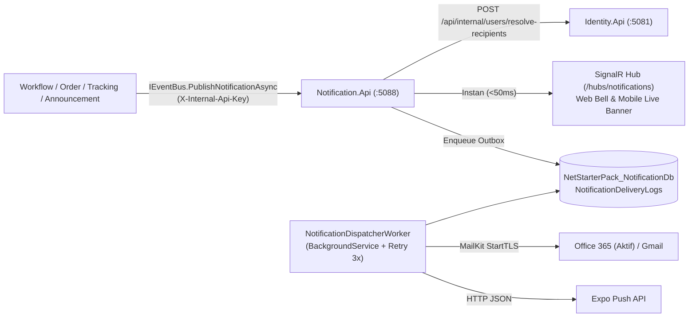

# Panduan Unified Notification Service (`Notification.Api :5088`)

Service **`Notification.Api`** adalah pusat notifikasi lintas microservice yang menggabungkan 3 channel sekaligus dalam 1 pintu:
1. **In-App Real-Time (SignalR `/hubs/notifications`)** — muncul langsung di lonceng header Web React dan live banner di Mobile Expo.
2. **Email HTML (MailKit + Scriban)** — mendukung preset **Office 365 / Microsoft 365 (Aktif)** dan **Gmail (Standby)**.
3. **Mobile Push Notification (Expo Push API)** — siap mengirim push ke perangkat Android (FCM) & iOS (APNs) yang terdaftar lewat `POST /api/notifications/devices`.

---

## 1. Alur Komunikasi Lintas Microservice



- Microservice bisnis **tidak tahu-menahu** soal HTML, CSS, SMTP, atau Expo Push. Mereka cukup kirim `NotificationIntegrationEvent` dengan kode dari `NotificationTemplateCodes`.
- Pengiriman Email & Push berjalan **asinkron** lewat `NotificationDispatcherWorker` (polling tiap 5 detik + exponential retry `15s → 60s → 180s`), jadi request utama (seperti Approve Workflow atau Create Order) tidak pernah lemot menunggu SMTP.

---

## 2. Arsitektur HTML Email Template (Scriban 2-Tahap)

Supaya template email tetap rapi meskipun jumlahnya terus bertambah:

1. **1 Master Layout (`_BaseLayout.html`)**: memegang header brand, container card 600px (table-based inline CSS supaya aman di Outlook Desktop & Gmail), strip warna status (`accent_color`), banner `[DEV REDIRECT]`, tombol CTA, dan footer.
2. **Body Partial per Event** di `src/Services/Notification/Notification.Api/Infrastructure/Templating/EmailTemplates/`:
   - `workflow-submitted.html`, `workflow-approved.html`, `workflow-rejected.html`, `workflow-revision.html`
   - `order-created.html`, `order-status-changed.html`
   - `tracking-assigned.html`, `tracking-pod-submitted.html`
   - `announcement-published.html`, `generic-notification.html`
3. **Hybrid Git File + Database Override**:
   - File `.html` default di-seed otomatis ke tabel `NotificationTemplates`.
   - `SuperAdmin` / `Admin` bisa preview langsung, edit redaksi & subject, **Send Test Email**, atau klik **Reset File Default** dari menu **Template & Log Email** (`/notification-templates`) tanpa redeploy.
4. **Auto HTML-Encoding**: semua variabel input user (`notes`, `recipient_name`, dll) otomatis di-escape sebelum masuk ke Scriban supaya karakter HTML/`<script>` tidak merusak layout email.

---

## 3. Setup Kredensial SMTP Office 365 (Aktif) & Gmail (Standby)

File `appsettings.json` sengaja **tidak menyimpan username/password SMTP** supaya aman dari kebocoran di Git. Isi kredensial lokal kamu pakai **.NET User Secrets** (paling bersih):

### A. Setup Office 365 / Microsoft 365 (Provider Aktif Saat Ini)

```powershell
cd src/Services/Notification/Notification.Api

dotnet user-secrets set "EmailSettings:ActiveProvider" "Office365"
dotnet user-secrets set "EmailSettings:DevOverrideRecipient" "ronysamuel19@gmail.com"
dotnet user-secrets set "EmailSettings:Providers:Office365:FromEmail" "email-kamu@domain-office365.com"
dotnet user-secrets set "EmailSettings:Providers:Office365:Username" "email-kamu@domain-office365.com"
dotnet user-secrets set "EmailSettings:Providers:Office365:Password" "PASSWORD_ATAU_APP_PASSWORD_M365"
```

**Catatan penting khusus Microsoft 365:**
- Pastikan **Authenticated SMTP** aktif di Microsoft 365 Admin Center → *Users → Active users → pilih akun → Mail → Manage email apps → Authenticated SMTP*.
- `FromEmail` **wajib sama** dengan `Username` (kecuali mailbox punya izin *Send As*).
- Kalau akun pakai MFA, gunakan **App Password** Microsoft 365.

### B. Pindah ke Gmail SMTP (Kapan Saja Tanpa Ubah Kode)

```powershell
cd src/Services/Notification/Notification.Api

dotnet user-secrets set "EmailSettings:ActiveProvider" "Gmail"
dotnet user-secrets set "EmailSettings:Providers:Gmail:FromEmail" "ronysamuel19@gmail.com"
dotnet user-secrets set "EmailSettings:Providers:Gmail:Username" "ronysamuel19@gmail.com"
dotnet user-secrets set "EmailSettings:Providers:Gmail:Password" "16_DIGIT_GMAIL_APP_PASSWORD"
```

### C. Cara Kerja `DevOverrideRecipient` & Mode Simulasi
- Selama `DevOverrideRecipient` diisi (default: `ronysamuel19@gmail.com`), semua email untuk user dummy `@starterpack.local` otomatis diarahkan ke alamat tersebut dengan banner kuning di atas email: *`[DEV REDIRECT] Email ini aslinya ditujukan ke ...`*.
- Untuk produksi, kosongkan `DevOverrideRecipient` (`""`) supaya email langsung masuk ke `User.Email` asli masing-masing penerima.
- Jika kredensial SMTP belum diisi sama sekali, worker otomatis masuk mode **Simulated** (dicatat rapi di Delivery Log tanpa crash).

---

## 4. Catatan Mobile Push Notification (Expo Go vs EAS Build)

- Endpoint backend `POST /api/notifications/devices` & `ExpoPushNotificationSender` sudah terhubung penuh ke `https://exp.host/--/api/v2/push/send`.
- Saat login di aplikasi Mobile (`mobile/`), perangkat otomatis terdaftar dan langsung tersambung ke SignalR `/hubs/notifications` (menampilkan **live banner** di bagian atas layar ketika notifikasi masuk).
- Untuk **remote background push notification** di Android/iOS (ketika aplikasi ditutup total), Expo SDK 53+ mensyaratkan **Development Build / EAS Build** dengan `expo-notifications` + FCM/APNs credentials. Selama testing harian pakai **Expo Go**, live banner SignalR + inbox `/notifications` tetap berjalan mulus tanpa error.
