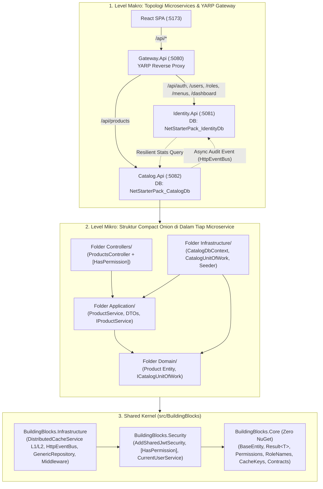
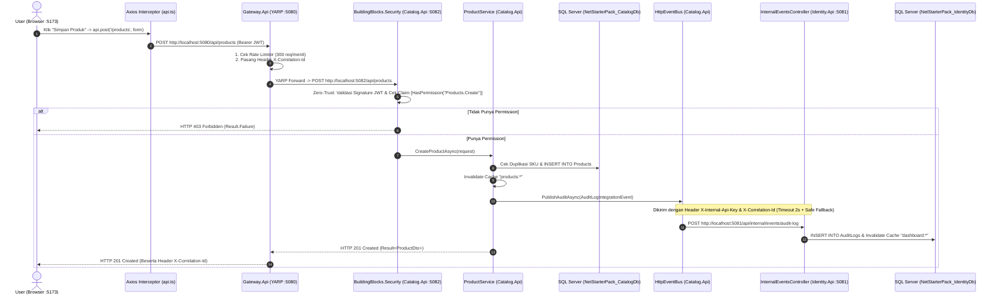
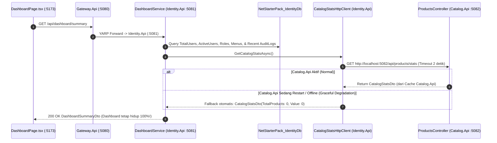

# Dokumentasi Arsitektur: Bedah Mendalam Microservices, Compact Onion, YARP Gateway, & Frontend React

Dokumen ini menjelaskan secara menyeluruh bagaimana **NetStarterPack Microservices** dirancang dari ujung ke ujung (*end-to-end*) — mulai dari pembagian **Microservices (level makro)**, struktur **Compact Onion Architecture (level mikro)** di dalam tiap service, **Shared BuildingBlocks**, **YARP API Gateway**, komunikasi antar-service, hingga arsitektur **React 19 + TypeScript** di sisi Frontend.

---

## 1. Hubungan Microservices vs Onion Architecture (Kenapa Dipakai Bareng?)

Sering ada kebingungan: *"Apakah Microservices dan Onion Architecture itu dua hal yang berbeda?"*
Jawabannya: **Berbeda level (skala), dan justru saling melengkapi!**

- **Microservices (Arsitektur Makro / Antar-Aplikasi)**:
  Mengatur bagaimana satu sistem besar dipecah menjadi beberapa aplikasi mandiri yang punya database sendiri-sendiri (`Identity.Api` dengan `NetStarterPack_IdentityDb`, dan `Catalog.Api` dengan `NetStarterPack_CatalogDb`), berjalan di port berbeda, dan disatukan oleh **API Gateway (`Gateway.Api`)**.
- **Compact Onion Architecture (Arsitektur Mikro / Internal Tiap Service)**:
  Mengatur bagaimana struktur folder dan kode **di dalam masing-masing microservice** disusun agar tidak menjadi *spaghetti code* (`Domain` $\rightarrow$ `Application` $\rightarrow$ `Infrastructure` $\rightarrow$ `Controllers`).

### Aturan Emas Dependency (*The Dependency Rule*)

| Project (`.csproj`) | Boleh Mereferensikan Project Apa? | Library Luar (NuGet) |
| :--- | :--- | :--- |
| **`1. BuildingBlocks.Core`** | Tidak ada (*Zero Dependency*) | **0 Package** (Murni C# standar) |
| **`2. BuildingBlocks.Security`** | Hanya `BuildingBlocks.Core` | `Microsoft.AspNetCore.Authentication.JwtBearer` |
| **`3. BuildingBlocks.Infrastructure`** | `BuildingBlocks.Core` & `BuildingBlocks.Security` | EF Core Base, StackExchangeRedis, OpenApi, Scalar |
| **`4. Identity.Api` & `Catalog.Api`** | Ketiga `BuildingBlocks` (Tidak boleh saling refer antar microservice!) | EF Core SQL Server / SQLite / InMemory |
| **`5. Gateway.Api`** | `BuildingBlocks` (Hanya *build-order reference* ke Services) | `Yarp.ReverseProxy`, `Scalar.AspNetCore` |

---

## 2. Alur Hidup Request End-to-End Lintas Microservice (Sequence Diagram)

### A. Skenario Tulis Data (`POST /api/products`) + Cross-Service Audit Event
Bagaimana perjalanan request saat user menambah produk baru di React hingga tersimpan di `NetStarterPack_CatalogDb` dan otomatis tercatat di `NetStarterPack_IdentityDb`?

### B. Skenario Baca Agregasi Lintas Service (`GET /api/dashboard/summary`)
Bagaimana halaman Dashboard mengambil jumlah User/Role dari `Identity.Api` sekaligus jumlah Produk/Nilai Inventori dari `Catalog.Api`?

---

## 3. Bedah 8 Pola Desain (*Design Patterns*) Utama di Backend

### 1. Compact Onion Architecture + Shared `BuildingBlocks`
Daripada memecah 1 microservice kecil menjadi 4 project `.csproj` (yang akan membuat solution penuh dengan puluhan `.csproj`), setiap microservice cukup berupa **1 project `.csproj`** (`Identity.Api`, `Catalog.Api`) yang di dalamnya memiliki **4 folder layer Onion** (`Domain/`, `Application/`, `Infrastructure/`, `Controllers/`).
Komponen lintas-service ditaruh di `src/BuildingBlocks/` sehingga penambahan microservice baru tidak membutuhkan duplikasi kode.

### 2. YARP API Gateway + Rate Limiting + Unified OpenAPI Merger
Lokasi: [`src/ApiGateway/Gateway.Api/Program.cs`](../src/ApiGateway/Gateway.Api/Program.cs) & [`appsettings.json`](../src/ApiGateway/Gateway.Api/appsettings.json)
- **Single Entry Point**: Frontend React cukup berkomunikasi ke port `5080`.
- **Rate Limiting**: Menggunakan `PartitionedRateLimiter` (`FixedWindowLimiter` 300 request/menit per IP) untuk melindungi microservice di belakangnya dari serangan flood/brute-force.
- **Unified OpenAPI Merger (`GET /openapi/v1.json`)**: Mengambil JSON OpenAPI dari `Identity.Api (:5081)` dan `Catalog.Api (:5082)`, menggabungkan seluruh `paths` dan `schemas` (sembari menyembunyikan endpoint `/api/internal/*`), sehingga kamu bisa mengetes **seluruh microservice dari satu halaman Swagger (`http://localhost:5080/swagger`) atau Scalar (`http://localhost:5080/scalar/v1`)**!

### 3. Database-per-Service (Isolasi Data Penuh)
- **`Identity.Api`** menggunakan `IdentityDbContext` yang terhubung ke database **`NetStarterPack_IdentityDb`** (berisi tabel `Users`, `Roles`, `UserRoles`, `RolePermissions`, `RefreshTokens`, `MenuItems`, `RoleMenus`, `AuditLogs`).
- **`Catalog.Api`** menggunakan `CatalogDbContext` yang terhubung ke database **`NetStarterPack_CatalogDb`** (hanya berisi tabel `Products`).
- Keuntungannya: Beban query berat di `Catalog.Api` tidak akan pernah mengunci tabel autentikasi di `Identity.Api`, dan masing-masing database bisa dipindah ke server SQL Server yang berbeda kapan saja lewat `appsettings.json`.

### 4. Resilient EventBus (`HttpEventBus`) & Graceful Degradation
Lokasi: [`src/BuildingBlocks/BuildingBlocks.Infrastructure/Messaging/HttpEventBus.cs`](../src/BuildingBlocks/BuildingBlocks.Infrastructure/Messaging/HttpEventBus.cs)
- Dalam arsitektur Microservices, kegagalan di satu service **tidak boleh** meruntuhkan service lainnya (*Cascading Failure*).
- Saat `Catalog.Api` memanggil `await eventBus.PublishAuditAsync(...)`, pengiriman HTTP ke `Identity.Api` dibatasi timeout 2 detik dan dibungkus `try-catch`. Jika `Identity.Api` kebetulan sedang di-restart, `Catalog.Api` cukup mencatat `LogWarning` dan transaksi penyimpanan produk **tetap berhasil 100%**.
- Karena sudah diabstraksi menggunakan interface `IEventBus` di `BuildingBlocks.Core`, implementasi `HttpEventBus` ini bisa diganti ke **RabbitMQ / Kafka / Azure Service Bus** kapan saja tanpa mengubah 1 baris kode pun di `ProductService`!

### 5. Distributed Tracing (`X-Correlation-Id`)
Lokasi: [`src/BuildingBlocks/BuildingBlocks.Infrastructure/Middleware/SharedMiddleware.cs`](../src/BuildingBlocks/BuildingBlocks.Infrastructure/Middleware/SharedMiddleware.cs)
- Setiap request yang masuk ke `Gateway.Api` otomatis diberikan header unik `X-Correlation-Id` (jika belum ada).
- Header ini diteruskan oleh YARP ke `Identity.Api` dan `Catalog.Api`, diteruskan lagi oleh `HttpEventBus` saat mengirim event audit, dicatat di log ketika terjadi exception pada `GlobalExceptionHandler`, dan dikembalikan di HTTP Response Header ke browser.

### 6. Direct Application Service Pattern + Standardized `Result<T>`
- Sama seperti edisi Monolith, kita tidak menggunakan boilerplate MediatR agar navigasi kode dengan **`F12` (*Go to Implementation*)** dari Controller langsung melompat ke `ProductService` atau `AuthService`.
- Semua method service mengembalikan `Result` atau `Result<T>` ([`Result.cs`](../src/BuildingBlocks/BuildingBlocks.Core/Common/Result.cs)), dan semua Controller mewarisi `BaseApiController` ([`BaseApiController.cs`](../src/BuildingBlocks/BuildingBlocks.Infrastructure/Controllers/BaseApiController.cs)) yang membungkus response dengan `ToActionResult(...)`.

### 7. Generic Repository Lintas DbContext (`GenericRepository<T, TContext>`) & Soft-Delete
Lokasi: [`src/BuildingBlocks/BuildingBlocks.Infrastructure/Persistence/GenericRepository.cs`](../src/BuildingBlocks/BuildingBlocks.Infrastructure/Persistence/GenericRepository.cs)
- Class `GenericRepository<T, TContext>` menerima parameter tipe `TContext : DbContext`. Artinya, baik `IdentityDbContext`, `CatalogDbContext`, maupun `OrderDbContext` di masa depan bisa langsung memakai ulang `GenericRepository` yang sama!
- Method `Remove(entity)` otomatis melakukan **Soft-Delete** (`entity.IsDeleted = true`), dipadukan dengan `entity.HasQueryFilter(x => !x.IsDeleted)` di masing-masing `DbContext`.

### 8. Development Auto-Orchestrator (Sekali Tekan `F5` Jalan Semua)
Lokasi: [`src/ApiGateway/Gateway.Api/Program.cs`](../src/ApiGateway/Gateway.Api/Program.cs) & [`Gateway.Api.csproj`](../src/ApiGateway/Gateway.Api/Gateway.Api.csproj)
- Di `Gateway.Api.csproj`, kita menambahkan `<ProjectReference ... ReferenceOutputAssembly="false" />` ke `Identity.Api` dan `Catalog.Api`. Trik ini membuat Visual Studio otomatis mengompilasi semua microservice setiap kali kamu menekan `F5` pada `Gateway.Api`.
- Saat `Gateway.Api` menyala di mode `Development`, ia mengecek port `5081`, `5082`, dan `5173`. Jika belum aktif, `Gateway.Api` otomatis menyalakan `Identity.Api`, `Catalog.Api`, dan `React Vite` di background, lalu mematikan semuanya secara otomatis ketika kamu menghentikan debugging!

---

## 4. Bedah Arsitektur Frontend (`frontend/src/`)

Frontend dibangun menggunakan **React 19 + TypeScript + Vite 8 + Tailwind CSS v4 + React Router v7 + Axios + Lucide Icons**.

- **`vite.config.ts`**: Mem-proxy seluruh panggilan `/api` dari port `5173` ke **YARP API Gateway (`http://localhost:5080`)**. Frontend sama sekali tidak direpotkan dengan urusan port microservice di belakang layar.
- **`frontend/src/services/api.ts`**: Axios client dengan sistem **Auto-Refresh Token Rotation** dan antrean `failedQueue` saat menerima HTTP `401`.
- **`frontend/src/context/AuthContext.tsx`**: Mengelola sesi user, daftar menu sidebar dinamis (`/api/menus/my-menus`), serta helper `hasPermission(code)` dan `hasRole(role)`.
- **`frontend/src/pages/DashboardPage.tsx`**: Menampilkan kartu topologi arsitektur Microservices (`Gateway.Api :5080`, `Identity.Api :5081`, `Catalog.Api :5082`), metrik gabungan lintas database, matriks permission JWT, dan log aktivitas terpusat.
