# Panduan Lengkap A sampai Z: Cara Membuat Modul CRUD Baru & Microservice Baru dari Nol

Dokumen ini adalah panduan komprehensif (*step-by-step*) dari **A sampai Z** untuk mengembangkan fitur di **NetStarterPack Microservices**.

Karena arsitektur project ini mendukung **Maintainability secara Vertikal maupun Horizontal**, panduan ini dibagi menjadi **2 Skenario Utama**:
- **BAGIAN A (Vertical Scaling)**: Menambah modul/tabel CRUD baru di dalam microservice yang sudah ada (Studi Kasus: Modul **Pelanggan / `Customer`**).
- **BAGIAN B (Horizontal Scaling)**: Membuat **Microservice Mandiri Baru** dari nol dengan port dan database terpisah (Studi Kasus: Microservice **`Order.Api` di Port `5083`** dengan database **`NetStarterPack_OrderDb`**), lalu menyambungkannya ke **YARP API Gateway (`:5080`)**, **Unified Swagger/Scalar**, dan **F5 Auto-Orchestrator**.

---

## Gambaran Alur Pengerjaan (Dari Shared Kernel $\rightarrow$ Microservice $\rightarrow$ Gateway $\rightarrow$ Frontend)

```mermaid
flowchart LR
    subgraph BB ["1. Shared BuildingBlocks"]
        B1["BuildingBlocks.Core<br/>• Permissions.cs<br/>• CacheKeys.cs"]
    end

    subgraph MS ["2. Microservice (Compact Onion)"]
        direction LR
        D["Domain/<br/>• Entity (BaseEntity)<br/>• IUnitOfWork"] --> A["Application/<br/>• DTOs (record)<br/>• Service (+Cache & IEventBus)"]
        A --> I["Infrastructure/<br/>• DbContext & Seeder<br/>• UnitOfWork"]
        I --> C["Controllers/<br/>• BaseApiController<br/>• [HasPermission]"]
    end

    subgraph GW ["3. YARP API Gateway (:5080)"]
        Y["Gateway.Api<br/>• Route & Cluster di appsettings.json<br/>• Test di Unified Swagger/Scalar"]
    end

    subgraph UT ["4. Unit Testing"]
        T["xUnit + InMemory DB<br/>+ InMemoryEventBus"]
    end

    subgraph FE ["5. React Frontend (:5173)"]
        F["types/index.ts -> Page.tsx<br/>-> App.tsx -> Menu Sidebar"]
    end

    BB --> MS --> GW --> UT --> FE
```



---

# BAGIAN A: Menambah Modul CRUD Baru di Microservice yang Sudah Ada (Studi Kasus: `Customer`)

Misalkan kita ingin menambahkan tabel dan fitur **Data Pelanggan (`Customer`)** ke dalam microservice bisnis `Catalog.Api` (atau microservice mana pun yang sudah ada).

## Checklist Cepat File yang Disentuh (Bagian A)

| Urutan | Project / Folder | Lokasi File | Aksi | Fungsi |
| :---: | :--- | :--- | :---: | :--- |
| **1.1** | `BuildingBlocks.Core` | [`src/BuildingBlocks/BuildingBlocks.Core/Constants/Permissions.cs`](../src/BuildingBlocks/BuildingBlocks.Core/Constants/Permissions.cs) | Edit | Daftar konstanta permission `Customers.*` |
| **1.2** | `BuildingBlocks.Core` | [`src/BuildingBlocks/BuildingBlocks.Core/Constants/CacheKeys.cs`](../src/BuildingBlocks/BuildingBlocks.Core/Constants/CacheKeys.cs) | Edit | Daftar prefix & helper key cache `customers:` |
| **2.1** | `Catalog.Api/Domain` | `src/Services/Catalog/Catalog.Api/Domain/Entities/Customer.cs` | Buat Baru | Class entity `Customer : BaseEntity` |
| **2.2** | `Catalog.Api/Domain` | [`src/Services/Catalog/Catalog.Api/Domain/Interfaces/ICatalogUnitOfWork.cs`](../src/Services/Catalog/Catalog.Api/Domain/Interfaces/ICatalogUnitOfWork.cs) | Edit | Tambah `IRepository<Customer> Customers { get; }` |
| **3.1** | `Catalog.Api/Application` | `src/Services/Catalog/Catalog.Api/Application/DTOs/CustomerDtos.cs` | Buat Baru | DTO Request & Response (`record`) |
| **3.2** | `Catalog.Api/Application` | `src/Services/Catalog/Catalog.Api/Application/Interfaces/ICustomerService.cs` | Buat Baru | Kontrak interface `ICustomerService` |
| **3.3** | `Catalog.Api/Application` | `src/Services/Catalog/Catalog.Api/Application/Services/CustomerService.cs` | Buat Baru | Logika bisnis CRUD + Cache + `IEventBus.PublishAuditAsync` |
| **4.1** | `Catalog.Api/Infrastructure` | [`src/Services/Catalog/Catalog.Api/Infrastructure/Persistence/CatalogPersistence.cs`](../src/Services/Catalog/Catalog.Api/Infrastructure/Persistence/CatalogPersistence.cs) | Edit | Tambah `DbSet<Customer>`, Fluent API, & `CatalogUnitOfWork` |
| **4.2** | `Catalog.Api` | [`src/Services/Catalog/Catalog.Api/Program.cs`](../src/Services/Catalog/Catalog.Api/Program.cs) | Edit | Registrasi DI `AddScoped<ICustomerService, CustomerService>()` |
| **5.1** | `Catalog.Api/Controllers` | `src/Services/Catalog/Catalog.Api/Controllers/CustomersController.cs` | Buat Baru | Endpoint HTTP `/api/customers` + `[HasPermission]` |
| **5.2** | `Gateway.Api` | [`src/ApiGateway/Gateway.Api/appsettings.json`](../src/ApiGateway/Gateway.Api/appsettings.json) | Edit | Tambah route YARP `/api/customers` ke `catalog-cluster` |
| **6.1** | `UnitTests` | [`tests/NetStarterPack.Microservices.UnitTests/MicroservicesArchitectureTests.cs`](../tests/NetStarterPack.Microservices.UnitTests/MicroservicesArchitectureTests.cs) | Edit | Unit test CRUD, Cache, Soft-Delete, & `InMemoryEventBus` |
| **7.1** | `Frontend React` | `frontend/src/types/index.ts`, `pages/CustomersPage.tsx`, `App.tsx` | Buat/Edit | Tampilan tabel, modal CRUD, & proteksi `hasPermission` |

---

## Tahap 1: Update `BuildingBlocks.Core` (Agar Permission & Cache Key Dikenali Semua Service)

### 1.1. Daftarkan Konstanta Permission di [`Permissions.cs`](../src/BuildingBlocks/BuildingBlocks.Core/Constants/Permissions.cs)
Buka `src/BuildingBlocks/BuildingBlocks.Core/Constants/Permissions.cs`, tambahkan class `Customers` dan daftarkan ke dalam `Permissions.GetAll()`:

```csharp
public static class Customers
{
    public const string View = "Customers.View";
    public const string Create = "Customers.Create";
    public const string Edit = "Customers.Edit";
    public const string Delete = "Customers.Delete";
}

// Di dalam method GetAll():
new(Customers.View, "Lihat Pelanggan", "Customers", "Melihat daftar dan detail pelanggan"),
new(Customers.Create, "Tambah Pelanggan", "Customers", "Menambahkan pelanggan baru"),
new(Customers.Edit, "Ubah Pelanggan", "Customers", "Mengubah data pelanggan"),
new(Customers.Delete, "Hapus Pelanggan", "Customers", "Menghapus data pelanggan"),
```
> **Kenapa ditaruh di `BuildingBlocks.Core`?**
> Supaya **`Identity.Api`** bisa menampilkan pilihan centangan permission `Customers.*` di halaman **Role & Hak Akses (`/roles`)**, sementara **`Catalog.Api`** bisa memakainya pada atribut `[HasPermission(Permissions.Customers.Create)]`!

### 1.2. Tambahkan Kunci Cache di [`CacheKeys.cs`](../src/BuildingBlocks/BuildingBlocks.Core/Constants/CacheKeys.cs)
Buka `src/BuildingBlocks/BuildingBlocks.Core/Constants/CacheKeys.cs`:

```csharp
public const string CustomersPrefix = "customers:";

public static string CustomerList(string? search = null, string? status = null) =>
    $"{CustomersPrefix}list:s={search?.Trim().ToLowerInvariant() ?? "all"}:st={status?.Trim().ToLowerInvariant() ?? "all"}";

public static string CustomerById(Guid id) =>
    $"{CustomersPrefix}id:{id}";
```

---

## Tahap 2: Folder `Domain/` di Dalam Microservice

### 2.1. Buat Entity `Customer.cs`
Buat file `src/Services/Catalog/Catalog.Api/Domain/Entities/Customer.cs` yang mewarisi **`BaseEntity`** dari `BuildingBlocks.Core.Common`:

```csharp
using BuildingBlocks.Core.Common;

namespace Catalog.Api.Domain.Entities;

public enum CustomerStatus
{
    Active = 1,
    Inactive = 2,
    Blacklisted = 3
}

public class Customer : BaseEntity
{
    public string Code { get; set; } = string.Empty;
    public string Name { get; set; } = string.Empty;
    public string Email { get; set; } = string.Empty;
    public string Phone { get; set; } = string.Empty;
    public string CompanyName { get; set; } = string.Empty;
    public decimal CreditLimit { get; set; }
    public CustomerStatus Status { get; set; } = CustomerStatus.Active;
}
```

### 2.2. Tambahkan Repository ke [`ICatalogUnitOfWork.cs`](../src/Services/Catalog/Catalog.Api/Domain/Interfaces/ICatalogUnitOfWork.cs)
```csharp
public interface ICatalogUnitOfWork
{
    IRepository<Product> Products { get; }
    IRepository<Customer> Customers { get; } // <-- Tambahkan baris ini
    Task<int> SaveChangesAsync(CancellationToken cancellationToken = default);
}
```

---

## Tahap 3: Folder `Application/` di Dalam Microservice (Logika Bisnis + Cache + `IEventBus`)

### 3.1. Buat DTO (`CustomerDtos.cs`) & Interface (`ICustomerService.cs`)
Buat `src/Services/Catalog/Catalog.Api/Application/DTOs/CustomerDtos.cs`:
```csharp
namespace Catalog.Api.Application.DTOs;

public record CustomerDto(
    Guid Id,
    string Code,
    string Name,
    string Email,
    string Phone,
    string CompanyName,
    decimal CreditLimit,
    string Status,
    DateTime CreatedAt,
    string? CreatedBy);

public record CreateOrUpdateCustomerRequest(
    string Code,
    string Name,
    string Email,
    string Phone,
    string CompanyName,
    decimal CreditLimit,
    string Status = "Active");
```

Buat `src/Services/Catalog/Catalog.Api/Application/Interfaces/ICustomerService.cs`:
```csharp
using BuildingBlocks.Core.Common;
using Catalog.Api.Application.DTOs;

namespace Catalog.Api.Application.Interfaces;

public interface ICustomerService
{
    Task<Result<IReadOnlyList<CustomerDto>>> GetAllCustomersAsync(string? search = null, string? status = null, CancellationToken cancellationToken = default);
    Task<Result<CustomerDto>> GetCustomerByIdAsync(Guid id, CancellationToken cancellationToken = default);
    Task<Result<CustomerDto>> CreateCustomerAsync(CreateOrUpdateCustomerRequest request, CancellationToken cancellationToken = default);
    Task<Result<CustomerDto>> UpdateCustomerAsync(Guid id, CreateOrUpdateCustomerRequest request, CancellationToken cancellationToken = default);
    Task<Result> DeleteCustomerAsync(Guid id, CancellationToken cancellationToken = default);
}
```

### 3.2. Buat Implementasi `CustomerService.cs` (Perhatikan Bedanya dengan Monolith pada Bagian `IEventBus`!)
Di arsitektur Microservices, tabel `AuditLogs` berada di database `NetStarterPack_IdentityDb` milik `Identity.Api`. Oleh karena itu, microservice bisnis **tidak melakukan insert ke tabel AuditLog lokal**, melainkan memanggil **`await eventBus.PublishAuditAsync(...)`**!

Buat file `src/Services/Catalog/Catalog.Api/Application/Services/CustomerService.cs`:

```csharp
using BuildingBlocks.Core.Common;
using BuildingBlocks.Core.Constants;
using BuildingBlocks.Core.Contracts;
using BuildingBlocks.Core.Interfaces;
using Catalog.Api.Application.DTOs;
using Catalog.Api.Application.Interfaces;
using Catalog.Api.Domain.Entities;
using Catalog.Api.Domain.Interfaces;

namespace Catalog.Api.Application.Services;

public class CustomerService(
    ICatalogUnitOfWork unitOfWork,
    ICurrentUserService currentUserService,
    ICacheService cacheService,
    IEventBus eventBus) : ICustomerService
{
    public async Task<Result<IReadOnlyList<CustomerDto>>> GetAllCustomersAsync(
        string? search = null,
        string? status = null,
        CancellationToken cancellationToken = default)
    {
        var baseKey = CacheKeys.CustomerList(null, null);

        var allDtos = await cacheService.GetOrCreateAsync(
            baseKey,
            async ct =>
            {
                var customers = await unitOfWork.Customers.GetListAsync(cancellationToken: ct);
                return customers
                    .OrderByDescending(c => c.CreatedAt)
                    .Select(MapToDto)
                    .ToList();
            },
            TimeSpan.FromMinutes(10),
            cancellationToken);

        IEnumerable<CustomerDto> query = allDtos;

        if (!string.IsNullOrWhiteSpace(search))
        {
            var term = search.Trim();
            query = query.Where(c =>
                c.Name.Contains(term, StringComparison.OrdinalIgnoreCase) ||
                c.Code.Contains(term, StringComparison.OrdinalIgnoreCase) ||
                c.CompanyName.Contains(term, StringComparison.OrdinalIgnoreCase) ||
                c.Email.Contains(term, StringComparison.OrdinalIgnoreCase));
        }

        if (!string.IsNullOrWhiteSpace(status))
        {
            var statusTerm = status.Trim();
            query = query.Where(c => c.Status.Equals(statusTerm, StringComparison.OrdinalIgnoreCase));
        }

        return Result<IReadOnlyList<CustomerDto>>.Success(query.ToList());
    }

    public async Task<Result<CustomerDto>> GetCustomerByIdAsync(Guid id, CancellationToken cancellationToken = default)
    {
        var dto = await cacheService.GetOrCreateAsync<CustomerDto?>(
            CacheKeys.CustomerById(id),
            async ct =>
            {
                var customer = await unitOfWork.Customers.GetByIdAsync(id, ct);
                return customer is null ? null : MapToDto(customer);
            },
            TimeSpan.FromMinutes(10),
            cancellationToken);

        return dto is null
            ? Result<CustomerDto>.Failure("Data pelanggan tidak ditemukan.", 404)
            : Result<CustomerDto>.Success(dto);
    }

    public async Task<Result<CustomerDto>> CreateCustomerAsync(
        CreateOrUpdateCustomerRequest request,
        CancellationToken cancellationToken = default)
    {
        if (string.IsNullOrWhiteSpace(request.Code) || string.IsNullOrWhiteSpace(request.Name))
        {
            return Result<CustomerDto>.Failure("Kode dan Nama pelanggan wajib diisi.", 400);
        }

        var code = request.Code.Trim().ToUpperInvariant();
        if (await unitOfWork.Customers.AnyAsync(c => c.Code == code, cancellationToken))
        {
            return Result<CustomerDto>.Failure($"Pelanggan dengan kode '{code}' sudah terdaftar.", 409);
        }

        if (!Enum.TryParse<CustomerStatus>(request.Status, true, out var status))
        {
            status = CustomerStatus.Active;
        }

        var customer = new Customer
        {
            Code = code,
            Name = request.Name.Trim(),
            Email = request.Email.Trim(),
            Phone = request.Phone.Trim(),
            CompanyName = request.CompanyName.Trim(),
            CreditLimit = request.CreditLimit,
            Status = status,
            CreatedBy = currentUserService.Username ?? "System"
        };

        // 1. Simpan ke Database lokal Microservice
        await unitOfWork.Customers.AddAsync(customer, cancellationToken);
        await unitOfWork.SaveChangesAsync(cancellationToken);

        // 2. Invalidate Cache modul Customers
        await cacheService.RemoveByPrefixAsync(CacheKeys.CustomersPrefix, cancellationToken);

        // 3. Publish AuditLogIntegrationEvent ke Identity.Api lewat IEventBus (Resilient & Decoupled!)
        await eventBus.PublishAuditAsync(new AuditLogIntegrationEvent(
            UserId: currentUserService.UserId,
            UserName: currentUserService.Username ?? "System",
            Action: "CREATE_CUSTOMER",
            Module: "Customers",
            EntityId: customer.Id.ToString(),
            Details: $"[Catalog.Api] Menambahkan pelanggan '{customer.Name}' (Kode: {customer.Code}).",
            IpAddress: currentUserService.IpAddress,
            SourceService: "Catalog.Api"), cancellationToken);

        return Result<CustomerDto>.Success(MapToDto(customer), "Data pelanggan berhasil ditambahkan.", 201);
    }

    public async Task<Result<CustomerDto>> UpdateCustomerAsync(
        Guid id,
        CreateOrUpdateCustomerRequest request,
        CancellationToken cancellationToken = default)
    {
        var customer = await unitOfWork.Customers.GetByIdAsync(id, cancellationToken);
        if (customer is null)
        {
            return Result<CustomerDto>.Failure("Data pelanggan tidak ditemukan.", 404);
        }

        var code = request.Code.Trim().ToUpperInvariant();
        if (await unitOfWork.Customers.AnyAsync(c => c.Id != id && c.Code == code, cancellationToken))
        {
            return Result<CustomerDto>.Failure($"Pelanggan lain dengan kode '{code}' sudah ada.", 409);
        }

        if (Enum.TryParse<CustomerStatus>(request.Status, true, out var status))
        {
            customer.Status = status;
        }

        customer.Code = code;
        customer.Name = request.Name.Trim();
        customer.Email = request.Email.Trim();
        customer.Phone = request.Phone.Trim();
        customer.CompanyName = request.CompanyName.Trim();
        customer.CreditLimit = request.CreditLimit;
        customer.UpdatedAt = DateTime.UtcNow;
        customer.UpdatedBy = currentUserService.Username ?? "System";

        unitOfWork.Customers.Update(customer);
        await unitOfWork.SaveChangesAsync(cancellationToken);

        await cacheService.RemoveByPrefixAsync(CacheKeys.CustomersPrefix, cancellationToken);

        await eventBus.PublishAuditAsync(new AuditLogIntegrationEvent(
            UserId: currentUserService.UserId,
            UserName: currentUserService.Username ?? "System",
            Action: "UPDATE_CUSTOMER",
            Module: "Customers",
            EntityId: customer.Id.ToString(),
            Details: $"[Catalog.Api] Memperbarui pelanggan '{customer.Name}' (Kode: {customer.Code}).",
            IpAddress: currentUserService.IpAddress,
            SourceService: "Catalog.Api"), cancellationToken);

        return Result<CustomerDto>.Success(MapToDto(customer), "Data pelanggan berhasil diperbarui.");
    }

    public async Task<Result> DeleteCustomerAsync(Guid id, CancellationToken cancellationToken = default)
    {
        var customer = await unitOfWork.Customers.GetByIdAsync(id, cancellationToken);
        if (customer is null)
        {
            return Result.Failure("Data pelanggan tidak ditemukan.", 404);
        }

        unitOfWork.Customers.Remove(customer);
        await unitOfWork.SaveChangesAsync(cancellationToken);

        await cacheService.RemoveByPrefixAsync(CacheKeys.CustomersPrefix, cancellationToken);

        await eventBus.PublishAuditAsync(new AuditLogIntegrationEvent(
            UserId: currentUserService.UserId,
            UserName: currentUserService.Username ?? "System",
            Action: "DELETE_CUSTOMER",
            Module: "Customers",
            EntityId: customer.Id.ToString(),
            Details: $"[Catalog.Api] Menghapus pelanggan '{customer.Name}' (Kode: {customer.Code}).",
            IpAddress: currentUserService.IpAddress,
            SourceService: "Catalog.Api"), cancellationToken);

        return Result.Success("Data pelanggan berhasil dihapus.");
    }

    private static CustomerDto MapToDto(Customer c) =>
        new(
            c.Id,
            c.Code,
            c.Name,
            c.Email,
            c.Phone,
            c.CompanyName,
            c.CreditLimit,
            c.Status.ToString(),
            c.CreatedAt,
            c.CreatedBy);
}
```

---

## Tahap 4: Folder `Infrastructure/` & Registrasi DI di Microservice

### 4.1. Update `CatalogDbContext` & `CatalogUnitOfWork` di [`CatalogPersistence.cs`](../src/Services/Catalog/Catalog.Api/Infrastructure/Persistence/CatalogPersistence.cs)
```csharp
// Di dalam CatalogDbContext:
public DbSet<Product> Products => Set<Product>();
public DbSet<Customer> Customers => Set<Customer>(); // <-- Tambahkan ini

// Di dalam OnModelCreating:
modelBuilder.Entity<Customer>(entity =>
{
    entity.ToTable("Customers");
    entity.HasKey(x => x.Id);
    entity.Property(x => x.Code).HasMaxLength(50).IsRequired();
    entity.Property(x => x.Name).HasMaxLength(200).IsRequired();
    entity.Property(x => x.Email).HasMaxLength(150);
    entity.Property(x => x.Phone).HasMaxLength(50);
    entity.Property(x => x.CompanyName).HasMaxLength(200);
    entity.Property(x => x.CreditLimit).HasPrecision(18, 2);
    entity.HasIndex(x => x.Code).IsUnique();
    entity.HasQueryFilter(x => !x.IsDeleted); // WAJIB untuk Soft-Delete!
});

// Di dalam CatalogUnitOfWork:
private IRepository<Customer>? _customers;
public IRepository<Customer> Customers =>
    _customers ??= new GenericRepository<Customer, CatalogDbContext>(dbContext);
```

### 4.2. Daftarkan Service di `Catalog.Api/Program.cs`
```csharp
builder.Services.AddScoped<ICustomerService, CustomerService>();
```

---

## Tahap 5: Buat Controller & Daftarkan Route di YARP API Gateway (`Gateway.Api`)

### 5.1. Buat `CustomersController.cs` di `Catalog.Api/Controllers/`
```csharp
using BuildingBlocks.Core.Constants;
using BuildingBlocks.Infrastructure.Controllers;
using BuildingBlocks.Security;
using Catalog.Api.Application.DTOs;
using Catalog.Api.Application.Interfaces;
using Microsoft.AspNetCore.Authorization;
using Microsoft.AspNetCore.Mvc;

namespace Catalog.Api.Controllers;

[Authorize]
public class CustomersController(ICustomerService customerService) : BaseApiController
{
    [HasPermission(Permissions.Customers.View)]
    [HttpGet]
    public async Task<IActionResult> GetAll([FromQuery] string? search, [FromQuery] string? status, CancellationToken ct) =>
        ToActionResult(await customerService.GetAllCustomersAsync(search, status, ct));

    [HasPermission(Permissions.Customers.View)]
    [HttpGet("{id:guid}")]
    public async Task<IActionResult> GetById(Guid id, CancellationToken ct) =>
        ToActionResult(await customerService.GetCustomerByIdAsync(id, ct));

    [HasPermission(Permissions.Customers.Create)]
    [HttpPost]
    public async Task<IActionResult> Create([FromBody] CreateOrUpdateCustomerRequest request, CancellationToken ct) =>
        ToActionResult(await customerService.CreateCustomerAsync(request, ct));

    [HasPermission(Permissions.Customers.Edit)]
    [HttpPut("{id:guid}")]
    public async Task<IActionResult> Update(Guid id, [FromBody] CreateOrUpdateCustomerRequest request, CancellationToken ct) =>
        ToActionResult(await customerService.UpdateCustomerAsync(id, request, ct));

    [HasPermission(Permissions.Customers.Delete)]
    [HttpDelete("{id:guid}")]
    public async Task<IActionResult> Delete(Guid id, CancellationToken ct) =>
        ToActionResult(await customerService.DeleteCustomerAsync(id, ct));
}
```

### 5.2. Tambahkan Route `/api/customers` di YARP [`Gateway.Api/appsettings.json`](../src/ApiGateway/Gateway.Api/appsettings.json)
Supaya panggilan `api.get('/customers')` dari React (`:5173`) diteruskan oleh YARP Gateway (`:5080`) ke `Catalog.Api (:5082)`, tambahkan route ini di `src/ApiGateway/Gateway.Api/appsettings.json`:

```json
"customers-route": {
  "ClusterId": "catalog-cluster",
  "Match": {
    "Path": "/api/customers/{**catch-all}"
  }
},
"customers-root-route": {
  "ClusterId": "catalog-cluster",
  "Match": {
    "Path": "/api/customers"
  }
}
```
> **Otomatis Tampil di Unified Swagger & Scalar Gateway!**
> Karena `Gateway.Api` memiliki *Unified OpenAPI Merger*, begitu kamu menambahkan `CustomersController` di `Catalog.Api`, seluruh endpoint `/api/customers` **langsung muncul secara otomatis** di **`http://localhost:5080/swagger`** dan **`http://localhost:5080/scalar/v1`**!

---

## Tahap 6: Membuat Unit Test (`tests/NetStarterPack.Microservices.UnitTests`)

Di [`MicroservicesArchitectureTests.cs`](../tests/NetStarterPack.Microservices.UnitTests/MicroservicesArchitectureTests.cs), kamu bisa langsung menguji `CustomerService` menggunakan `CreateSeededCatalogAsync()` dan `InMemoryEventBus`:

```csharp
[Fact]
public async Task CustomerService_CreateUpdateDelete_ShouldValidateCacheAndPublishAuditEvents()
{
    var (db, catalogUow) = await CreateSeededCatalogAsync();
    var currentUser = new FakeCurrentUserService { Username = "staff" };
    var cache = CreateTestCacheService();
    var eventBus = new InMemoryEventBus();

    var customerService = new CustomerService(catalogUow, currentUser, cache, eventBus);

    // 1. Tambah Pelanggan Baru (201 Created)
    var createReq = new CreateOrUpdateCustomerRequest(
        Code: "cust-001",
        Name: "PT Nusantara Maju",
        Email: "billing@nusantara.co.id",
        Phone: "021-5550123",
        CompanyName: "Nusantara Group",
        CreditLimit: 50_000_000m,
        Status: "Active");

    var createResult = await customerService.CreateCustomerAsync(createReq);

    Assert.True(createResult.Succeeded);
    Assert.Equal(201, createResult.StatusCode);
    Assert.Equal("CUST-001", createResult.Data!.Code);

    // 2. Pastikan event CREATE_CUSTOMER terkirim ke IEventBus
    Assert.Single(eventBus.PublishedEvents);
    Assert.Equal("CREATE_CUSTOMER", eventBus.PublishedEvents[0].Action);

    // 3. Pastikan kode duplikat ditolak (409 Conflict)
    var duplicateResult = await customerService.CreateCustomerAsync(createReq);
    Assert.False(duplicateResult.Succeeded);
    Assert.Equal(409, duplicateResult.StatusCode);

    // 4. Pastikan Soft-Delete mengubah IsDeleted = true
    var customerId = createResult.Data.Id;
    await customerService.DeleteCustomerAsync(customerId);

    var rawInDb = await db.Customers.IgnoreQueryFilters().FirstOrDefaultAsync(c => c.Id == customerId);
    Assert.NotNull(rawInDb);
    Assert.True(rawInDb!.IsDeleted);
}
```

---

## Tahap 7: Implementasi di Frontend React (`frontend/`) & Menu Sidebar

Di sisi Frontend React (`:5173`), langkahnya **100% sama mudahnya** dengan edisi Monolith karena semua request `/api/*` di-proxy otomatis ke YARP API Gateway (`:5080`):

1. **Tambahkan Interface di [`frontend/src/types/index.ts`](../frontend/src/types/index.ts)**:
   ```ts
   export interface CustomerItem {
     id: string;
     code: string;
     name: string;
     email: string;
     phone: string;
     companyName: string;
     creditLimit: number;
     status: string;
     createdAt: string;
     createdBy?: string;
   }
   ```
2. **Buat Halaman `frontend/src/pages/CustomersPage.tsx`**:
   Gunakan `const { hasPermission } = useAuth();` untuk mengecek `Customers.Create`, `Customers.Edit`, dan `Customers.Delete`, lalu panggil `api.get('/customers')`, `api.post('/customers', form)`, `api.put(...)`, dan `api.delete(...)`.
3. **Daftarkan Route di [`frontend/src/App.tsx`](../frontend/src/App.tsx)**:
   ```tsx
   <Route
     path="customers"
     element={
       <ProtectedRoute permission="Customers.View">
         <CustomersPage />
       </ProtectedRoute>
     }
   />
   ```
4. **Daftarkan ke Menu Sidebar**:
   - Bisa ditambahkan secara permanen di [`IdentityDatabaseSeeder.cs`](../src/Services/Identity/Identity.Api/Infrastructure/Persistence/IdentityDatabaseSeeder.cs) (milik `Identity.Api`), **ATAU**
   - Langsung login sebagai `superadmin` di web (`http://localhost:5173`), buka halaman **Manajemen Menu (`/menus`)** $\rightarrow$ klik **Tambah Menu** (`/customers`, permission `Customers.View`), lalu centang hak aksesnya di halaman **Role & Hak Akses (`/roles`)**!

---

# BAGIAN B (EXAMPLE 2 — SUDAH TERIMPLEMENTASI LIVE!): Membuat Microservice Mandiri Baru dari Nol (`Order.Api` di Port `5083`)

> 💡 **Kabar Baik!** Seluruh studi kasus **Example 2 (`Order.Api` di Port `5083` + database `NetStarterPack_OrderDb` + halaman React `OrdersPage.tsx`)** di bawah ini **SUDAH DIIMPLEMENTASIKAN SECARA NYATA** di dalam solution ini!
> Kamu bisa langsung membuka dan mempelajari file aslinya di:
> - **Backend Microservice**: [`src/Services/Order/Order.Api/`](../src/Services/Order/Order.Api/)
> - **YARP Gateway Route**: [`src/ApiGateway/Gateway.Api/appsettings.json`](../src/ApiGateway/Gateway.Api/appsettings.json) (`orders-route` $\rightarrow$ `http://localhost:5083`)
> - **Unit Test**: [`tests/NetStarterPack.Microservices.UnitTests/MicroservicesArchitectureTests.cs`](../tests/NetStarterPack.Microservices.UnitTests/MicroservicesArchitectureTests.cs)
> - **Frontend React UI**: [`frontend/src/pages/OrdersPage.tsx`](../frontend/src/pages/OrdersPage.tsx) (Menu: **Pesanan (Order.Api)** di `/orders`)

---

## Kapan Harus Pakai Bagian A vs Bagian B?
- Gunakan **Bagian A** kalau tabel barumu masih satu rumpun dengan service yang sudah ada (misal tambah tabel `Kategori` di dalam `Catalog.Api`).
- Gunakan **Bagian B (Example 2 ini)** kalau kamu ingin membuat **Microservice Mandiri Baru** yang punya **Port sendiri (`:5083`)** dan **Database SQL Server sendiri (`NetStarterPack_OrderDb`)**.

---

## Langkah 1: Buat Project Web API Baru (Tanpa Edit `.csproj` Manual!)

Kamu **sama sekali tidak perlu** menulis atau mengedit XML `.csproj` secara manual. Pilih salah satu dari **2 cara standar** di bawah ini (lewat klik GUI Visual Studio atau lewat Terminal CLI):

### Cara 1: Lewat Visual Studio GUI (Paling Umum & Gampang)
1. **Buat Project Baru**:
   - Di **Solution Explorer**, klik kanan folder **`Services`** (di bawah `src`) $\rightarrow$ pilih **Add** $\rightarrow$ **New Project...**
   - Pilih template **ASP.NET Core Web API** $\rightarrow$ Klik **Next**.
   - Isi **Project name**: `Order.Api`
   - Isi **Location**: `...\net-starterpack-microservice\src\Services\Order`
   - Pilih Framework **`.NET 10.0`**, centang *Use controllers* $\rightarrow$ Klik **Create**.
2. **Sambungkan ke `BuildingBlocks` (Klik Kanan)**:
   - Di project `Order.Api` yang baru muncul, klik kanan **Dependencies** $\rightarrow$ **Add Project Reference...**
   - Centang **`BuildingBlocks.Core`**, **`BuildingBlocks.Security`**, dan **`BuildingBlocks.Infrastructure`** $\rightarrow$ Klik **OK**.
3. **Install Package EF Core (Lewat NuGet GUI)**:
   - Klik kanan **Dependencies** pada `Order.Api` $\rightarrow$ **Manage NuGet Packages...**
   - Cari dan install:
     - `Microsoft.EntityFrameworkCore.SqlServer` (versi `10.0.*`)
     - `Microsoft.EntityFrameworkCore.Sqlite` (versi `10.0.*`)
     - `Microsoft.EntityFrameworkCore.InMemory` (versi `10.0.*`)
4. **Agar Ikut Di-Build Otomatis Saat Tekan `F5` di `Gateway.Api`**:
   - Klik kanan project **`Gateway.Api`** di Solution Explorer $\rightarrow$ pilih **Build Dependencies** $\rightarrow$ **Project Dependencies...**
   - Centang kotak **`Order.Api`** $\rightarrow$ Klik **OK**.

### Cara 2: Lewat Terminal PowerShell (Kalau Suka Command Line)
Kalau kamu malas klik-klik di Visual Studio, cukup copy-paste perintah `dotnet` standar ini di terminal root project:
```powershell
# 1. Buat project Web API baru & masukkan ke Solution
dotnet new webapi -n Order.Api -o src/Services/Order/Order.Api --use-controllers
dotnet sln NetStarterPack.Microservices.sln add src/Services/Order/Order.Api/Order.Api.csproj --solution-folder Services

# 2. Tambahkan reference ke BuildingBlocks
dotnet add src/Services/Order/Order.Api reference src/BuildingBlocks/BuildingBlocks.Core
dotnet add src/Services/Order/Order.Api reference src/BuildingBlocks/BuildingBlocks.Security
dotnet add src/Services/Order/Order.Api reference src/BuildingBlocks/BuildingBlocks.Infrastructure

# 3. Install package EF Core
dotnet add src/Services/Order/Order.Api package Microsoft.EntityFrameworkCore.SqlServer --version "10.0.*"
dotnet add src/Services/Order/Order.Api package Microsoft.EntityFrameworkCore.Sqlite --version "10.0.*"
dotnet add src/Services/Order/Order.Api package Microsoft.EntityFrameworkCore.InMemory --version "10.0.*"
```

---

## Langkah 2: Daftarkan Permission, CacheKey, & Kontrak di `BuildingBlocks.Core`

Sebelum ngoding di dalam `Order.Api`, kita daftarkan dulu konstanta permission `Orders.*` di `BuildingBlocks.Core` supaya dikenali oleh `Identity.Api` (untuk halaman Role & Menu) maupun oleh `Order.Api`:

### 2.1. Tambahkan `Permissions.Orders` di [`BuildingBlocks.Core/Constants/Permissions.cs`](../src/BuildingBlocks/BuildingBlocks.Core/Constants/Permissions.cs)
```csharp
public static class Orders
{
    public const string View = "Orders.View";
    public const string Create = "Orders.Create";
    public const string Edit = "Orders.Edit";
    public const string Delete = "Orders.Delete";
}

// Dan tambahkan ke dalam list Permissions.GetAll():
new(Orders.View, "Lihat Pesanan / Order", "Orders", "Melihat daftar transaksi pesanan (Order Microservice)"),
new(Orders.Create, "Buat Pesanan / Order", "Orders", "Membuat transaksi pesanan baru (Order Microservice)"),
new(Orders.Edit, "Ubah Pesanan / Order", "Orders", "Mengubah status dan detail pesanan (Order Microservice)"),
new(Orders.Delete, "Hapus Pesanan / Order", "Orders", "Menghapus/membatalkan data pesanan (Order Microservice)"),
```

### 2.2. Tambahkan Kunci Cache `OrdersPrefix` di [`BuildingBlocks.Core/Constants/CacheKeys.cs`](../src/BuildingBlocks/BuildingBlocks.Core/Constants/CacheKeys.cs)
```csharp
public const string OrdersPrefix = "orders:";

public static string OrderList(string? search, string? status) =>
    $"{OrdersPrefix}list:s={search?.Trim().ToLowerInvariant() ?? "all"}:st={status?.Trim().ToLowerInvariant() ?? "all"}";

public static string OrderById(Guid id) =>
    $"{OrdersPrefix}id:{id}";

public static string OrderStats() =>
    $"{OrdersPrefix}stats";
```

### 2.3. Tambahkan Kontrak Statistik `OrderStatsDto` di [`BuildingBlocks.Core/Contracts/IntegrationContracts.cs`](../src/BuildingBlocks/BuildingBlocks.Core/Contracts/IntegrationContracts.cs)
```csharp
public record OrderStatsDto(
    int TotalOrders,
    decimal TotalRevenue,
    int PendingOrders,
    int CompletedOrders
);
```

---

## Langkah 3: Buat Layer `Domain/` di Dalam `Order.Api`

Di dalam project `Order.Api`, buat folder `Domain/Entities/` dan `Domain/Interfaces/`.

### 3.1. Buat Entity [`Domain/Entities/Order.cs`](../src/Services/Order/Order.Api/Domain/Entities/Order.cs)
```csharp
using BuildingBlocks.Core.Common;

namespace Order.Api.Domain.Entities;

public enum OrderStatus
{
    Pending = 0,
    Processing = 1,
    Completed = 2,
    Cancelled = 3
}

public class Order : BaseEntity
{
    public string OrderNumber { get; set; } = string.Empty;
    public string CustomerName { get; set; } = string.Empty;
    public string CustomerEmail { get; set; } = string.Empty;
    public string ProductSku { get; set; } = string.Empty;
    public string ProductName { get; set; } = string.Empty;
    public int Quantity { get; set; }
    public decimal UnitPrice { get; set; }
    public decimal TotalAmount { get; set; }
    public OrderStatus Status { get; set; } = OrderStatus.Pending;
    public string Notes { get; set; } = string.Empty;
}
```

### 3.2. Buat Kontrak Unit of Work [`Domain/Interfaces/IOrderUnitOfWork.cs`](../src/Services/Order/Order.Api/Domain/Interfaces/IOrderUnitOfWork.cs)
```csharp
using BuildingBlocks.Core.Interfaces;

namespace Order.Api.Domain.Interfaces;

public interface IOrderUnitOfWork
{
    IRepository<Entities.Order> Orders { get; }
    Task<int> SaveChangesAsync(CancellationToken cancellationToken = default);
}
```

---

## Langkah 4: Buat Layer `Application/` di Dalam `Order.Api`

### 4.1. Buat DTO [`Application/DTOs/OrderDtos.cs`](../src/Services/Order/Order.Api/Application/DTOs/OrderDtos.cs)
```csharp
namespace Order.Api.Application.DTOs;

public record OrderDto(
    Guid Id,
    string OrderNumber,
    string CustomerName,
    string CustomerEmail,
    string ProductSku,
    string ProductName,
    int Quantity,
    decimal UnitPrice,
    decimal TotalAmount,
    string Status,
    string Notes,
    DateTime CreatedAt,
    string? CreatedBy
);

public record CreateOrUpdateOrderRequest(
    string OrderNumber,
    string CustomerName,
    string CustomerEmail,
    string ProductSku,
    string ProductName,
    int Quantity,
    decimal UnitPrice,
    string Status,
    string Notes
);
```

### 4.2. Buat Interface [`Application/Interfaces/IOrderService.cs`](../src/Services/Order/Order.Api/Application/Interfaces/IOrderService.cs)
```csharp
using BuildingBlocks.Core.Common;
using BuildingBlocks.Core.Contracts;
using Order.Api.Application.DTOs;

namespace Order.Api.Application.Interfaces;

public interface IOrderService
{
    Task<Result<IReadOnlyList<OrderDto>>> GetAllOrdersAsync(string? search = null, string? status = null, CancellationToken cancellationToken = default);
    Task<Result<OrderDto>> GetOrderByIdAsync(Guid id, CancellationToken cancellationToken = default);
    Task<Result<OrderDto>> CreateOrderAsync(CreateOrUpdateOrderRequest request, CancellationToken cancellationToken = default);
    Task<Result<OrderDto>> UpdateOrderAsync(Guid id, CreateOrUpdateOrderRequest request, CancellationToken cancellationToken = default);
    Task<Result> DeleteOrderAsync(Guid id, CancellationToken cancellationToken = default);
    Task<Result<OrderStatsDto>> GetOrderStatsAsync(CancellationToken cancellationToken = default);
}
```

### 4.3. Buat Implementasi [`Application/Services/OrderService.cs`](../src/Services/Order/Order.Api/Application/Services/OrderService.cs)
Perhatikan bagaimana `OrderService` menghitung otomatis `TotalAmount = Quantity * UnitPrice`, menyimpan ke database `NetStarterPack_OrderDb`, menghapus cache `orders:*`, dan mengirim `AuditLogIntegrationEvent` dengan `SourceService: "Order.Api"` ke `Identity.Api`:

```csharp
using BuildingBlocks.Core.Common;
using BuildingBlocks.Core.Constants;
using BuildingBlocks.Core.Contracts;
using BuildingBlocks.Core.Interfaces;
using Order.Api.Application.DTOs;
using Order.Api.Application.Interfaces;
using Order.Api.Domain.Entities;
using Order.Api.Domain.Interfaces;

namespace Order.Api.Application.Services;

public class OrderService(
    IOrderUnitOfWork unitOfWork,
    ICurrentUserService currentUserService,
    ICacheService cacheService,
    IEventBus eventBus) : IOrderService
{
    public async Task<Result<IReadOnlyList<OrderDto>>> GetAllOrdersAsync(
        string? search = null,
        string? status = null,
        CancellationToken cancellationToken = default)
    {
        var baseKey = CacheKeys.OrderList(null, null);

        var allDtos = await cacheService.GetOrCreateAsync(
            baseKey,
            async ct =>
            {
                var orders = await unitOfWork.Orders.GetListAsync(cancellationToken: ct);
                return orders
                    .OrderByDescending(o => o.CreatedAt)
                    .Select(MapToDto)
                    .ToList();
            },
            TimeSpan.FromMinutes(10),
            cancellationToken);

        IEnumerable<OrderDto> query = allDtos;

        if (!string.IsNullOrWhiteSpace(search))
        {
            var term = search.Trim();
            query = query.Where(o =>
                o.OrderNumber.Contains(term, StringComparison.OrdinalIgnoreCase) ||
                o.CustomerName.Contains(term, StringComparison.OrdinalIgnoreCase) ||
                o.ProductName.Contains(term, StringComparison.OrdinalIgnoreCase) ||
                o.ProductSku.Contains(term, StringComparison.OrdinalIgnoreCase));
        }

        if (!string.IsNullOrWhiteSpace(status))
        {
            var statusTerm = status.Trim();
            query = query.Where(o => o.Status.Equals(statusTerm, StringComparison.OrdinalIgnoreCase));
        }

        return Result<IReadOnlyList<OrderDto>>.Success(query.ToList());
    }

    public async Task<Result<OrderDto>> GetOrderByIdAsync(Guid id, CancellationToken cancellationToken = default)
    {
        var dto = await cacheService.GetOrCreateAsync<OrderDto?>(
            CacheKeys.OrderById(id),
            async ct =>
            {
                var order = await unitOfWork.Orders.GetByIdAsync(id, ct);
                return order is null ? null : MapToDto(order);
            },
            TimeSpan.FromMinutes(10),
            cancellationToken);

        return dto is null
            ? Result<OrderDto>.Failure("Data pesanan tidak ditemukan.", 404)
            : Result<OrderDto>.Success(dto);
    }

    public async Task<Result<OrderDto>> CreateOrderAsync(
        CreateOrUpdateOrderRequest request,
        CancellationToken cancellationToken = default)
    {
        if (string.IsNullOrWhiteSpace(request.OrderNumber) ||
            string.IsNullOrWhiteSpace(request.CustomerName) ||
            string.IsNullOrWhiteSpace(request.ProductName))
        {
            return Result<OrderDto>.Failure("Nomor Order, Nama Pelanggan, dan Nama Produk wajib diisi.", 400);
        }

        if (request.Quantity <= 0)
        {
            return Result<OrderDto>.Failure("Jumlah (Quantity) pesanan minimal 1 unit.", 400);
        }

        var orderNo = request.OrderNumber.Trim().ToUpperInvariant();
        if (await unitOfWork.Orders.AnyAsync(o => o.OrderNumber == orderNo, cancellationToken))
        {
            return Result<OrderDto>.Failure($"Pesanan dengan nomor '{orderNo}' sudah terdaftar.", 409);
        }

        if (!Enum.TryParse<OrderStatus>(request.Status, true, out var status))
        {
            status = OrderStatus.Pending;
        }

        var order = new Domain.Entities.Order
        {
            OrderNumber = orderNo,
            CustomerName = request.CustomerName.Trim(),
            CustomerEmail = request.CustomerEmail.Trim(),
            ProductSku = string.IsNullOrWhiteSpace(request.ProductSku) ? "CUSTOM-ITEM" : request.ProductSku.Trim().ToUpperInvariant(),
            ProductName = request.ProductName.Trim(),
            Quantity = request.Quantity,
            UnitPrice = request.UnitPrice,
            TotalAmount = request.Quantity * request.UnitPrice,
            Status = status,
            Notes = request.Notes.Trim(),
            CreatedBy = currentUserService.Username ?? "System"
        };

        await unitOfWork.Orders.AddAsync(order, cancellationToken);
        await unitOfWork.SaveChangesAsync(cancellationToken);

        await cacheService.RemoveByPrefixAsync(CacheKeys.OrdersPrefix, cancellationToken);
        await cacheService.RemoveByPrefixAsync(CacheKeys.DashboardPrefix, cancellationToken);

        await eventBus.PublishAuditAsync(new AuditLogIntegrationEvent(
            UserId: currentUserService.UserId,
            UserName: currentUserService.Username ?? "System",
            Action: "CREATE_ORDER",
            Module: "Orders",
            EntityId: order.Id.ToString(),
            Details: $"[Order.Api] Membuat pesanan '{order.OrderNumber}' untuk '{order.CustomerName}' ({order.ProductName} x{order.Quantity}).",
            IpAddress: currentUserService.IpAddress,
            SourceService: "Order.Api"), cancellationToken);

        return Result<OrderDto>.Success(MapToDto(order), "Pesanan baru berhasil dibuat.", 201);
    }

    // Method UpdateOrderAsync, DeleteOrderAsync, & GetOrderStatsAsync
    // tersedia lengkap di src/Services/Order/Order.Api/Application/Services/OrderService.cs
}
```

---

## Langkah 5: Buat Layer `Infrastructure/` (`OrderDbContext` & Seeder)

Buat file [`Infrastructure/Persistence/OrderPersistence.cs`](../src/Services/Order/Order.Api/Infrastructure/Persistence/OrderPersistence.cs) yang berisi:
1. **`OrderDbContext`**: Mengatur tabel `Orders`, precision `decimal(18,2)` untuk `UnitPrice` & `TotalAmount`, index unik `OrderNumber`, dan `entity.HasQueryFilter(x => !x.IsDeleted)`.
2. **`OrderUnitOfWork`**: Menggunakan `GenericRepository<Order, OrderDbContext>` dari `BuildingBlocks.Infrastructure` (jadi kita tidak perlu menulis kode CRUD Repository lagi!).
3. **`OrderDatabaseSeeder`**: Otomatis membuat database `NetStarterPack_OrderDb` dan mengisi 4 data pesanan contoh (`ORD-2026-001` s/d `ORD-2026-004`) saat startup.

---

## Langkah 6: Buat Controller, `Program.cs`, & `appsettings.json` (`Port 5083`)

### 6.1. Buat [`Controllers/OrdersController.cs`](../src/Services/Order/Order.Api/Controllers/OrdersController.cs)
```csharp
using BuildingBlocks.Core.Constants;
using BuildingBlocks.Infrastructure.Controllers;
using BuildingBlocks.Security;
using Microsoft.AspNetCore.Authorization;
using Microsoft.AspNetCore.Mvc;
using Order.Api.Application.DTOs;
using Order.Api.Application.Interfaces;

namespace Order.Api.Controllers;

[Authorize]
public class OrdersController(IOrderService orderService) : BaseApiController
{
    [HasPermission(Permissions.Orders.View)]
    [HttpGet]
    public async Task<IActionResult> GetAll([FromQuery] string? search, [FromQuery] string? status, CancellationToken ct) =>
        ToActionResult(await orderService.GetAllOrdersAsync(search, status, ct));

    [AllowAnonymous]
    [HttpGet("stats")]
    public async Task<IActionResult> GetStats(CancellationToken ct) =>
        ToActionResult(await orderService.GetOrderStatsAsync(ct));

    [HasPermission(Permissions.Orders.View)]
    [HttpGet("{id:guid}")]
    public async Task<IActionResult> GetById(Guid id, CancellationToken ct) =>
        ToActionResult(await orderService.GetOrderByIdAsync(id, ct));

    [HasPermission(Permissions.Orders.Create)]
    [HttpPost]
    public async Task<IActionResult> Create([FromBody] CreateOrUpdateOrderRequest request, CancellationToken ct) =>
        ToActionResult(await orderService.CreateOrderAsync(request, ct));

    [HasPermission(Permissions.Orders.Edit)]
    [HttpPut("{id:guid}")]
    public async Task<IActionResult> Update(Guid id, [FromBody] CreateOrUpdateOrderRequest request, CancellationToken ct) =>
        ToActionResult(await orderService.UpdateOrderAsync(id, request, ct));

    [HasPermission(Permissions.Orders.Delete)]
    [HttpDelete("{id:guid}")]
    public async Task<IActionResult> Delete(Guid id, CancellationToken ct) =>
        ToActionResult(await orderService.DeleteOrderAsync(id, ct));
}
```

### 6.2. Isi [`Order.Api/Program.cs`](../src/Services/Order/Order.Api/Program.cs)
Karena semua urusan JWT, `[HasPermission]`, Cache, EventBus, CorrelationId, dan Swagger/Scalar sudah dibungkus di `BuildingBlocks`, file `Program.cs` milik microservice baru sangat bersih:

```csharp
using BuildingBlocks.Infrastructure;
using BuildingBlocks.Security;
using Microsoft.EntityFrameworkCore;
using Order.Api.Application.Interfaces;
using Order.Api.Application.Services;
using Order.Api.Domain.Interfaces;
using Order.Api.Infrastructure.Persistence;

var builder = WebApplication.CreateBuilder(args);

// 1. Plug & Play Zero-Trust JWT, [HasPermission], L1/L2 Cache, EventBus, & OpenAPI
builder.Services.AddSharedJwtSecurity(builder.Configuration);
builder.Services.AddSharedInfrastructure(builder.Configuration);

// 2. Setup Database Terpisah: NetStarterPack_OrderDb
var connectionString = builder.Configuration.GetConnectionString("DefaultConnection");
builder.Services.AddDbContext<OrderDbContext>(options =>
    options.UseSqlServer(connectionString, sql => sql.EnableRetryOnFailure(3)));

// 3. Register Order Onion Services
builder.Services.AddScoped<IOrderUnitOfWork, OrderUnitOfWork>();
builder.Services.AddScoped<IOrderService, OrderService>();
builder.Services.AddScoped<OrderDatabaseSeeder>();

var app = builder.Build();

// 4. Auto-Migrate, Seed Order Data, & Pre-Warm Cache
using (var scope = app.Services.CreateScope())
{
    var seeder = scope.ServiceProvider.GetRequiredService<OrderDatabaseSeeder>();
    await seeder.SeedAsync();
}

app.UseSharedMicroservicePipeline(
    serviceTitle: "Order & Transaction Microservice API",
    serviceName: "Order.Api");

app.Run();
```

---

## Langkah 7: Sambungkan `Order.Api (:5083)` ke YARP Gateway (`:5080`) & React Frontend (`:5173`)

1. **Tambahkan Route YARP di [`Gateway.Api/appsettings.json`](../src/ApiGateway/Gateway.Api/appsettings.json)**:
   - Route `orders-route` (`/api/orders/{**catch-all}`) & `orders-root-route` (`/api/orders`) diarahkan ke `order-cluster` (`http://localhost:5083`).
2. **Daftarkan ke Orchestrator & OpenAPI Merger di [`Gateway.Api/Program.cs`](../src/ApiGateway/Gateway.Api/Program.cs)**:
   - Panggil `TryStartDotnetMicroservice("Order.Api", 5083, ...)` agar otomatis ikut menyala saat tekan `F5`.
   - Panggil `MergeMicroserviceOpenApiAsync(client, "http://localhost:5083/openapi/v1.json", ...)` agar endpoint `/api/orders` otomatis tampil di Unified Swagger (`http://localhost:5080/swagger`).
3. **Buat Halaman React [`frontend/src/pages/OrdersPage.tsx`](../frontend/src/pages/OrdersPage.tsx)**:
   - Halaman ini mengambil daftar pesanan dari `GET /api/orders` (diteruskan YARP ke `Order.Api :5083`).
   - Saat modal **Buat Pesanan Baru** dibuka, ia juga memanggil `GET /api/products` (diteruskan YARP ke `Catalog.Api :5082`) untuk menampilkan dropdown pilihan produk yang otomatis mengisi SKU dan Harga Satuan!
