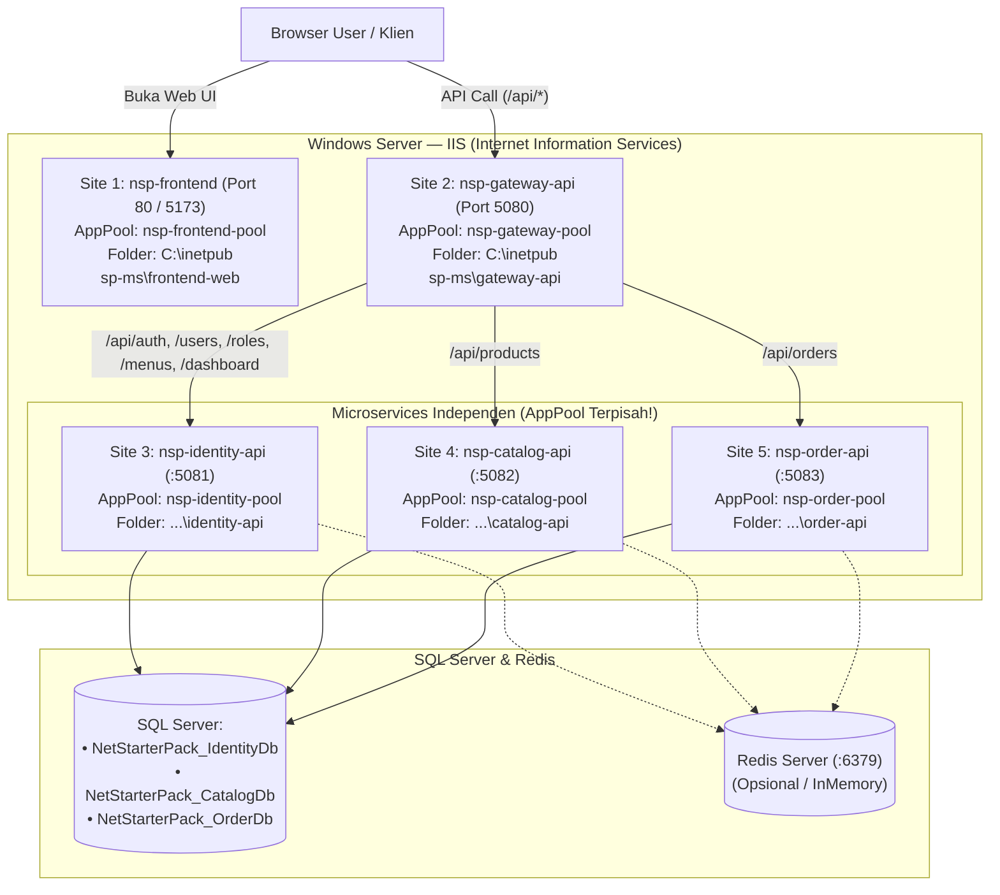

# Panduan Lengkap Publish & Deploy Microservices ke IIS (Windows Server)

Dokumen ini adalah panduan praktis dari **A sampai Z** untuk mem-publish dan men-deploy **NetStarterPack Microservices** ke **IIS (Internet Information Services)** di Windows Server atau Windows lokal.

Panduan ini dibagi menjadi **3 bagian utama**:
1. **BAGIAN 1 — First-Time Deployment**: Langkah awal dari nol sampai seluruh microservice dan Frontend React menyala di IIS.
2. **BAGIAN 2 — 6 Studi Kasus Update / Patching Harian (Case A s/d Case F)**: Panduan *"Kalau saya habis ngubah fitur A atau fitur B, project mana saja yang harus di-publish dan AppPool mana yang harus di-restart?"*
3. **BAGIAN 3 — Solusi Error / Troubleshooting Umum di IIS**.

> 💡 Untuk rangkuman cepat topologi **7 Site** (termasuk `Workflow.Api :5084` & `Announcement.Api :5085`) serta playbook lengkap kasus lapangan (`NETSDK1152`, `404 /api` ARR Proxy vs `VITE_API_URL`, error SQL `IIS APPPOOL\*` dengan 3 opsi solusi, dan SignalR WebSocket), baca juga **[`docs/IIS_TROUBLESHOOTING_AND_PLAYBOOK.md`](IIS_TROUBLESHOOTING_AND_PLAYBOOK.md)**.

---

## Topologi Microservices di Dalam IIS

Berbeda dengan aplikasi Monolith yang hanya punya 1 folder dan 1 Application Pool di IIS, pada arsitektur Microservices kita membuat **Application Pool dan Site terpisah untuk masing-masing service**:



> **Kenapa Tiap Microservice WAJIB Dipisah Application Pool-nya di IIS?**
> Supaya saat kamu melakukan update/bugfix di **`Order.Api`**, kamu cukup menghentikan (*Stop*) **`nsp-order-pool`** selama 3 detik untuk menimpa file `.dll`-nya, sementara **`nsp-identity-pool`** dan **`nsp-catalog-pool` tetap menyala 100%**! User yang sedang login atau sedang melihat katalog barang sama sekali tidak merasakan *downtime*.

---

# BAGIAN 1: First-Time Deployment (Deploy Pertama Kali dari Nol)

## Langkah 1: Install Prasyarat di Windows Server (Cukup Sekali Seumur Hidup)

Pastikan di komputer/server Windows tujuan sudah terpasang:
1. **IIS (Internet Information Services)** aktif lewat *Turn Windows features on or off* (atau *Server Manager > Add Roles and Features*).
2. **.NET 10.0 Windows Server Hosting Bundle** (*Wajib!* Tanpa ini, IIS tidak punya `AspNetCoreModuleV2` untuk menjalankan aplikasi .NET 10).
   - Setelah install Hosting Bundle, jalankan `net stop was /y` lalu `net start w3svc` di CMD Administrator agar IIS memuat modul .NET 10.
3. **IIS URL Rewrite Module 2.1** (*Wajib untuk Frontend React SPA* supaya ketika user menekan tombol Refresh `F5` di halaman `/products` atau `/orders`, IIS tidak membalas `404 Not Found` melainkan mengarahkannya ke `index.html`).

---

## Langkah 2: Jalankan Script Publisher (`publish-iis.ps1`) di Laptop Developer

Di root folder project ini sudah disediakan script otomatis **[`publish-iis.ps1`](../publish-iis.ps1)**.
Untuk deploy pertama kali, buka PowerShell di root project lalu jalankan:

```powershell
.\publish-iis.ps1 -Target All
```

Script ini akan otomatis mengompilasi ke-4 project `.NET 10` dalam mode `Release` dan mem-build React Frontend (`npm run build` + membuatkan file `web.config` URL Rewrite otomatis), lalu menyusun hasilnya dengan rapi di folder **`publish-iis/`**:

```text
publish-iis/
├── gateway-api/       # Hasil publish Gateway.Api (YARP :5080)
├── identity-api/      # Hasil publish Identity.Api (:5081)
├── catalog-api/       # Hasil publish Catalog.Api (:5082)
├── order-api/         # Hasil publish Order.Api (:5083)
└── frontend-web/      # Hasil build React (index.html, assets/, & web.config)
```

> **Catatan tentang Base URL API di Frontend (`VITE_API_URL`)**:
> Jika di server production alamat API Gateway bukan `http://localhost:5080` (misalnya `http://192.168.1.100:5080` atau `https://api.kantorku.com`), buat file `frontend/.env.production` sebelum menjalankan `publish-iis.ps1`:
> ```env
> VITE_API_URL=http://192.168.1.100:5080/api
> ```

---

## Langkah 3: Copy Folder ke Server IIS & Sesuaikan `appsettings.json`

1. Copy ke-5 subfolder di dalam `publish-iis/` ke server tujuan, misalnya di:
   `C:\inetpub\nsp-ms\`
2. **PENTING — Matikan Auto-Orchestrator Development di `gateway-api\appsettings.json`**:
   Saat di laptop developer, `Gateway.Api` otomatis menyalakan `dotnet run` dan `npm run dev`. Di server IIS, yang menyalakan tiap service adalah **IIS Application Pool**, bukan `Gateway.Api`.
   Buka `C:\inetpub\nsp-ms\gateway-api\appsettings.json`, pastikan:
   ```json
   "MicroservicesOrchestrator": {
     "AutoStartBackendServices": false,
     "AutoStartFrontendSpa": false
   }
   ```
3. **Sesuaikan `ConnectionStrings:DefaultConnection`** di:
   - `C:\inetpub\nsp-ms\identity-api\appsettings.json` (`NetStarterPack_IdentityDb`)
   - `C:\inetpub\nsp-ms\catalog-api\appsettings.json` (`NetStarterPack_CatalogDb`)
   - `C:\inetpub\nsp-ms\order-api\appsettings.json` (`NetStarterPack_OrderDb`)
   *(Tips: Untuk server IIS, disarankan memakai akun SQL Auth `User Id=sa;Password=...;` di connection string supaya tidak terkendala permission Windows Authentication milik akun virtual `IIS APPPOOL\...`).*

---

## Langkah 4: Buat 5 Application Pool Terpisah di IIS Manager

Buka **IIS Manager** (`inetmgr`), klik kanan **Application Pools** $\rightarrow$ **Add Application Pool...**, lalu buat 5 AppPool berikut:

| Nama Application Pool | .NET CLR Version | Managed Pipeline Mode | Start Mode |
| :--- | :--- | :--- | :--- |
| **`nsp-gateway-pool`** | **No Managed Code** | Integrated | AlwaysRunning |
| **`nsp-identity-pool`** | **No Managed Code** | Integrated | AlwaysRunning |
| **`nsp-catalog-pool`** | **No Managed Code** | Integrated | AlwaysRunning |
| **`nsp-order-pool`** | **No Managed Code** | Integrated | AlwaysRunning |
| **`nsp-frontend-pool`** | **No Managed Code** | Integrated | OnDemand |

> **Kenapa pilih "No Managed Code"?**
> Karena di .NET Core / .NET 10, runtime .NET dijalankan oleh `AspNetCoreModuleV2`, bukan oleh CLR `.NET Framework v4.0` warisan lama.

---

## Langkah 5: Buat 5 Website di IIS Manager

Klik kanan **Sites** $\rightarrow$ **Add Website...**, lalu daftarkan ke-5 site berikut:

| No | Site Name | Application Pool | Physical Path | Port Binding |
| :-: | :--- | :--- | :--- | :---: |
| **1** | `nsp-identity-api` | `nsp-identity-pool` | `C:\inetpub\nsp-ms\identity-api` | **`5081`** |
| **2** | `nsp-catalog-api` | `nsp-catalog-pool` | `C:\inetpub\nsp-ms\catalog-api` | **`5082`** |
| **3** | `nsp-order-api` | `nsp-order-pool` | `C:\inetpub\nsp-ms\order-api` | **`5083`** |
| **4** | `nsp-gateway-api` | `nsp-gateway-pool` | `C:\inetpub\nsp-ms\gateway-api` | **`5080`** |
| **5** | `nsp-frontend` | `nsp-frontend-pool` | `C:\inetpub\nsp-ms\frontend-web` | **`5173`** *(atau `80`)* |

### Verifikasi Setelah First-Time Deploy:
1. Buka `http://localhost:5080/api/health` di browser server $\rightarrow$ Pastikan `Identity.Api`, `Catalog.Api`, dan `Order.Api` semuanya berstatus **`"Healthy"`**!
2. Buka `http://localhost:5080/swagger` $\rightarrow$ Pastikan Unified Swagger menampilkan gabungan endpoint dari ke-3 microservice.
3. Buka `http://localhost:5173` (atau port `80`) $\rightarrow$ Login dengan `superadmin` / `Password123!`.
   *(Database SQL Server otomatis dibuat dan di-seed oleh masing-masing microservice saat pertama kali menyala!).*

---

# BAGIAN 2: Panduan Update / Patching Berdasarkan Studi Kasus (Case A s/d Case F)

Salah satu keuntungan terbesar memakai arsitektur **Microservices** adalah: **saat ada revisi atau penambahan fitur, kamu TIDAK PERLU mem-build dan me-restart seluruh aplikasi!**

Berikut adalah tabel contekan cepat diikuti penjelasan detail tiap kasusnya:

### Tabel Matriks Keputusan Cepat: "Kalau Ubah X, Apa yang Harus Di-Deploy?"

| Kasus Perubahan Kodingan | Perintah `publish-iis.ps1` | Folder IIS yang Ditimpa | AppPool IIS yang Di-Stop/Start | Apakah Service Lain Ikut Mati? |
| :--- | :--- | :--- | :--- | :---: |
| **Case A**: Ubah logika bisnis / validasi / rumus di **1 Microservice** (misal `Order.Api`) | `.\publish-iis.ps1 -Target Order` | Hanya `order-api\` | Hanya `nsp-order-pool` | **TIDAK!** (Gateway, Identity, Catalog tetap hidup 100%) |
| **Case B**: Tambah kolom / tabel baru di **1 Microservice** (misal tambah tabel `Customer` di `Catalog.Api`) | `.\publish-iis.ps1 -Target Catalog` | Hanya `catalog-api\` | Hanya `nsp-catalog-pool` | **TIDAK!** |
| **Case C**: Tambah konstanta Permission baru di **`BuildingBlocks.Core`** (`Permissions.cs`) untuk `Order.Api` | `.\publish-iis.ps1 -Target Identity`<br/>`.\publish-iis.ps1 -Target Order` | `identity-api\` & `order-api\` | `nsp-identity-pool` & `nsp-order-pool` | `Catalog.Api` & `Gateway.Api` tetap hidup |
| **Case D**: Ubah konfigurasi global di **`BuildingBlocks.Security` / `Infrastructure`** (misal ubah format JWT / Cache) | `.\publish-iis.ps1 -Target All` | Semua folder backend | Semua AppPool backend | Ya (Full Backend Update) |
| **Case E**: Tambah **Microservice Baru ke-4** (misal `Finance.Api :5084`) | Publish `Finance.Api` saja | Buat folder baru `finance-api\` + Edit teks `gateway-api\appsettings.json` | Buat `nsp-finance-pool` baru **(Tanpa restart Gateway!)** | **TIDAK ADA yang mati sama sekali!** |
| **Case F**: Ubah tampilan **Frontend React saja** (warna, tabel, form, halaman) | `.\publish-iis.ps1 -Target Frontend` | Hanya `frontend-web\` | Tidak perlu restart AppPool `.NET`! | **TIDAK!** |

---

## Bedah Detail Tiap Studi Kasus (Step-by-Step)

### 🔹 Case A: Ada Perubahan Logika Bisnis / Bugfix di Satu Microservice Saja
**Contoh Kasus:**
Bos minta di modul **Pesanan (`Order.Api`)**, kalau total pesanan di atas Rp 50 juta otomatis dapat catatan *"Prioritas VIP"*, atau kamu baru saja memperbaiki bug validasi di `OrderService.cs`. File di `BuildingBlocks`, `Identity.Api`, dan `Catalog.Api` sama sekali tidak berubah.

**Langkah Deploy ke IIS (Cuma 30 Detik!):**
1. Di laptop developer, jalankan publish khusus `Order`:
   ```powershell
   .\publish-iis.ps1 -Target Order
   ```
2. Buka IIS Manager di server $\rightarrow$ Klik kanan AppPool **`nsp-order-pool`** $\rightarrow$ klik **Stop** *(supaya file `.dll` tidak terkunci oleh Windows)*.
3. Copy isi folder `publish-iis\order-api\*` ke `C:\inetpub\nsp-ms\order-api\` *(Catatan: Jangan timpa file `appsettings.json` di server jika connection string server berbeda dengan laptop!)*.
4. Klik kanan AppPool **`nsp-order-pool`** $\rightarrow$ klik **Start**.
5. **Selesai!** Selama kamu men-deploy `Order.Api`, user lain yang sedang login (`Identity.Api`) atau sedang melihat katalog (`Catalog.Api`) **sama sekali tidak terputus**.

---

### 🔹 Case B: Ada Penambahan Kolom atau Tabel Baru di Database Satu Microservice
**Contoh Kasus:**
Kamu menambah kolom `Discount` pada tabel `Products` atau menambah tabel baru `Categories` di dalam **`Catalog.Api` (`CatalogDbContext`)**.

**Langkah Deploy ke IIS:**
1. Buat EF Core Migration untuk `CatalogDbContext` (atau jalankan script `ALTER TABLE` di database `NetStarterPack_CatalogDb` pada SQL Server):
   ```powershell
   dotnet ef migrations add AddCategoryTable --project src/Services/Catalog/Catalog.Api
   ```
   *(Karena di `CatalogDatabaseSeeder.SeedAsync()` sudah ada kode `if (pending.Any()) await dbContext.Database.MigrateAsync()`, maka tabel/kolom baru akan otomatis dibuat di SQL Server begitu `Catalog.Api` dinyalakan!).*
2. Jalankan publish khusus `Catalog`:
   ```powershell
   .\publish-iis.ps1 -Target Catalog
   ```
3. Stop AppPool **`nsp-catalog-pool`** $\rightarrow$ Copy file `publish-iis\catalog-api\*` ke server $\rightarrow$ Start AppPool **`nsp-catalog-pool`**.

---

### 🔹 Case C: Menambah Permission Baru di `BuildingBlocks.Core` (`Permissions.cs`)
**Contoh Kasus:**
Kamu menambahkan konstanta permission baru `Permissions.Orders.Approve = "Orders.Approve"` di dalam [`BuildingBlocks.Core/Constants/Permissions.cs`](../src/BuildingBlocks/BuildingBlocks.Core/Constants/Permissions.cs), lalu memasang `[HasPermission(Permissions.Orders.Approve)]` di `OrdersController.cs` (`Order.Api`).

**Pertanyaan:** *"Karena yang diubah ada di `BuildingBlocks.Core`, apakah SEMUA microservice wajib di-deploy ulang?"*
**Jawabannya:** **TIDAK SEMUA!** Cukup pikirkan: *"Siapa yang membaca konstanta `Permissions.Orders.Approve` tersebut?"*
1. **`Identity.Api` (:5081)**: Butuh di-update supaya method `Permissions.GetAll()` di `Identity.Api` memuat `"Orders.Approve"`, sehingga kotak centang `Orders.Approve` muncul di halaman web **Role & Permission (`/roles`)** dan otomatis diberikan ke `SuperAdmin` saat login!
2. **`Order.Api` (:5083)**: Butuh di-update karena `OrdersController` memiliki endpoint baru yang memakai `[HasPermission(Permissions.Orders.Approve)]`.
3. Sedangkan **`Catalog.Api` (:5082)** dan **`Gateway.Api` (:5080)** **TIDAK PERLU** di-deploy ulang karena mereka tidak berurusan dengan permission `Orders.Approve`!

**Langkah Deploy ke IIS:**
```powershell
.\publish-iis.ps1 -Target Identity
.\publish-iis.ps1 -Target Order
```
Lalu cukup Stop/Copy/Start pada **`nsp-identity-pool`** dan **`nsp-order-pool`**.

---

### 🔹 Case D: Mengubah Kode Teknis Bersama di `BuildingBlocks.Security` atau `BuildingBlocks.Infrastructure`
**Contoh Kasus:**
Kamu mengubah logika `DistributedCacheService.cs` (misal mengubah cara kompresi Redis), mengubah `CorrelationIdMiddleware.cs`, atau mengubah cara validasi token di `PermissionAuthorization.cs`.

Karena perubahan ini memengaruhi perilaku teknis seluruh microservice di belakang layar:
**Langkah Deploy ke IIS:**
1. Jalankan:
   ```powershell
   .\publish-iis.ps1 -Target All
   ```
2. Update keempat folder backend (`gateway-api`, `identity-api`, `catalog-api`, `order-api`) satu per satu secara bergiliran (*Rolling Update*).

---

### 🔹 Case E: Menambah Microservice Baru ke Server IIS yang Sedang Live (Zero-Downtime!)
**Contoh Kasus:**
Sistem sudah berjalan di Production dengan 3 microservice (`Identity`, `Catalog`, `Order`). Bulan depan, timmu selesai membuat microservice ke-4 bernama **`Finance.Api` (Port `5084`)** untuk urusan Invoice & Pembukuan.

**Langkah Deploy ke IIS (Tanpa Mematikan Service yang Sudah Ada!):**
1. Publish project `Finance.Api`:
   ```powershell
   dotnet publish src/Services/Finance/Finance.Api/Finance.Api.csproj -c Release -o publish-iis/finance-api /p:UseAppHost=false
   ```
2. Di IIS Manager server:
   - Buat AppPool baru **`nsp-finance-pool`** (*No Managed Code*).
   - Buat Site baru **`nsp-finance-api`** di folder `C:\inetpub\nsp-ms\finance-api` dengan Port **`5084`**.
3. **Sambungkan ke YARP API Gateway (`Gateway.Api :5080`) Tanpa Build Ulang**:
   - Buka file teks `C:\inetpub\nsp-ms\gateway-api\appsettings.json` langsung di Notepad pada server IIS.
   - Tambahkan route `/api/finance/{**catch-all}` dan cluster `finance-cluster` (`http://localhost:5084`) di bawah `"ReverseProxy"`.
   - Klik **Save** di Notepad.
   - **Keajaiban YARP**: Karena `Gateway.Api` memakai `.LoadFromConfig(builder.Configuration.GetSection("ReverseProxy"))`, YARP otomatis mendeteksi perubahan file `appsettings.json` dan membuka jalur `/api/finance` **secara real-time tanpa perlu me-restart `nsp-gateway-pool`**!

---

### 🔹 Case F: Hanya Mengubah Tampilan UI di Frontend React (`frontend/src/...`)
**Contoh Kasus:**
Kamu mengubah warna tema, merapikan kolom tabel di `OrdersPage.tsx`, atau menambah halaman baru di React (di mana endpoint API backend-nya sudah tersedia).

**Langkah Deploy ke IIS:**
1. Jalankan:
   ```powershell
   .\publish-iis.ps1 -Target Frontend
   ```
2. Copy seluruh isi folder `publish-iis\frontend-web\*` ke `C:\inetpub\nsp-ms\frontend-web\`.
3. **Selesai!** Karena file hasil build React hanyalah file statis (`index.html`, `.js`, `.css`), kamu **sama sekali tidak perlu me-restart AppPool mana pun**! User cukup me-refresh browser (`Ctrl + F5`) dan tampilan baru langsung muncul.

---

# BAGIAN 3: Troubleshooting Error Umum Saat Deploy di IIS

### 1. Error `HTTP Error 500.30 - ASP.NET Core app failed to start`
- **Penyebab 1**: File `appsettings.json` rusak karena kurang tanda koma `,` atau kurung kurawal `}` setelah diedit manual di Notepad server.
- **Penyebab 2**: Port di `Urls` bentrok dengan aplikasi lain di server.
- **Cara Cek Log Aslinya**:
  Buka `web.config` di folder microservice yang error (misal `C:\inetpub\nsp-ms\identity-api\web.config`), ubah `stdoutLogEnabled="false"` menjadi **`stdoutLogEnabled="true"`**, buat folder kosong `logs` di dalamnya, lalu refresh browser. Buka file `.log` di dalam folder `logs\` untuk melihat pesan exception C# yang sebenarnya!

### 2. Error `Login failed for user 'IIS APPPOOL\nsp-identity-pool'` di SQL Server
- **Penyebab**: Connection string di `appsettings.json` masih memakai `Integrated Security=True` (Windows Authentication), sedangkan di IIS aplikasi dijalankan oleh user virtual `IIS APPPOOL\nsp-identity-pool` yang belum terdaftar di SQL Server.
- **Solusi Paling Gampang**:
  Ganti `Integrated Security=True` di `appsettings.json` menjadi SQL Server Authentication:
  ```text
  Data Source=NAMA_SERVER\SQLEXPRESS02;Initial Catalog=NetStarterPack_IdentityDb;User Id=sa;Password=PasswordSqlKamu;TrustServerCertificate=True;
  ```
  *(Atau daftarkan login `IIS APPPOOL\nsp-identity-pool` di SQL Server Management Studio pada bagian **Security > Logins** dan beri role `dbcreator` + `db_owner`).*

### 3. Saat Buka `http://server:5173/orders` Lalu Tekan Refresh (`F5`), Muncul `404 Not Found` dari IIS
- **Penyebab**: IIS mencari folder fisik bernama `orders` di dalam `frontend-web\`, padahal `/orders` adalah route virtual milik **React Router**.
- **Solusi**:
  1. Pastikan **IIS URL Rewrite Module 2.1** sudah ter-install di Windows Server.
  2. Pastikan file `web.config` hasil generate `publish-iis.ps1` sudah ikut ter-copy ke dalam folder `C:\inetpub\nsp-ms\frontend-web\web.config`.

### 4. Saat Menimpa File `.dll` di Folder IIS, Muncul Pesan *"The action can't be completed because the file is open in w3wp.exe / dotnet.exe"*
- **Penyebab**: Application Pool microservice tersebut masih menyala sehingga Windows mengunci file `.dll`-nya.
- **Solusi**:
  - **Cara 1**: Klik **Stop** dulu pada Application Pool microservice tersebut di IIS Manager, copy filenya, lalu klik **Start** lagi.
  - **Cara 2 (Trik Tanpa Buka IIS Manager)**: Buat file kosong bernama **`app_offline.htm`** di dalam folder microservice tersebut. Begitu IIS melihat file `app_offline.htm`, IIS otomatis melepas kunci semua `.dll` dalam 1 detik. Setelah selesai copy file baru, hapus file `app_offline.htm` tadi maka microservice langsung menyala kembali secara otomatis!
